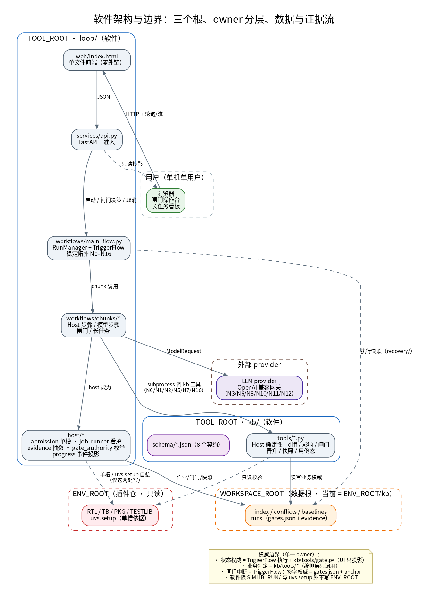
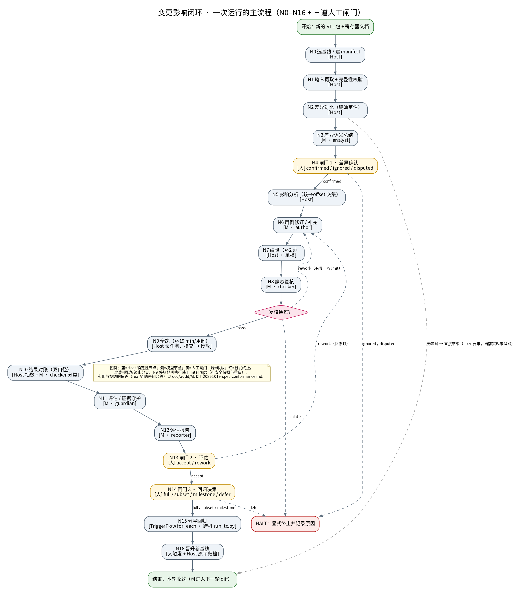
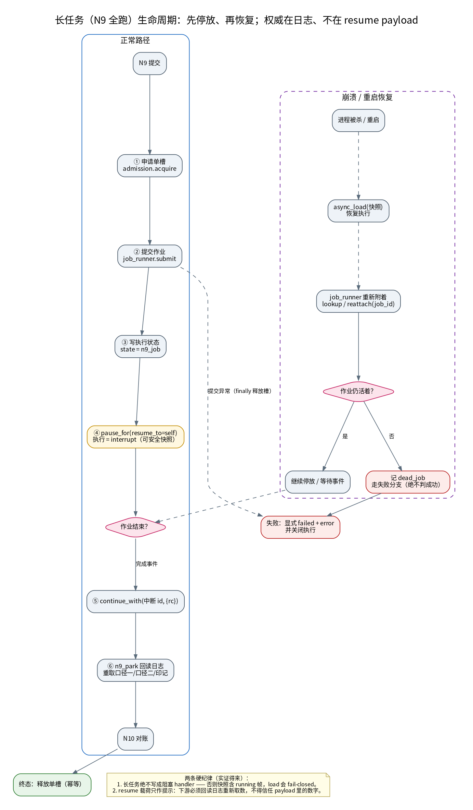

# 项目总览（含流程图）

> **一句话**：给 FPGA 仿真环境做一套「改一笔 RTL/文档 → 算出哪些用例必须改 → 三道人审闸门 → 跑回归 → 原子晋升基线」的闭环工具，以及一个本地可交互的操作台。
>
> **读法**：本文是「是什么、怎么转」的总览；契约细节看 [`spec/`](spec/)；实现偏差看 [`audit/`](audit/)；数字看 [`STATUS.md`](STATUS.md)。
> 图片源文件在 [`diagrams/*.dot`](diagrams/)（graphviz，改完重新 `dot -Tpng`）。

---

## 1 它解决什么问题

FPGA 仿真环境里，RTL 或寄存器文档一改，最贵的不是改，而是**找全**：

- 哪些寄存器段/offset 变了？→ 需要确定性 diff 与索引（N2/N5）。
- 哪些用例访问了这些站点？→ 需要「段 → RTL 文件 → 用例」的 join。
- 改完的用例真的跑通了吗？→ 需要编译卡点、静态复核、全跑双口径对账、证据链。
- 谁批准改、谁批准发版？→ 三道**人工闸门**，模型不得代签。
- 一轮成果怎么变成下一轮的「上一版」？→ **N16 原子晋升**，基线链可回放。

软件是**独立产品**，环境是**插件**：同一套工具可以指向任意符合插件契约的环境仓。

---

## 2 架构总览



### 三层 owner（每个决策/状态/效果只有一个 owner）

| 层 | 角色 | 负责 | 不负责 |
|---|---|---|---|
| **界面/传输** | `loop/web` + `loop/services` | 只读投影、提交闸门决策、取消作业 | 不判绿判红、不建第二个状态机 |
| **编排** | `loop/workflows`（TriggerFlow） | 稳定拓扑 N0–N16、durable interrupt、恢复、投影 | 不写业务判定、不做准入 |
| **确定性业务** | `kb/tools/*` | diff、影响分析、闸门权威、晋升、用例态 | 不上模型、不猜、不吞异常 |
| **外部容量** | `loop/host/admission.py` | 单槽（`uvs.setup` 全局单文件）、队列、取消 | 不决定业务是否继续 |
| **模型语义** | `loop/prompts` + `chunks/model_steps` | N3/N6/N8/N10/N11/N12 的语义判断 | 不越权、不做授权/算术/身份 join |
| **人** | 闸门 1/2/3 + N16 触发 | 确认范围、接受/返工、回归与晋升 | —— |

### 三个根（拆仓后必须分开）

| 根 | 是什么 | 本机取值 |
|---|---|---|
| `TOOL_ROOT` | 软件仓（本仓，自锚定） | `change-impact-loop/` |
| `ENV_ROOT` | 被守卫的环境仓（只读插件） | `…/SimEnv_TCS9620_64CH_F_RJ_PANGO_DCN_WHITEBOXES` |
| `WORKSPACE_ROOT` | 该环境的数据根 | 当前 = `ENV_ROOT/kb`（数据不搬，见 `spec/ENV_PLUGIN_SPEC.md` §7） |

> **权威边界**：状态权威 = TriggerFlow 执行 + `kb/tools/gate.py`；业务判定 = `kb/tools/*`；
> 闸门中断 = TriggerFlow；闸门签字 = `gates.json` + `sha256` anchor。界面只是投影。

---

## 3 一次运行的主流程（N0–N16 + 三道闸门）



### 节点台账（按 owner 分类）

| 节点 | 类型 | 干什么 | 失败/分支 |
|---|---|---|---|
| N0 | Host | 选基线、建 manifest（交付包 sha256 + 清单 md5 + 文档指纹 + parent） | 缺包/缺文档 → 拒绝 |
| N1 | Host | 摄取新包/新文档、完整性校验、生成新 manifest | 校验失败 → 拒绝 |
| N2 | Host | 纯确定性 diff（文件/段/offset/证据行号） | 无差异 → 直接结束（spec 要求） |
| N3 | 模型 | 把 diff 翻译成「影响」 | 解析失败 → 结束执行，不伪造 |
| **N4** | **人** | **闸门 1：差异确认**（逐条 confirmed / ignored / disputed） | 未决 >0 不得进入修订 |
| N5 | Host | 段粗筛 → offset 交集 → 必改/待查 | 索引缺口 → 转人工 |
| N6 | 模型 | 修订/补充用例（写沙箱，不碰 `TESTLIB/`） | checker 退回 → 有界重改 |
| N7 | Host | 编译（≈2 s，卡点 B，经单槽） | 编译失败 → 回 N6 |
| N8 | 模型 | 静态复核（卡点 C，「怎样才能失败」） | 退回/升级人工 |
| N9 | Host | 全跑（≈19 min/用例，长任务：提交 → 停放） | 死任务/取消 → 显式失败 |
| N10 | Host + 模型 | 双口径对账 + FAIL 三分类（数字归 Host） | 分歧不判绿 |
| N11 | 模型 | 评估 / 证据守护（成链判断） | 不成链 → 回 N7 重采 |
| N12 | 模型 | 评估报告（引用必须可解析） | 引用不可解析 → 拒发 |
| **N13** | **人** | **闸门 2：接受 / 返工** | 返工 → 回 N6 |
| **N14** | **人** | **闸门 3：回归决策**（full / subset / milestone / defer） | 冲突未清零不得选 full |
| N15 | TriggerFlow | 分层回归（唯一真并行：`run_tc.py` 5 机 × 2 LIC） | 复用 N7–N11 的批量形态 |
| N16 | Host | 晋升新基线（七件套原子归档，parent 指向 vₙ） | 前置不过 → rc=3 零副作用 |

**三条不变式在流程图上的落点**

- **I1**：闸门 1 之前有未决条目 ⇒ 不得进入修订。
- **I3**：「跑通」= 编译 rc=0 ∧ 静态卡点 C ∧ 完整 UVM 汇总 ∧ **两套口径都为 0** ∧ 观测印记三向一致；两套口径并列显示、互不替代。
- **I6**：三道闸门的 `actor_kind` 必须是 `human`；模型/演练 actor 在 `require-signed` 下被拒。

---

## 4 长任务生命周期与恢复



两条来自实证的硬纪律：

1. **长 Host 阶段绝不能写成阻塞 handler**：快照里若有 `running` 帧，`load` 会 fail-closed。所以 N9 拆成「提交 → `pause_for(resume_to="self")` 停放 → 完成事件 resume」。
2. **resume 载荷只作提示**：恢复后的下游必须回读日志重新取口径一/口径二/印记，不能信任 payload 里的数字（否则外部可伪造跑通）。

崩溃恢复：进程重启 → `async_load` 快照 → 重新附着到仍在跑的作业；作业已死 ⇒ 记 `dead_job`、走失败分支（**绝不判成功**）。

---

## 5 数据、证据与权威

| 产物 | 位置 | 纪律 |
|---|---|---|
| 索引 / 冲突 / 基线 / 运行记录 | `WORKSPACE_ROOT/{index,conflicts,baselines,runs}` | 归档只增不改；冻结件 chmod 444；md5 记在目录之外 |
| 闸门权威 | `<run>/gates.json` + `gates.sha256` | 枚举唯一来源 `kb_lib.GATE_DECISIONS`；`pending` 是状态不是动作 |
| 执行快照 | `loop/state/recovery/` | 只落「干净停车」；恢复失败必须显式 failed |
| 验收/演练证据 | `doc/evidence/` | 内容冻结；移动必须留 MIGRATION |
| 数字 | [`STATUS.md`](STATUS.md) | 唯一数字源，其他文档引用不抄写 |

---

## 6 当前状态（诚实版）

| 项 | 状态 |
|---|---|
| `drill` 链路（夹具） | 可运行：单测 70 收集 / 可写数据根下 67 passed（3 条为沙箱/布局限制）；终验历史 117 断言 |
| `real` 链路 | **未闭合**：N1 缺 `--parent`、N6 不产出沙箱、N7 不编译、N9 固定用例、N15 不执行（见审计附录 A） |
| 失败路径 | 存在僵尸 run / 孤儿签名 / 单槽泄漏等 **22 条阻断级**问题，已登记未修复 |
| 数据迁移 | 按决定暂不搬（`ENV_PLUGIN_SPEC` §7） |
| 待人工拍板 | I3 双口径、72 条冲突清零、是否授权改 `TB/`、真机全跑时间窗 |

> **不要**把「drill 能跑通」当成「工具可用」；审计报告 [`AUDIT-20261019-spec-conformance.md`](audit/AUDIT-20261019-spec-conformance.md) 是当前的权威偏差清单。

---

## 7 怎么跑

```bash
cd loop && ./run.sh          # 界面：http://127.0.0.1:8099
cd loop && LOOP_LLM_MODE=standin .venv/bin/python -m pytest -q
loop/.venv/bin/python kb/tools/_selftest_gate_schema.py      # 10/10（需可写 WORKSPACE_ROOT）
loop/.venv/bin/python kb/tools/_selftest_n5_reachability.py  # 9/9
```

环境与数据位置登记在 [`environments.json`](../environments.json)，零配置即可运行；临时指向别处用 `$LOOP_ENV_ROOT` / `$LOOP_WORKSPACE`。

---

## 8 延伸阅读

- 业务契约：[`spec/CHANGE_IMPACT_LOOP_SPEC.md`](spec/CHANGE_IMPACT_LOOP_SPEC.md)
- 编排契约：[`spec/LOOP_ORCHESTRATION_SPEC.md`](spec/LOOP_ORCHESTRATION_SPEC.md)
- 环境插件/三根：[`spec/ENV_PLUGIN_SPEC.md`](spec/ENV_PLUGIN_SPEC.md)
- 角色与写权：[`agents/README.md`](agents/README.md)、[`../AGENTS.md`](../AGENTS.md)
- 审计与修复顺序：[`audit/AUDIT-20261019-spec-conformance.md`](audit/AUDIT-20261019-spec-conformance.md)
- 流程图源：[`diagrams/flow-overview.dot`](diagrams/flow-overview.dot)、[`diagrams/architecture.dot`](diagrams/architecture.dot)、[`diagrams/long-job.dot`](diagrams/long-job.dot)
