# 人工跑通手册：用 Web 工作台走完 S0 → N0–N16（2026-10-23 版）

> **这是什么**：给**人**用的操作手册。从起服务、准备环境、配置一次运行，到三道人工闸门
> 怎么点、每屏该看什么、点了会发生什么、怎么判断终点、失败怎么查。
> **这不是契约**：节点语义、闸门枚举、红线以 [`spec/CHANGE_IMPACT_LOOP_SPEC.md`](spec/CHANGE_IMPACT_LOOP_SPEC.md)、
> [`spec/LOOP_ORCHESTRATION_SPEC.md`](spec/LOOP_ORCHESTRATION_SPEC.md)、
> [`spec/ENV_PLUGIN_SPEC.md`](spec/ENV_PLUGIN_SPEC.md)、[`spec/WEB_UI_SPEC.md`](spec/WEB_UI_SPEC.md)、
> [`spec/S0_ENVIRONMENT_SPEC.md`](spec/S0_ENVIRONMENT_SPEC.md) 为准。
> 本手册与契约冲突时，**以契约为准，并回来修本手册**。
>
> **对应实现**：`loop/web/`（工作台）、`loop/services/api.py`、`loop/host/s0.py`、
> `loop/workflows/main_flow.py`、`kb/tools/gate.py`。数字唯一来源是 [`STATUS.md`](STATUS.md)。
>
> **本版依据**：2026-10-23 在隔离实例上，用**真实浏览器**按本手册步骤走通
> `S0 演练 → 运行配置 → G1 → G2 → G3（含一次被拒）→ N16`，run `RUN-20261023-110500`。
> 截图与环境说明见 [`evidence/UI_RUNBOOK_20261023/README.md`](evidence/UI_RUNBOOK_20261023/README.md)。
> 上一版（2026-10-20，三视图旧界面）已被本版整体替换；旧版里仍有效的口径以本版为准。
>
> **先记住三句话**
> 1. 界面只是**只读投影 + 少量写动作的传输层**，不判绿、不判红，闸门权威永远在 `gates.json`。
> 2. 当前数据状态下，drill 一轮的正常终点是 **N16 = `refused`（rc=3）+ run `finished`**，
>    这不是失败，是设计的诚实收敛（I3 口径一 1687≠0、I4 冲突 72 项未清零）。
> 3. **第一遍请用 drill + standin**；real 模式链路尚未整体验收（见 §9）。

---

## 0 五分钟速览

### 0.1 一轮到底会发生什么

```
S0（可选，环境准备）
  └─ S0-a 派生 / S0 演练 —— 只证明"复制→替换→核验"链路；S0-b 未接入
        │（注意：它不改变运行配置，也不被 run 自动消费）
        ▼
运行配置：基线 v0 + 环境仓根 + drill/happy + （可选）时间注入
        ▼
N0 基线 → N1 摄取 → N2 diff → N3 总结 → N4 闸门 1（人）
        ▼ confirmed
N5 影响 → N6 修订 → N7 编译 → N8 复核
        ▼
N9 全跑（长作业，停放/恢复）→ N10 对账 → N11 守护 → N12 报告 → N13 闸门 2（人）
        ▼ accept
N14 闸门 3（人）→ N15 回归（drill 为显式 no-op）→ N16 晋升（dry-run）
        ▼
run 变「已结束」；N16 = refused（rc=3），gates.json 记三次人工决策
```

三道闸门是**人**的工作；模型与 Host 不能代签。本手册的 drill 演练里为了可复跑，会用
`human:manual-verify` 这类**占位 actor**——那**不是**人工签署证据（见 §0.4）。

### 0.2 最短路径

```bash
# ① 起服务（可写副本 + 离线替身；第一次强烈推荐）
cd /home/work/chenjunming/change-impact-loop
LOOP_WORKSPACE="$PWD/workspaces/simenv-tcs9620-64ch-sandbox" \
LOOP_STATE_ROOT="$PWD/loop/state" \
LOOP_LLM_MODE=standin \
LOOP_PORT=8099 \
bash loop/remote/serve.sh

# ② 浏览器打开 http://127.0.0.1:8099/
```

然后按 §8 的 12 步点：**S0 演练 → 运行配置 → 启动 → G1（差异确认）→ G2（接受报告）
→ G3（先故意选 full_now 看拒绝，再改选 milestone_only）→ 看 N16/终点**。

### 0.3 界面能写什么、不能写什么

| 动作 | 界面入口 | 权威落点 |
|---|---|---|
| S0-a 派生 / S0 演练 | 环境准备视图 | `<STATE_DIR>/s0/` 下的准备记录与副本 |
| 新建运行 | 运行配置「确认并启动」 | `POST /api/runs`；`<WORKSPACE_ROOT>/runs/<RUN_ID>/` |
| 闸门决策 | 运行监控右列闸门卡 / 人工闸门视图 | `kb/tools/gate.py` → `gates.json` + `gates.sha256` |
| 取消作业 | 运行监控顶部「取消作业」（仅作业 running 时） | Host 作业看护 → 显式 failed |
| 观察/干预模型节点 | Agent 工作窗口 | `agent_calls/`、`agent_controls/`（只增不改） |

**界面不做**：判绿/判红、编辑用例、改基线/冲突清单、手抄闸门枚举、直接晋升。
**晋升**目前只能调 API（§7.5），界面没有按钮。

### 0.4 你是「human actor」，名字要自己写

- 闸门表单里的 actor 默认是 `human:`。**请补成 `human:你的名字`**（如 `human:chenjunming`）。
- 服务端只校验「以 `human` 开头」，`: ` 后为空也会被接受——但那是匿名签署，审计上说不清谁批的。
- **不要填别人的名字，也不要让模型/脚本代签**（I6）。Agent 工作窗口的控制更严格：
  必须是 `human:<非空名字>`，`human:` 这种空名会被拒。
- 事件流里的 actor 是自报字符串，不是凭据；凭据是 `gates.json` + `gates.sha256` 锚。

### 0.5 单机、单用户、单槽

- 服务只绑 `127.0.0.1`，**无鉴权**。远程访问一律 SSH 隧道，不要把端口暴露到网络。
- **一个服务 = 一个 `WORKSPACE_ROOT` + 一个 `LOOP_STATE_ROOT` + 一个端口。**
  两个服务共享同一 workspace 会互相覆盖 `runs/<id>/view.json`（实测），闸门可提交性都会被污染。
- `uvs.setup` 是环境根下全局单文件 ⇒ **同一环境禁止并发**。第二个 run 会显示「排队等单槽」。
- 时间字段是唯一允许的非确定性；要在同一秒重复建 run，用「高级 → 时间注入」换一个 `now`。

### 0.6 先确认你连的是哪个实例

```bash
ss -ltn | grep -E '8099|18099'                    # 谁在监听
curl -s http://127.0.0.1:8099/api/health | head -c 400; echo
curl -s http://127.0.0.1:8099/openapi.json \
  | python3 -c 'import json,sys;print("routes =", len(json.load(sys.stdin)["paths"]))'
```

- 当前构建应为 **18 条路由**（含 `/api/runs/{run_id}/nodes/{node}`、`/api/s0/rehearsal`）。
- **不要**用旧结论「8099 一定是旧构建」；以实际路由数和页面行为为准。
- 本机可能同时有其他实例（如 `18099` 复核实例）。选一个**没有被别人用**的端口和
  `LOOP_STATE_ROOT`，不要和它共用数据根/state。

---

## 1 开跑前的准备

### 1.1 三个根（先确认，再启动）

| 根 | 含义 | 本机典型取值 |
|---|---|---|
| `TOOL_ROOT` | 本软件仓（自锚定） | `/home/work/chenjunming/change-impact-loop` |
| `ENV_ROOT` | 被守卫的环境仓（插件） | `/home/work/chenjunming/FPGA_SIM/SimEnv_TCS9620_64CH_F_RJ_PANGO_DCN_WHITEBOXES` |
| `WORKSPACE_ROOT` | 该环境的**数据根**（index/conflicts/baselines/runs） | 默认 `ENV_ROOT/kb`；可用 `$LOOP_WORKSPACE` 覆盖 |

界面里看根：顶栏健康胶囊 + 左栏底部（`TOOL_ROOT / 数据根 / 模型`）+ 运行配置「环境与工具」卡。
解析优先级与 fail-closed 规则见 [`spec/ENV_PLUGIN_SPEC.md`](spec/ENV_PLUGIN_SPEC.md) §1。

### 1.2 选数据根（本版最容易踩的坑）

界面要能**建新 run**，数据根必须同时满足：

1. `<WORKSPACE_ROOT>/baselines/v0/manifest.json` 通过准入（`valid=true`）；
2. **drill 夹具存在**：`<WORKSPACE_ROOT>/runs/RUN-20261015-120626/`（`n1_manifest_new.json` 等）。

> 为什么：drill 的 N1–N12 夹具目录是硬编码的 `RUN-20261015-120626`。缺它时新 run 会在 N1
> 失败，`error` 原文是 `FileNotFoundError: 夹具缺 n1_manifest_new.json`。这不是界面问题。

**推荐：可写副本（沙箱）**

```bash
cd /home/work/chenjunming/change-impact-loop
bash loop/remote/seed-sandbox-workspace.sh      # 从 ENV_ROOT/kb 复制（只复制，不移动）
```

如果随后 `/api/baselines` 显示 `valid=false`，且 `missing` 正好是
`rtl_snapshot / allfiles_manifest / cases_freeze / conflicts_snapshot / doc_fingerprint / evidence_index`
六件，**不是数据坏了，是数据根布局问题**：这些基线 manifest 里的路径按环境仓根写成了
`kb/baselines/...`。旧布局的兼容做法（**只对一次性演示副本**，不要动 `ENV_ROOT/kb`）：

```bash
WS="$PWD/workspaces/simenv-tcs9620-64ch-sandbox"
test -e "$WS/kb" || ln -s . "$WS/kb"    # 让 <WS>/kb/baselines/... 解析回 <WS>/baselines/...
curl -s http://127.0.0.1:8099/api/baselines | python3 -m json.tool | head -30
```

> 另一条路：直接用一份**新布局**的数据根（baseline manifest 里写 `baselines/v0/...`），
> 例如本机已存在的 `workspaces/real-ws`（复制一份再用）。不要把 `ENV_ROOT/kb` 当草稿本。

### 1.3 启动服务

```bash
cd /home/work/chenjunming/change-impact-loop
LOOP_WORKSPACE="$PWD/workspaces/simenv-tcs9620-64ch-sandbox" \
LOOP_STATE_ROOT="$PWD/loop/state" \
LOOP_LLM_MODE=standin \
LOOP_PORT=8099 \
bash loop/remote/serve.sh
```

- `serve.sh` 前台运行，`Ctrl+C` 停止；会打印监听地址、工作区、环境根和 Windows 隧道命令。
- **`LOOP_STATE_ROOT` 建议显式写出来**：`serve.sh` 不打印它；换 state 等于换锁、换恢复能力。
- 不想等模型/断网：加 `LOOP_LLM_MODE=standin`。它会用确定性替身，**不代表模型判断**。

### 1.4 30 秒预检（能挡掉一半「为什么按钮是灰的」）

```bash
cd /home/work/chenjunming/change-impact-loop

# 1) 健康：插件/数据面齐全、模型状态
curl -s http://127.0.0.1:8099/api/health | python3 -m json.tool | head -40

# 2) 基线必须 available=valid
curl -s http://127.0.0.1:8099/api/baselines | python3 -c '
import json,sys
d=json.load(sys.stdin)
for b in d["baselines"]:
    print(b["id"], "valid=", b["valid"], "cases=", b.get("cases"), "missing=", b.get("missing"))'

# 3) 环境校验（把 ENV_ROOT 换成你的路径）
curl -s "http://127.0.0.1:8099/api/env/check?path=/home/work/chenjunming/FPGA_SIM/SimEnv_TCS9620_64CH_F_RJ_PANGO_DCN_WHITEBOXES" \
  | python3 -c 'import json,sys;d=json.load(sys.stdin);print({k:d.get(k) for k in ("ok","plugin_missing","counts","writable","matches_current_process")})'

# 4) drill 夹具
test -f "$PWD/workspaces/simenv-tcs9620-64ch-sandbox/runs/RUN-20261015-120626/n1_manifest_new.json" \
  && echo "夹具 OK" || echo "缺 drill 夹具"

# 5) 端口与构建
ss -ltn | grep 8099
curl -s http://127.0.0.1:8099/openapi.json | python3 -c 'import json,sys;print("routes",len(json.load(sys.stdin)["paths"]))'
```

`/api/health` 重点看：`plugin_missing=[]`、`workspace_missing=[]`、`llm.available` 与 `llm.reason`。
`/api/env/check` 重点看：`ok=true`、`plugin_missing=[]`、`matches_current_process=true`。
`writable` **以接口返回为准**，不要用 shell 的 `test -w` 判（服务进程视角可能不同）。

### 1.5 打开页面

- 本机：<http://127.0.0.1:8099/>
- Windows 远程：服务器跑 `bash loop/remote/serve.sh`，Windows 侧跑
  `loop\remote\connect-loop.bat`（或 `connect-loop.ps1`），再开 `http://127.0.0.1:8099/`。
  见 [`../loop/remote/README.md`](../loop/remote/README.md)。
- **别和 DSH 自己的 Web GUI 搞混**：DSH Web 是会话界面；本手册说的是 `loop/` 起的
  **变更影响闭环工作台**（默认 8099）。
- 右上角「旧版操作台 ↗」进入 `legacy.html`，只作过渡，功能与当前口径可能不一致。
- 页面**没有 URL 路由**：刷新会回到「环境准备」并丢失当前选中 run。刷新前先想清楚。

### 1.6 启动前最后三问

1. **数据根对不对？** 左栏「数据根」必须是你打算写入的位置（沙箱 vs `ENV_ROOT/kb`）。
2. **上一个服务停了吗？** 同一端口只能一个；同一 workspace + state 也只能一个。
3. **要不要模型 live？** 默认按 `loop/SETTINGS.yaml` + 宿主凭据解析；standin 更快、可复现，
   但**不代表模型判断**（尤其 N11 不会做真实成链判断）。

---

## 2 界面地图（先认路）

```
顶栏：品牌 · 环境胶囊 · 服务地址 · 健康检查 · 「旧版操作台」
左栏：当前工作空间 / ＋新建运行 / 工作台四视图 / 最近运行 / 底部 TOOL_ROOT·数据根·模型
右区：环境准备(S0) · 运行配置(01) · 运行监控(02) · 人工闸门(03)
弹层：节点执行详情 <dialog> · Agent 工作窗口 <dialog> · 目录浏览器
```

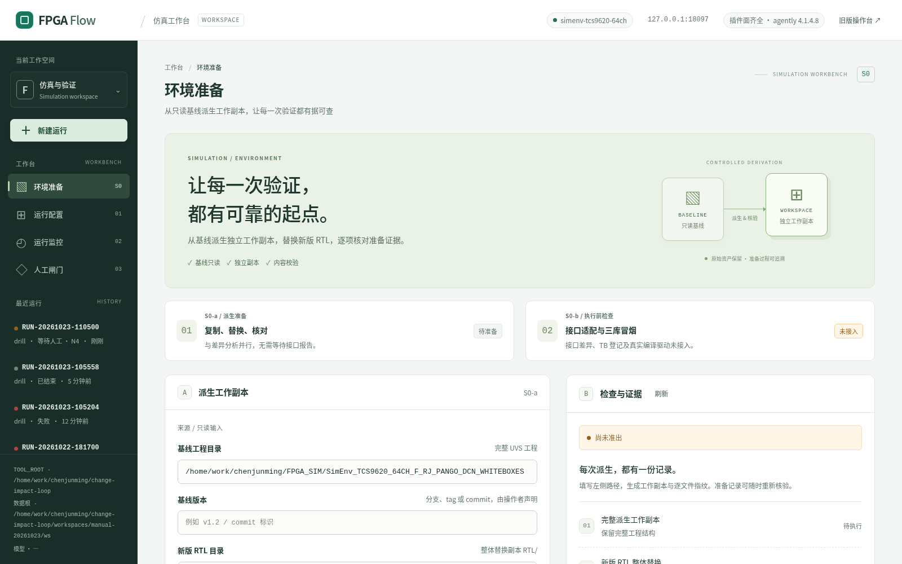

| 区域 | 你要看什么 | 权威性 |
|---|---|---|
| 顶栏环境胶囊 | `env_id`、插件面/数据面缺项、`agently` 版本 | 来自 `/api/health`，只读 |
| 左栏运行列表 | `run_id / mode / 状态·当前节点 / 最近更新`；按 run_id 倒序 | 来自各 run 的 `view.json` 投影 |
| 环境准备 | S0-a 表单、S0-b 阻断、检查与证据、准备记录、S0 演练 | 派生由 Host 写；界面只展示 |
| 运行配置 | 基线 / 项目目录 / 选项 / 校验 / 启动 | 校验只读；启动是写动作 |
| 运行监控 | 四段流程、节点 chip、Agent 卡、双口径、阻断项、长任务、事件流 | 全部投影；判据在服务端 |
| 人工闸门 | 闸门材料 + 决策选项 + actor/理由 + 提交 | 提交会写 `gates.json`，是唯一业务写动作 |

**轮询**：运行监控/人工闸门约 **1.5 s** 刷一次；页面在后台降为 **10 s**，切回立即刷新。
配置视图、S0 视图和两个弹层**不参与轮询重建**（输入不会被打断）。
断连时顶部出现红色横幅并保留最后成功时间；恢复后自动消失。

**状态胶囊**（运行监控/人工闸门顶部）：

| 状态 | 含义 | 你应该做什么 |
|---|---|---|
| `执行中` | 节点正在跑 | 等；看四段进度 |
| `等待人工` | 执行已停放，等闸门决策 | 去「人工闸门」 |
| `等待作业` | N9/N15 长任务在跑，图已停放 | 等；可取消；可安全重启 |
| `排队等单槽` | 别的作业占着单槽 | 等队首释放；不要重复启动 |
| `已结束` | 走到 HALT / N16，执行已关闭 | 判读终点（§7） |
| `失败` | 显式失败（顶部红框给出 `error`） | 按 error 排查；**不能续跑**，重开一轮 |

---

## 3 第 0 步：环境准备（S0）

> **先搞清 S0 是什么**：它是「从只读基线派生一个独立工作副本，并核对派生结果」的准备流程。
> **S0 不是 N0**，不替代运行；**drill 不覆盖 S0**；当前 S0-b 未接入，`ready_for_execution` 恒为 false。
> 详见 [`spec/S0_ENVIRONMENT_SPEC.md`](spec/S0_ENVIRONMENT_SPEC.md) §3/§6/§7。

### 3.1 页面结构

- 顶部两个阶段卡：`S0-a / 派生准备`（可做）、`S0-b / 执行前检查`（**未接入**）。
- 左栏 A 卡「派生工作副本」：四个必填路径 + 「派生并校验 →」。
- 右栏 B 卡「检查与证据」：`尚未准出` / 六项检查 / 准备报告下载。
- 下方「准备记录」折叠区：历史派生记录，点一条可重新核验。
- 最下「S0 演练」卡：一键演练，不需要内网 UVS 与任何路径。

### 3.2 S0-a：真实派生（需要可写目标）

| 字段 | 含义 | 注意 |
|---|---|---|
| 基线工程目录 | 完整 UVS 工程（只读来源） | 必须是允许根内的目录 |
| 基线版本 | 你声明的分支/tag/commit 字符串 | 由操作者声明，不是自动探测 |
| 新版 RTL 目录 | 整体替换副本的 `RTL/` | 只替换 RTL，其余继承 |
| 新工作副本目录 | 目标副本路径 | **父目录已存在、目标尚未创建**；已存在会被拒，不覆盖 |

- 「可访问的目录范围」折叠块会列出服务端允许根（`GET /api/s0.allowed_roots`），越界会 403。
- 点「派生并校验 →」会完整复制工程，**可能很慢**；该请求不套 15 s 超时，页面会显示
  「正在派生与校验…」。**断连不等于失败**：先按记录 id 去「准备记录」里刷新。
- 成功回执：`readiness=尚未准出`、`S0-a 已完成 / S0-b 尚未完成`、六项检查（01/02/03/06 已验证，
  04/05 未完成）、准备报告下载按钮。
- 失败回执：`status=failed` + `error` 原文 + 记录保留（可复核），失败不会删除副本。

> **不要**把 S0 的成功理解成「环境就绪」。04（接口核对/TB 登记）与 05（三库冒烟）仍是
> **未接入**；`ready_for_execution` 恒 false。

### 3.3 S0 演练：第一次先点这个

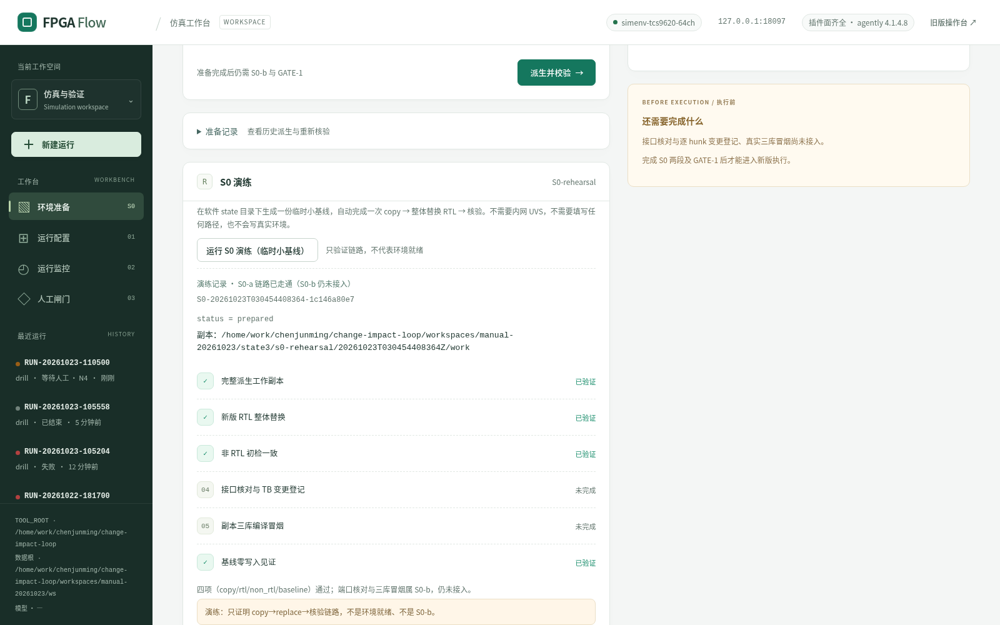

1. 点「运行 S0 演练（临时小基线）」。
2. 等服务端返回（约 0.3–2 s；卡上显示「演练运行中…」）。
3. 预期回执：
   - 标题「演练记录 · S0-a 链路已走通（S0-b 仍未接入）」；
   - `status = prepared`、记录 id（`S0-YYYYMMDDTHHMMSSmmm-xxxx`）、副本路径；
   - 四项 `已验证`：完整派生工作副本、新版 RTL 整体替换、非 RTL 初检一致、基线零写入见证；
   - 第 04/05 项 `未完成`（端口核对、三库冒烟）；
   - 固定免责声明：「只证明 copy→replace→核验链路，**不是**环境就绪、不是 S0-b。」
4. 演练**不会**改变右上「尚未准出」，也不会改变运行配置。

> 演练输入由服务端在软件 state 目录下自造，**不接受客户端路径**；多余参数会 400。
> 记录 id 使用 UTC 时间，与页面其它 `+08:00` 时间显示可能不同——这是当前行为，不是错误。

### 3.4 准备记录与复核

- 「准备记录」里每条显示 `baseline_version || id`、副本路径、派生时 status；点一条会
  `GET /api/s0/{id}` 重新核验并展示当前结果。
- 历史检查通过 + 当前漂移会**并列显示**（不会把旧证据回填成新状态）；有 `drift` 与 `errors` 就看它们。
- 报告下载只对合法 id 出现，链接是 `GET /api/s0/{id}/report`（Markdown）。

### 3.5 S0 与运行配置的边界（重要）

- 当前「运行配置」**尚未消费 S0 记录**：页面底部明确写「这里启动现有闭环，不会自动切换到 S0 副本」。
- 因此 UI 建的 run 顶部会显示 `未经 S0 派生（drill 不覆盖 S0）`；这**不是**缺陷提示，是如实投影
  （`s0_record_id` 为空）。API 支持可选 `s0_record_id`，但界面不发送。
- 想真正用 S0 派生副本跑，需要以该副本为 `ENV_ROOT` 重启服务（跨环境必须重启，见 §1.1），
  且当前 UI 仍不会自动写 `s0_record_id`。这是已知边界，见 §14。

---

## 4 第 1 步：运行配置（01）

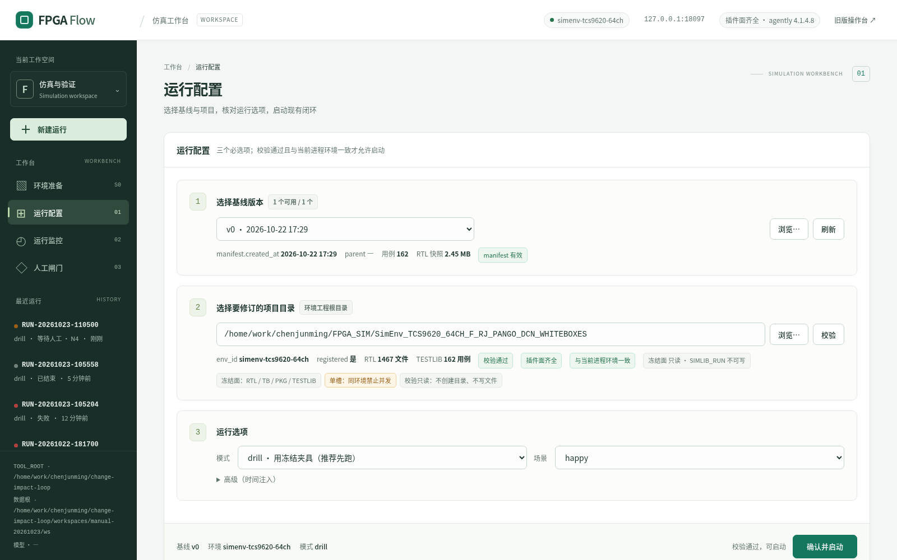

### 4.1 选择基线版本

- 下拉框列出 `GET /api/baselines` 的全部版本；**不可用版本也会列出但置灰**，
  右上 chip 显示「N 个可用 / M 个」。
- 选中后 meta 显示：`manifest.created_at`、`parent`、用例数、RTL 快照大小、`manifest 有效/不可用`。
- 「浏览…」打开目录浏览器（只列基线版本，`valid=false` 置灰）；「刷新」重新拉取。
- **通过条件**：必须选一个 `valid=true` 的版本；否则「确认并启动」永远灰，hint 显示「请选择有效基线」。
- 本机示例（写手册时）：`v0`、162 用例、RTL 快照 2.45 MB、`manifest 有效`（`created_at` 视数据根而定）。

若列表为空或全部不可用：看 `/api/baselines` 的 `missing`，按 §1.2 处理数据根布局。

### 4.2 选择要修订的项目目录

- 输入框只读；打开页面时通常已按当前进程 `ENV_ROOT` 预填并自动校验一次。
- 「浏览…」打开目录浏览器：只列目录、不读文件；越界由服务端 403。
- 选完会自动触发一次「校验」；也可手动点「校验」。
- 校验通过的 chips（应同时出现）：
  - `ok / env_id / registered / RTL N 文件 / TESTLIB N 用例`（本机示例 1467 / 162）
  - `校验通过`
  - `插件面齐全`
  - `与当前进程环境一致`
  - `冻结面 只读/可写 · SIMLIB_RUN 可写/不可写`
- **`matches_current_process` 必须为 true**：项目目录必须等于当前进程的 `ENV_ROOT`；
  跨环境不能运行时切换，只能以该环境重启服务（否则启动 400）。

> 本机只读环境会显示「冻结面 只读 · SIMLIB_RUN 不可写」。**drill 可以继续**（不写真机仿真目录）；
> **real 会因此失败**，不要拿这个档位跑 real。

### 4.3 运行选项

| 控件 | 取值 | 说明 |
|---|---|---|
| 模式 | `drill`（默认）/ `real` | drill 用冻结夹具；real 走真机编译/全跑 |
| 场景 | `happy` / `dead_job` / `cancel` | 只对 drill 有意义；选 real 时下拉禁用 |
| 高级 → 时间注入 | 留空 = 服务器时间；或 ISO 时间 | 注入后整轮用该时间，**`run_id` 也由它决定** |

选 `real` 会显示警告条：「真实运行需要内网仿真插件与数据。请核对实际模型、编译与作业证据；
此入口尚未消费新版 S0 准出结果。」——real 的结果**不得当作真机已验收**（§9）。

### 4.4 确认条与启动

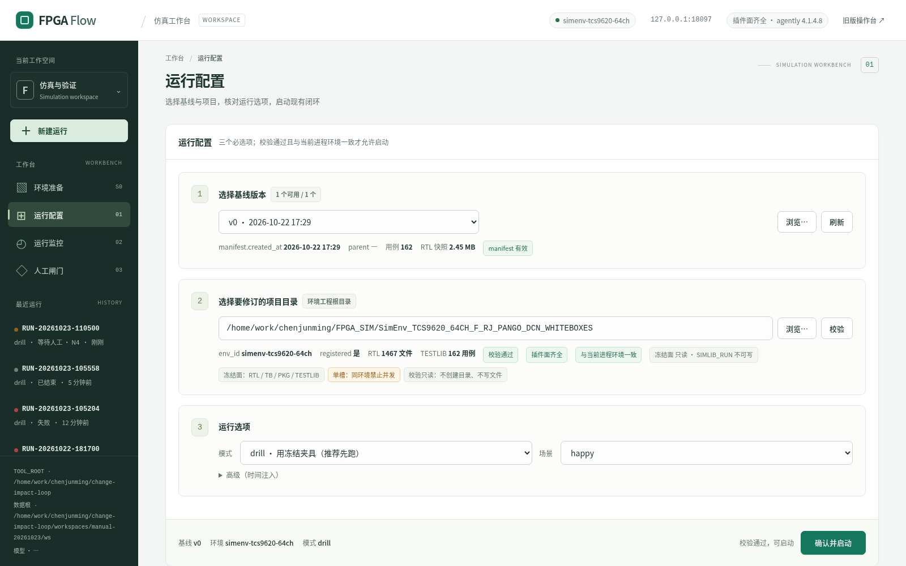

- 左侧汇总：`基线 / 环境 / 模式`；右侧 hint 按状态依次显示：
  `请选择有效基线` → `请选择项目目录` → `请先点「校验」` → `项目目录已变更，请重新校验` →
  `校验未通过，不能启动` → `插件面缺项：…` → `需以该环境重启服务…` →
  `real 模式：结果不得当作真机结论` → `校验通过，可启动`。
- 点「确认并启动」→ `POST /api/runs`。按钮变「启动中…」并防双击。
- ⚠ 前端所有请求 **15 s 超时**：standin/drill 很快不会触发；live 模型下建 run 可能超过 15 s，
  页面显示「启动失败：请求超时（15 s）」，但**服务端可能已经建好 run 并在继续跑**。
  **超时 ≠ 没建成**：先刷新左栏/`GET /api/runs`，不要连点第二次（会多建一条 run）。
- 成功 toast「已创建运行：RUN-…」，界面自动进入：
  - 服务端已停在闸门（drill 很快）⇒ 直接进「人工闸门」；
  - 否则进「运行监控」。

常见失败：

| HTTP | 原文要点 | 处置 |
|---|---|---|
| 400 | `project 必须等于当前进程 ENV_ROOT；跨环境需以该环境重启服务。` | 用 `LOOP_ENV_ROOT` 重启后再选 |
| 400 | `now 不是可解析的 ISO 时间` | 用合法 ISO 时间，如 `2026-10-23T13:00:00` |
| 409 | `运行目录 RUN-… 已存在；run_id 必须唯一` | 换一个注入时间；权威 run 绝不删 |
| 500 | 无结构化错误（多为数据根不可写） | 换可写 `WORKSPACE_ROOT` |
| 0 | `请求超时（15 s）` | 先查 `/api/runs`；已建好就不要再点 |

---

## 5 第 2 步：运行监控（02）

### 5.1 顶部状态条

`run_id` · 状态胶囊（含当前节点）· mode · **S0 来源徽标** · baseline · project · 已用时长 ·
更新时间 · 「刷新」·「取消作业」。

- S0 徽标只有两种：`S0 记录 <id>` 或 `未经 S0 派生`；drill 空值显示
  `未经 S0 派生（drill 不覆盖 S0）`。**徽标只是投影，不证明环境就绪。**
- 运行备注（notes）折叠在状态条下方；`failed` 时顶部红框给 `error` 原文。
- 「取消作业」只在 job `phase=running` 时可用；点击有浏览器确认框。

### 5.2 四段流程与节点

| 段 | 节点 |
|---|---|
| 摄取 | N0 基线 · N1 摄取 · N2 diff · N3 总结 · N4 闸门1 |
| 修订 | N5 影响 · N6 修订 · N7 编译 · N8 复核 |
| 验证 | N9 全跑 · N10 对账 · N11 守护 · N12 报告 |
| 决策 | N13 闸门2 · N14 闸门3 · N15 回归 · N16 晋升 |

- 同一时刻只展开一段（默认自动展开当前段）；再点段头会收起。
- 节点 chip 显示「节点号 + 名称 + owner」；**所有 chip 都可点**，打开节点详情。
- `node_history` 里不在四段映射中的内部节点（`N6_apply`、`N9_submit`、`N15_select`、`N15_submit`、`HALT`）
  会列在四段下方「未纳入四段展示的节点」区——**这是如实展示，不是异常**。
- **chip 的 ✓ 只表示该节点执行结束（`node_finished`），不表示业务通过**。
  例如 N9 `status=fail`、N16 `refused` 也会显示完成；结论看顶部状态、阻断项和 `gates.json`。

### 5.3 节点执行详情（点任意节点 chip）

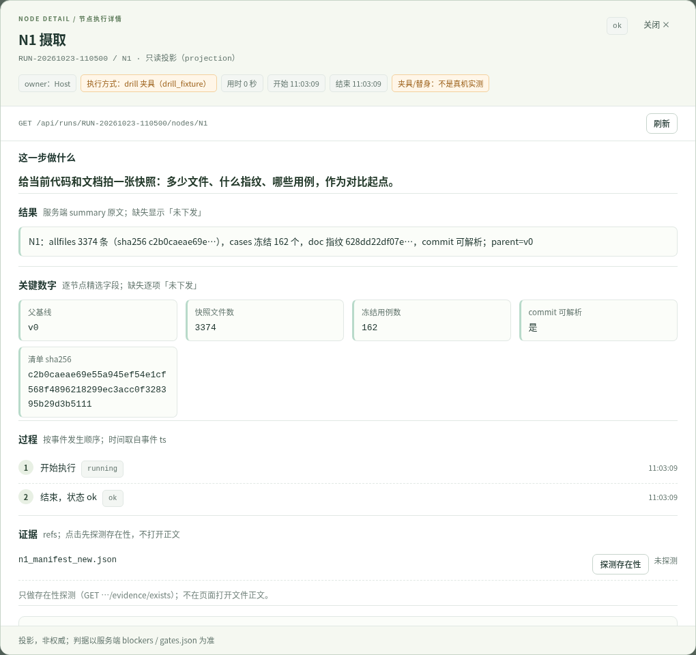

面板从上到下固定六块（适用全部节点，含内部节点与 `HALT`）：

1. **头部**：节点号 + 名称 + owner + **状态原值** + 执行方式（如 `drill 夹具`、`真实工具 kb_tool`）+ 用时/起止时间。
2. **这一步做什么**：一句大白话用途，由服务端目录下发；未知节点显示「服务端未登记」。
3. **结果**：`summary` 原文；缺失显示「未下发」，界面不补默认值。
4. **关键数字**：逐节点精选字段（中文标签 + 值）；缺失逐项「未下发」。
5. **过程**：按事件发生顺序的人话步骤（开始/结束/等待/失败），时间为事件 `ts`。
6. **证据 / 失败**：`refs` 按钮只做存在性探测；`node_failed` 时显示 `error` 原文。

底部「原始记录（排查用）」默认收起：里面有事件流水号 `seq`、`kind/status`、完整 `detail`、
`missing_fields` 和身份技术字段。**`seq` 是同一 run 内的事件流水号，只用于排序/排查，不是业务状态。**

> 历史 run 不回填新字段：旧 run 的 `missing_fields` 会列出缺失项，这是预期，不要当缺陷。
> 未知节点返回 `known=false`，面板不报错，只显示空投影 + 事件记录。

### 5.4 Agent 工作状态

五张角色卡（`simenv-analyst` N3、`simenv-author` N6、`simenv-checker` N8/N10、
`simenv-guardian` N11、`simenv-reporter` N12）+ Host 一行。

- 卡片字段：状态、最近动作、耗时、摘要、`mode`（live/standin）、能力四维、证据入口。
- **点角色名或卡片**打开 Agent 工作窗口：

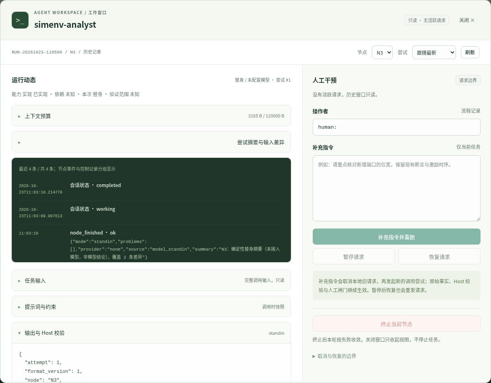

  - 左栏只读：运行动态、能力事实、上下文预算、尝试摘要与输入差异、时间线、任务输入、提示词/约束、输出与 Host 校验。
  - 右栏人工干预：操作者（必须 `human:<非空名字>`）、补充指令、暂停/恢复/终止。
  - 只有存在**活跃请求**时按钮才可用；历史记录只读。**关闭窗口不停止任务**；暂停/恢复不持久，
    重启后旧会话只读。
- 能力四维显示「实现 / 依赖 / 本次 / 验证范围」；未知就是「未知」，`idle` 不等于「未实现」，
  `standin` 不等于真实完成。
- 证据按钮只弹 toast（存在/缺失/不按路径探测），不会在页面打开文件正文。

### 5.5 右列

1. **闸门卡**（仅 pending 时出现）：闸门名/轮次、精简材料、服务端决策选项、actor、理由、提交。
   它与「人工闸门」视图**共用同一份草稿**，在哪边填都一样。
2. **双口径计数**：口径一 / 口径二并列同权、不换算；两者都归零才可判绿。
   无 N9 证据时显示「无全跑证据：两套口径均无法取数（I3 / E-2）」。
3. **阻断项**：按 `blocker → defect → info` 排序，显示 `code + title + message` 和最多 3 条 refs；
   前端不过滤。**没有阻断项 ≠ 判绿**（以服务端 `can` 与 `gates.json` 为准）。
4. **长任务**：`job_id / 节点·用例 / phase / rc / 已用 / ETA`，日志尾部折叠（只读）。
5. **事件流**：折叠；只显示服务端白名单 `kind`；seq 递增；最近 60 条倒序。

---

## 6 第 3 步：人工闸门（03）

### 6.0 通用操作（三道门都一样）

1. 等到状态 `等待人工`，进「人工闸门」（或直接看运行监控右列闸门卡）。
2. 看左侧「闸门材料」：闸门/节点/轮次、冲突快照、返工轮次、硬阻断、缺陷、权威枚举、
   服务端决策选项数、双口径、`invariant_note`。
3. 在右侧「闸门操作」选一个决策（单选；选项与 `requires_reason` 全部由服务端下发）。
4. actor 补上你的名字（`human:xxx`）。**每道闸门的草稿独立**；换门后 actor 会重置成 `human:`，
   每次都要重新补。
5. 理由：标了「必须填写理由」的**一定**要写；没标的也建议写（会作为 `note` 进 `gates.json`）。
6. 点「提交闸门决策」。提交中按钮/输入禁用；**重复点击不会发第二次请求**。
7. 成功：toast「闸门决策已提交：`<GATE>` · `<decision>`」→ 自动回「运行监控」。
   服务端是**同步**把执行推进到下一个停放点才返回的：
   - standin/drill 通常 < 1 s；
   - live 模型节点可能 > 15 s。前端 15 s 超时后页面会报「闸门提交被拒：请求超时（15 s）」，
     但**签名可能已落账、执行可能已在推进**。**超时 ≠ 未提交**：先刷新
     `GET /api/runs/{id}` 看 `status/pending_interrupt` 与 `gates.json`；若已消费，再提交只会得到 400。
8. 被拒：表单里出现红色错误 + 「服务端 blockers（原样）」。**闸门保持待决策、中断没有被消耗**，
   改选或补齐后再提交即可。

**提交前的服务端拒绝顺序**（理解它就不会瞎试）：
① 闸门/枚举/actor 静态校验 → ② 业务前置（I1/I2/I4/A2）→ ③ 确认本门确有中断 →
④ 才写账本 → ⑤ 恢复执行。被拒**不会**留下孤儿签名，也不会把执行打成 failed。

> **一个真实例外**：如果恢复阶段本身失败（模型异常、死任务同调用判死等），HTTP 可能返回 200，
> 但随后 `GET /api/runs/{id}` 的 `status` 变成 `failed`、`error` 有值。
> 这时**不要再点提交**：先看顶部 error 与事件流，按 §10.3 处理。

### 6.1 闸门 1（N4）：差异确认

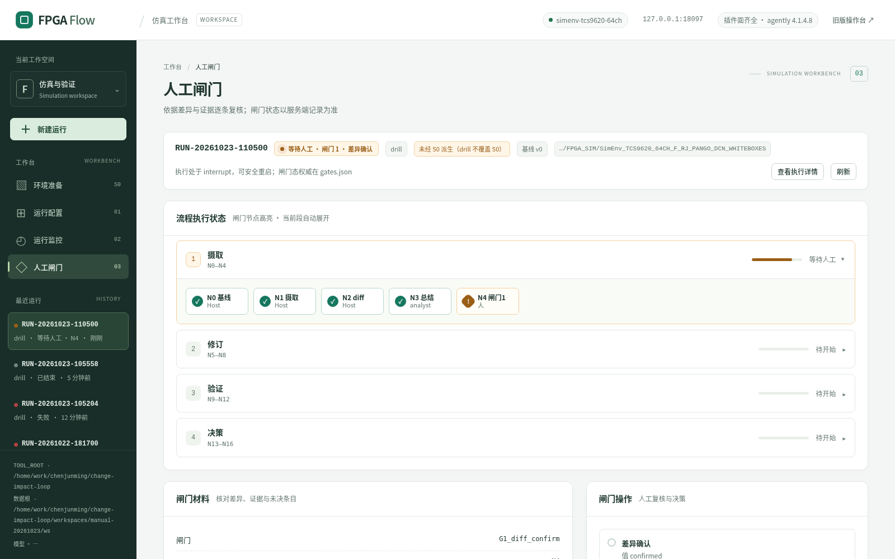

**材料看什么**

- 顶部 `N2 差异清单 · N 条 · 未决 M 条`，带 `self_check_ok`、`drill_fixture` 等徽标。
- 每条差异卡片显示：
  - `entry_id`、`kind`、`change`、`segment/offset/lines`；
  - **`before` / `after` 双栏**（缺失显示「服务端未下发该字段；界面不补默认值」）；
  - `diff_hunk` 行级差异（按原文件双行号）；没有 hunk 时显示**原因**
    （编码/二进制/夹具/只下行号）；
  - `encoding` 徽标（非 UTF-8 显示「编码 gbk（解码后对比）」）；
  - `unresolved` 未决原因；`drill_fixture` / `drill 历史夹具` 徽标；
  - `evidence` 原文。
- 下方「材料入口」：`N3 摘要 n3_digest.md`、`Host 留痕`，可点「探测存在性」（只探测，不打开正文）。
- `doc_entry` 会先列「变化字段」表（优先服务端 `changed_fields`），其余字段折叠为「未变」。
- 若 `entry_decisions_required=true`，界面会显式提示「该门要求逐条处置，v1 未提供输入控件，
  不得盲签；请通过 API 提交」，并给出可复制样例。

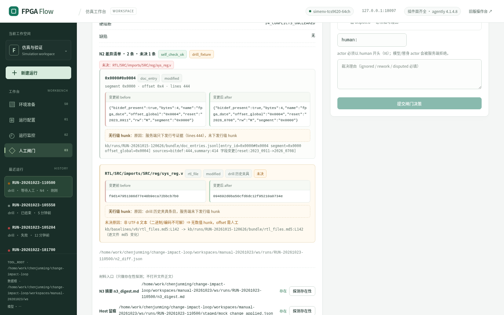

**决策**

| 决策 | 后果 | 适用 |
|---|---|---|
| `confirmed` 差异确认 | 进入 N5→N8 修订 | 你逐条看过了，同意进入修订 |
| `ignored` 忽略（须给理由） | 去 HALT，本轮终止 | 认为这轮变更不值得修 |
| `disputed` 有疑义（须理由） | 去 HALT，转人工裁决 | 差异本身有争议 |

**坑 1（drill）**：存在未决条目时，`confirmed` 虽然**选项上没标「必须理由」**，但服务端强制要求
非空 reason（作为「已逐条核对」的证明）。不写会得到 403：

> `I1：N2 有未决差异条目。drill 模式须给出非空 reason（作为「已逐条核对」的证明），或提交覆盖全部条目的 entry_decisions。`

**坑 2（real）**：当 `entry_decisions_required=true` 时，`confirmed` 必须提交覆盖**全部**条目的
`entry_decisions`；而 v1 界面没有逐条输入控件。这时 UI 提交会被 403 拒绝，只能走 API
（材料区有可复制样例，脚本见附录 A）。**不要为了过闸门把有疑义的条目一律写 `confirmed`**；
逐条处置正是闸门要你做的判断。

### 6.2 闸门 2（N13）：报告验收


**材料看什么**

- `n12_report.md`（报告本体）、`reconcile.md` / `n10_reconcile.md`（N10 对账）、`check_C.md`；
  N9 聚合结果在 execution state（`n9_result`）里，不落 run 根目录，证据看 `evidence/` 下全跑日志。
- 材料 kv：`counts`、`conflicts`、`rework`、`case_states`、`defects`、`hard_block`。
- 双口径（本机 drill 夹具）：**口径一 = 1687**（`*E` 文本行数）、
  **口径二 = {UVM_ERROR:0, UVM_FATAL:0, UVM_WARNING:0, UVM_INFO:34933}**。
  `1687 ≠ 0` ⇒ 即使口径二为 0 **也不得判绿**（I3；根因是 TB 侧走 `uvm_info` 而非 `uvm_error`，
  属既有缺陷，不是本轮引入）。
- 返工计数：`n6_n8_cycles` 与 `g2_rework_cycles` 分账（各有上限 3）；界面「返工轮次」
  只渲染 `n6_n8_cycles`。

**决策**

| 决策 | 前置 | 后果 |
|---|---|---|
| `accept` 接受报告 | 本轮无「已修订待验」 | 进 N14（闸门 3） |
| `rework` 返工（须理由） | —— | 回到 N6，`g2_rework_cycles + 1` |

**坑**：`accept` 被拒时原文类似：

> `I2：本轮仍有 N 个用例「已修订待验」（[…]）⇒ 不得接受报告（I2：待验不得称跑通）。`

处置：要么选 `rework` 且写清返工要求，要么先让本轮用例态归零（正常流程里由 N8/N10 写入）。
drill 下 `case_states.json` 可能不存在（N10 明确跳过台账），这不算 `pending_own`，
`accept` 可以通过——但报告里会如实保留 I3/I4 阻断。

**接受报告 ≠ 判绿**：G2 只表示「报告本身可接受」，不解除 I3/I4。

### 6.3 闸门 3（N14）：回归决策

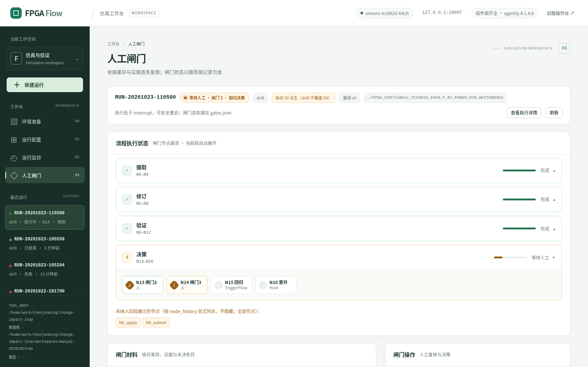

**材料看什么**

- 冲突快照：`total / open / blocks_release`，本机 = **72 / 72 / 72**。
- 硬阻断：`I4_CONFLICTS_UNCLEARED`（若选 full/subset 会被拒）。
- 报告与用例态、返工轮次。

**决策与后果**

| 决策 | 前置 | 后果 |
|---|---|---|
| `full_now` 立即全量回归 | **冲突必须清零** | N15 全量 → N16 |
| `subset_only` 仅受影响子集回归 | **冲突必须清零** | N15 子集 → N16 |
| `milestone_only` 仅里程碑 | 无 I4 前置 | N15（按 G3 选择取集合）→ N16 |
| `defer` 暂缓 | 无 | 去 **HALT**：本轮显式终止，不跑 N15/N16 |

**本机一定会遇到的拒绝**（实测原文）：

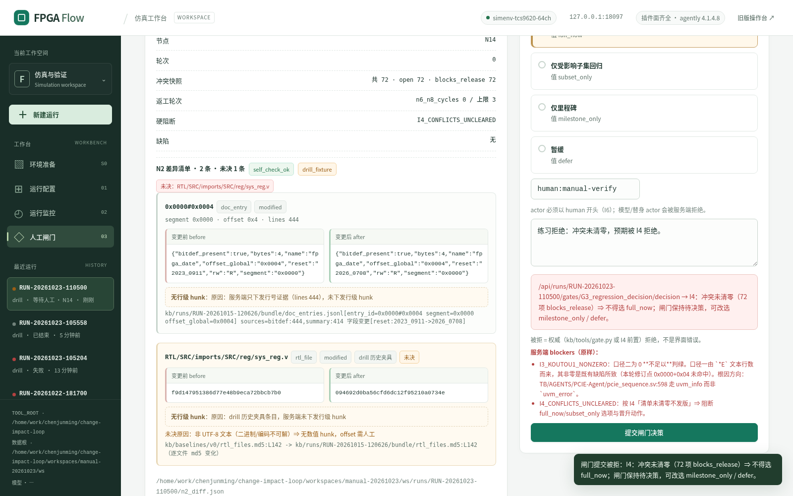

> `I4：冲突未清零（72 项 blocks_release）⇒ 不得选 full_now；闸门保持待决策，可改选 milestone_only / defer。`

HTTP 403，**闸门仍是 pending**（`gates.json` 中 G3 仍 `pending`、history 为空）。
改选 `milestone_only`（先让流程走完）或 `defer`（显式停）即可。

**推荐第一次演练选 `milestone_only`**：能走到 N15→N16，看到完整终点形态；
`defer` 看不到 N15/N16，但同样是合法终点。选哪个都请写理由。

### 6.4 提交之后

| 决策 | 你接下来会看到 |
|---|---|
| G1 confirmed | 修订段亮起，N5→N6→N7→N8，然后 N9 作业（drill 约 0.2 s）、N10、N11、N12，最后停在 G2 |
| G1 ignored/disputed | 决策段 → HALT，run `finished` |
| G2 accept | N14 闸门 3 |
| G2 rework | 回 N6（可能重复 N6–N12）；看返工计数与事件流 |
| G3 milestone_only/subset/full | N15_select → N15 → N16；run `finished` |
| G3 defer | HALT；run `finished` |

drill 下 N15 是**显式 no-op**：节点详情里 `simulated=true`，不是真跑仿真。real 下 N15 才是真实回归。

### 6.5 闸门权威表（写死在心里）

| 闸门 | 节点 | 可提交决策 | 必须理由 | 业务前置 |
|---|---|---|---|---|
| `G1_diff_confirm` | N4 | confirmed / ignored / disputed | ignored、disputed；**drill+未决+无 entry_decisions 时 confirmed 也必须给 reason** | I1：未决条目需逐条处置（real 强制 `entry_decisions`） |
| `G2_report_accept` | N13 | accept / rework | rework | I2：本轮无「已修订待验」 |
| `G3_regression_decision` | N14 | full_now / subset_only / milestone_only / defer | 无（仍建议写） | I4：full/subset 需 `blocks_release=0` |

- 枚举权威 = `kb/tools/kb_lib.py` 的 `GATE_DECISIONS`；`pending` 是状态不是动作。
- actor 规则（I6）：只校验 `human` 前缀；**请写全名**。Agent 窗口控制更严格（`human:<非空>`）。

**常见拒绝原文（可抄进排障记录）**

| 场景 | 服务端原文（要点） | HTTP |
|---|---|---|
| 无理由落账（A2） | `A2：'ignored' 必须给出理由（reason），不得无理由落账。` | 403 |
| G1 drill 未决 | `I1：N2 有未决差异条目。drill 模式须给出非空 reason（作为「已逐条核对」的证明），或提交覆盖全部条目的 entry_decisions。` | 403 |
| G1 real 未决 | `I1：N2 有 N 条未决差异条目（[…]）⇒ real 模式必须提交 entry_decisions 覆盖**全部**条目（confirmed/ignored/disputed；ignored/disputed 带理由）。` | 403 |
| G1 条目不全 | `I1：entry_decisions 未覆盖全部差异条目（缺 […]）⇒ 不得放行。` | 403 |
| G1 条目值与整门不一致 | `I1：有条目判 disputed ⇒ 闸门决策必须是 disputed。`（同族还有 ignored / 全 confirmed） | 403 |
| G2 有待验用例 | `I2：本轮仍有 N 个用例「已修订待验」（[…]）⇒ 不得接受报告（I2：待验不得称跑通）。` | 403 |
| G3 冲突未清零 | `I4：冲突未清零（N 项 blocks_release）⇒ 不得选 full_now；闸门保持待决策，可改选 milestone_only / defer。` | 403 |
| actor 非 human | `I6：闸门决策只接受 human actor（actor 必须以 'human' 开头）`；缺 actor 时 API 层是 `必须提供 actor，且必须以 'human' 开头（I6）。` | 403 / 400 |
| 本门无待处理中断 | `闸门 <GATE> 当前没有待处理中断（可能已被决策，或执行未停在该闸门）；未写权威账本。pending=[…]` | 400 |
| 权威未签 | `闸门 <GATE> 未在 kb/tools/gate.py 中获得权威签署（决策 <decision>，rc=…）：UI 的提交不算权威。` | 403 |
| 未知 run | `未知 run_id：…` | 404 |

> 403 的本义是「业务前置拒绝，中断未消耗」。看到 403 不要重复点；按原文补理由/改选项。
> 400 的本义是「用法/枚举/没有中断」；多半是状态已经变了，先刷新再判断。

---

## 7 终点判读：什么算正常结束

### 7.1 四种终点

| 终点 | 触发 | run.status | 关键证据 |
|---|---|---|---|
| **N16 refused** | G3 = full/subset/milestone，走到 N16 | `finished` | N16 详情 `rc=3` + `stderr_tail`；点击 N16 chip 看 |
| **HALT** | G1 = ignored/disputed，或 G3 = defer | `finished` | 事件 `warning/halted`；节点 HALT `halted` |
| **failed** | 死任务、取消、闸门恢复失败、节点异常 | `failed` + `error` | 顶部红框原文；事件 `node_failed` / `dead_job` |
| **仍在等待** | 闸门/作业/单槽 | `waiting_*` | 服务重启后可恢复（§11） |

### 7.2 一次成功的 drill 演练长什么样

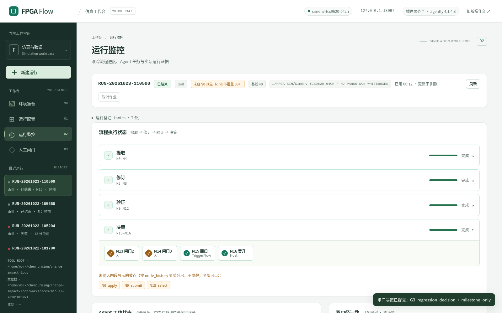

- 顶部：`已结束`、`drill`、`未经 S0 派生（drill 不覆盖 S0）`、基线 v0、项目路径、已用时长。
- 四段都显示「完成」；决策段的 N13/N14/N15/N16 chip 都在。
- 右侧双口径：`1687` / `UVM_INFO=34933 …`；阻断项仍有 I3/I4/I1/F_N16_04。
- 这不是「失败」，而是「本轮按现有数据状态诚实收敛」。

### 7.3 点开 N16 看 rc 与 dry-run

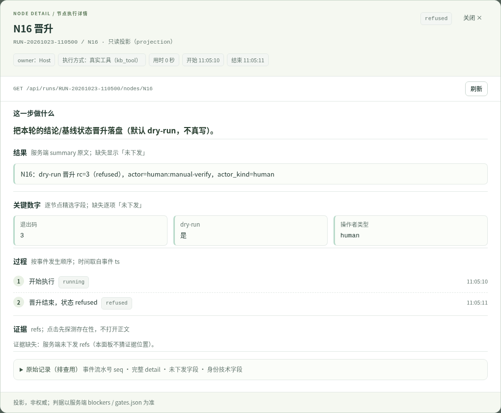

- 状态原值 `refused`；「关键数字」显示 `退出码 3`、`dry-run 是`、`操作者类型 human`。
- 「过程」显示：开始执行 → 晋升结束，状态 refused。
- 证据/失败区按服务端字段显示；原始记录里可看到完整 `detail`（含 `cmd`/`stderr_tail`）。
- N16 是 dry-run 晋升（不写 `baselines/`）；`rc=3` 表示权威拒绝，不是界面错误。

### 7.4 权威在哪

| 事实 | 权威文件 | 说明 |
|---|---|---|
| 三道闸门签没签、谁签的 | `<RUN_DIR>/gates.json` + `<RUN_DIR>/gates.sha256` | `human_signed` 只在 `actor_kind=human` 时为真；sha256 是锚 |
| 本轮做了什么 | `<RUN_DIR>/view.json`、`<STATE_DIR>/events/<RUN>.jsonl` | 投影/事件流，**不是**权威 |
| 业务判据 | 服务端 `blockers` / `can` | 界面不持有「已通过」 |
| 产物 | `<RUN_DIR>/` 下的 `n*.json/md`、`evidence/` | 界面不直接显示绝对路径，用 API 的 `run_dir` |

复核闸门账本（只读）：

```bash
cd /home/work/chenjunming/change-impact-loop
RUN=RUN-xxxx                                  # 换成你的 run_id
WS=/path/to/your/workspace                    # 换成你的 WORKSPACE_ROOT

# 数据根路径也可从 API 取
curl -s http://127.0.0.1:8099/api/runs/$RUN \
  | python3 -c 'import sys,json;print(json.load(sys.stdin)["run_dir"])'

# kb 工具按 LOOP_WORKSPACE 解析数据根
LOOP_WORKSPACE="$WS" loop/.venv/bin/python kb/tools/gate.py show --run "$RUN"
cat "$WS/runs/$RUN/gates.sha256"
```

正常一轮 happy 路径应有 **3 条** `gate_history`（G1/G2/G3 各一次）；G2 rework 会更多，
HALT 路径更少。`gates.json` 里每条含 `decision / actor / actor_kind / human_signed / signed_at / artifacts`。

### 7.5 晋升（不在 UI 上）

```bash
RUN=RUN-xxxx                                  # 换成你的 run_id
curl -s -X POST "http://127.0.0.1:8099/api/runs/$RUN/promote" \
  -H 'Content-Type: application/json' \
  -d '{"actor":"human:你的名字","reason":"G3 已签署，申请晋升"}'
```

- `actor` 必须 `human` 开头，且与 **G3 签署者逐字一致**。
- G3 只能是 `full_now` / `subset_only` / `milestone_only`（`defer` 不允许晋升）。
- 只有前置都满足才会成功；否则 **403**，且拒绝发生在任何写盘之前。
- 本机现状（drill 且 case_states 缺失/冲突未清零）预期被拒：
  `晋升被权威拒绝（rc=3）：[FAIL] 用例态台账不存在 …（I2：缺台账不得晋升）` 或 I4 冲突。
- **界面没有晋升按钮**，这是已知缺口（§14）。

---

## 8 一次完整演练（照这个顺序点）

> 前置：可写数据根（沙箱或副本）+ `LOOP_LLM_MODE=standin`；「高级 → 时间注入」留空，
> 或填一个唯一时间（例如 `2026-10-23T13:00:00`）。括号里是**预期值**，用于自查。
>
> 下面的截图来自本手册的实测轮 `RUN-20261023-110500`（隔离实例 18097，数据根是副本 + 夹具）。

### 8.1 准备

1. 按 §1.2 准备数据根：`valid=true` 的 `v0` + `runs/RUN-20261015-120626`。
2. 按 §1.3 起服务，预检全绿。
3. 打开 `http://127.0.0.1:8099/`。

### 8.2 12 步对照表

| # | 操作 | 预期现象 / 判据 |
|---|---|---|
| 1 | 打开页面 | 默认「环境准备 S0」；顶栏 `simenv-tcs9620-64ch`、`插件面齐全`；左栏数据根 = 你的 `WORKSPACE_ROOT` |
| 2 | 点「运行 S0 演练（临时小基线）」 | `status = prepared`；四项已验证（copy/rtl/non_rtl/baseline）；04/05 未完成；免责声明可见 |
| 3 | 切「运行配置」 | 基线 `v0` 有效、162 用例、2.45 MB；项目目录已预填并「校验通过」；hint「校验通过，可启动」 |
| 4 | 选 `drill` + `happy` → 「确认并启动」 | toast「已创建运行：RUN-…」；通常直接进「人工闸门」 |
| 5 | 看 G1 材料 | `N2 差异清单 · 2 条 · 未决 1 条`；`doc_entry` 有 before/after（reset 2023_0911→2026_0708）；`sys_reg.v` 未决、无 hunk、带 drill 历史夹具徽标；冲突 72/72/72；选项 3 个 |
| 6 | 点 N1/N2/N4 节点 chip | 六块详情可读；N4 显示「由人确认差异清单没问题…」、状态 `waiting`、证据未下发 |
| 7 | 选「差异确认」，actor `human:你的名字`，理由写「已逐条核对 N2 未决条目」→ 提交 | toast 成功；回运行监控；修订/验证段走完；停在 G2 `0-0` |
| 8 | 看双口径/阻断项 | 口径一 `1687`、口径二 `UVM_ERROR=0 …`；阻断项含 I3、I4、I1（warning） |
| 9 | G2 选「接受报告」，写理由 → 提交 | toast 成功；决策段亮起；停在 G3 |
| 10 | G3 先选「立即全量回归」→ 提交（练习拒绝） | 红框：`I4：冲突未清零（72 项 blocks_release）…`；**闸门仍待决策** |
| 11 | 改选「仅里程碑」，写理由 → 提交 | N15_select（count=5）→ N15（simulated）→ N16（`refused`，rc=3）；run 变「已结束」 |
| 12 | 点 N16 节点 chip / 看 `gates.json` | N16 状态 `refused`、退出码 3、dry-run 是；`gate_history` 3 条；`can.judge_pass/promote=false` |

### 8.3 时间预期

- standin + drill 的 **run 执行耗时**约 **5–15 s**（模型节点是确定性替身）。本手册实测轮
  `RUN-20261023-110500` 页面显示「已用 00:12」（不含你点 S0/配置的时间）。
- 默认 live 模型会慢很多（N3 实测约 16 s，已**超过前端 15 s 超时**；N6/N8/N10/N11/N12
  各自数十秒到分钟级），而且 **N11 可能判证据不成链并触发 N6 返工**（最多 3 轮后升级到 G2）。
  这是设计行为，不是界面故障。**第一次走流程请用 standin**。

### 8.4 清理演示 run（仅沙箱副本）

```bash
WS=/home/work/chenjunming/change-impact-loop/workspaces/simenv-tcs9620-64ch-sandbox
RUN=RUN-xxxx                                  # 换成你刚建的演示 run

# 1) 先停服务：waiting_* 的 run 会被 0.2 s 快照节拍重建 view.json / recovery，服务运行时删不掉
pkill -f "uvicorn services.api:app" || true   # ⚠ 会杀掉同机所有实例；更稳的是按端口/pid
# fuser -k 8099/tcp

# 2) 确认绝对路径无误后再删（只动演示副本）
test -d "$WS/runs/$RUN" && echo "将删除 $WS/runs/$RUN"
rm -rf "$WS/runs/$RUN"
rm -f loop/state/recovery/"$RUN".json loop/state/events/"$RUN".jsonl
```

删除 run 目录会**连 `gates.json` 一起删掉**——对这个 run 而言它就是权威账本，删了就没有了。
只删你自己刚建的演示 run；`ENV_ROOT/kb/runs/` 下的任何 run（尤其是冻结见证
`RUN-20261015-120626`）与冻结基线**绝对不要删**。

---

## 9 drill 与 real 的差别（UI 操作一样，预期不同）

| 项 | drill | real |
|---|---|---|
| 前提 | 可读环境 + 可写 `WORKSPACE_ROOT` + 夹具 run | **`ENV_ROOT` 可写**（`SIMLIB_RUN`、`uvs.setup` 自愈）+ 可写数据根 + 空单槽 |
| 模型 | 可用 standin | **必须 live**：N3/N8/N10/N11/N12 缺 live 即 fail-closed；N6 standin 只产出显式空 |
| G1 | 未决条目可用 reason attestation | 可能要求 `entry_decisions` ⇒ 用 API 脚本 |
| N7 | 不真编译 | 真编译（走单槽） |
| N9 | 夹具作业瞬间完成（约 0.2 s） | 真实全跑，**单用例约 19 min 起** |
| N15 | 显式 no-op（`simulated=true`） | 真实串行回归 |
| 终点 | N16 `refused`（drill 原因） | N16 `refused`（I3/I4/台账等原因不同） |
| 结论口径 | 只验证机制 | 结果**仍不得当作已验收** |

**real 当前事实（2026-10-23）**：

- 真机完整轮已跑到 N9 全跑（3 例 rc=0，1465 s，口径一 1687），但 **G2 `accept` 被 I2 阻断**
  （3 个用例仍「已修订待验」），停在 G2；**N16 不可达**。这是契约问题（F2），待人拍板。
- N5 必改 3 例 vs SCN 预登记 5 例（F3）待查，**不得拿数量当通过**。
- 因此：real 可以起、可以走，但**不要把结果当「真机已验收」**；也不要在 UI 上硬过 G2。
- 详见 [`STATUS.md`](STATUS.md) §43、[`evidence/REAL_RUN_20261022.md`](evidence/REAL_RUN_20261022.md)。

real 模式下**不要**因为 N9 跑得久就反复刷新/重启：执行已停放，重启会重新附着；
真要停就点「取消作业」，它会显式 `failed` 并释放单槽。

---

## 10 长任务、取消、失败

### 10.1 N9（全跑）在界面上的形态

- N9 拆成「提交 → 停放」：提交后 run 变「等待作业」，执行处于 interrupt（**可安全重启**）。
- 右列「长任务」显示 `job_id / 节点·用例 / phase / rc / 已用 / ETA` 与日志尾部。
  完整日志在 `<STATE_DIR>/jobs/<JOB_ID>.log`。
- 作业 running 时顶部「取消作业」可用；完成后自动禁用。
- 恢复后**以日志为权威重新取数**，不信任 resume 载荷里的数字。

### 10.2 练习取消（用 `cancel` 场景）

1. 新建运行：`drill` + 场景 `cancel` + 唯一 `now`。
2. G1 选 confirmed 并写理由 → 提交。
3. run 变「等待作业」，长任务 phase=`running`（夹具睡眠作业）。
4. 点「取消作业」→ 浏览器确认框 → 服务端返回 `{"ok":true,...}`。
5. 预期：run 变「失败」，顶部红框：
   > `投递失败：RuntimeError: 作业 JOB-… 被取消 ⇒ 本轮无法满足 I3，按失败处理，不得继续。`

   作业 phase=`cancelled`，单槽释放；**流程条上 N9 可能仍显示进行中**（事件流没有 `node_failed`），
   以顶部 `failed` + error 为准。

### 10.3 失败后的纪律

- `failed` 是显式收敛：**不要**手工改 `gates.json`/`view.json` 让它「看起来通过」。
- 失败轮不能续跑；要重试请**新开一轮**（换 `now`，避免 409）。
- 死任务（`dead_job` 场景）与取消一样按失败处理并释放单槽；不会把槽永久占住。
- 如果失败发生在「闸门已签署但恢复失败」，账本里那次签名视为未生效；先看 `error`、
  再决定是否重开。必要时把经过写进 evidence/记录，不要静默重签。

---

## 11 重启与恢复（可以放心重启，前提是同一个 STATE_ROOT）

### 11.1 重启会发生什么

- 服务启动时 `async_restore_all()`：重新判定作业命运 + 从 `<STATE_DIR>/recovery/<RUN>.json`
  快照恢复执行。
- 停在闸门的 run：恢复后仍停在**同一个闸门**，`pending_interrupt` 不变，你可以继续决策。
- 停在作业的 run：会重新附着到仍在跑的作业；未投递的中断会补投递（幂等）。
- 恢复报告在 `/api/health` 的 `restore_report`：`restored` / `failed` / `jobs` 分桶。
- **前提**：同一个 `LOOP_STATE_ROOT`。换 state 后旧 `waiting_*` run **不能续签**，
  会显式失败：`恢复失败：无快照（…/recovery/<RUN>.json）⇒ 无法续跑；已显式 failed，请人工确认后重开一轮。`

### 11.2 三种恢复失败原文与处置

| 原文 | 原因 | 处置 |
|---|---|---|
| `恢复失败：无快照（…）⇒ 无法续跑；已显式 failed` | 换了 `STATE_ROOT`/机器，或快照被清 | 回原 state 目录；否则重开一轮 |
| `Can not load TriggerFlow execution snapshot … fingerprint mismatch` | 构建/拓扑变了，快照不匹配 | 重开一轮；不要手改快照 |
| `snapshot 失败：… with require_idle=True while tasks are active` | 0.2 s 快照竞态，未落盘 | 本轮不受影响；若紧接着重启可能退回更早快照或显式失败，重开一轮 |

### 11.3 操作步骤

```bash
# 停（只停这个端口；不要 pkill 同机所有 uvicorn）
fuser -k 8099/tcp

# 起（与上次相同的数据根/state/端口！）
cd /home/work/chenjunming/change-impact-loop
LOOP_WORKSPACE="$PWD/workspaces/simenv-tcs9620-64ch-sandbox" \
LOOP_STATE_ROOT="$PWD/loop/state" \
LOOP_LLM_MODE=standin LOOP_PORT=8099 \
bash loop/remote/serve.sh

# 验
curl -s http://127.0.0.1:8099/api/health \
  | python3 -c 'import sys,json;print(json.load(sys.stdin)["restore_report"])'
```

重启后左栏会重新列出 `runs/*/view.json` 可读的 run（包括已 `finished` 的）——列表来自磁盘投影，
不是重新执行；点进去看状态是否还是你离开时的样子。停在闸门的 run 会继续可签；
换过 `LOOP_STATE_ROOT` 的 run 会显式 `failed`（无快照），不能续签。

### 11.4 不要做的事

- **不要**删 `<STATE_DIR>/recovery/<RUN>.json` 来「清掉卡住的 run」——会让它下次恢复失败。
- **不要**手改 `gates.json`（权威 + 锚；手改既不生效也毁证据）。
- **不要**把 `loop/state` 从一个工作区/环境挪到另一个（会恢复出错误的作业语义）。
- **不要**用 `pkill -f "uvicorn services.api:app"` 停服务（会杀掉同机所有实例）；
  用 `fuser -k <PORT>/tcp` 或按 PID。

---

## 12 排障表（症状 → 原因 → 处置）

| 症状 | 最可能原因 | 处置 |
|---|---|---|
| 浏览器打不开 / 连接被拒 | 服务没起；端口不是 8099；隧道没建 | `ss -ltn \| grep 8099`；看启动终端；重连隧道 |
| 顶栏「环境未就绪」/ 健康失败 | `ENV_ROOT` 解析错误、健康端点异常 | `curl /api/health`；按 `plugin_missing` 修 |
| 顶栏「插件缺 N 项」 | 选的目录不是完整环境仓 | 用注册表里的环境根；缺 `uvs.setup`/`RTL` 等 |
| 顶栏「数据缺 N 项」 | `WORKSPACE_ROOT` 指错 | 检查 `LOOP_WORKSPACE` / `environments.json` |
| 基线列表为空 | 数据根没有 `baselines/*/manifest.json` | 看 `/api/baselines`；按 §1.2 重建/修布局 |
| 基线 `valid=false` + 六件 missing | 数据根布局（manifest 写 `kb/...`） | 演示副本加 `ln -sfn . <WS>/kb`；或换新布局数据根 |
| 「请选择有效基线」/ 启动按钮灰 | 没选有效基线、没校验、目录变过 | 重新选/校验；看 hint 原文 |
| 「需以该环境重启服务」 | 项目目录 ≠ 进程 `ENV_ROOT` | 用 `LOOP_ENV_ROOT` 重启后再选；不要静默换根 |
| `SIMLIB_RUN 不可写` | 环境仓只读 | drill 可继续；real 必须换可写环境 |
| 启动 400 `project 必须等于…` | 同上 | 同上 |
| 启动 409 `运行目录…已存在` | 固定 `now` 重复建 run | 换注入时间；或清理同一演示 run |
| 启动 500 | 数据根不可写（建 run 目录失败） | 换沙箱/可写 `WORKSPACE_ROOT` |
| 启动超时 15 s | live 模型建 run 慢 | 先查 `/api/runs`；已建好就不要再点 |
| 新 run 在 N1 失败 `夹具缺 n1_manifest_new.json` | 数据根缺 drill 夹具 run | 补 `<WS>/runs/RUN-20261015-120626/`（§1.2） |
| 闸门提交 403 含 `I1…entry_decisions` | real 有未决条目、UI 没逐条输入 | 用附录 A 的 API 脚本 |
| 闸门提交 403 `I2…已修订待验` | G2 accept 前置不满足 | 选 rework（写理由）或先归零用例态 |
| 闸门提交 403 `I4…blocks_release` | G3 选了 full/subset 且冲突未清零 | 改选 milestone_only / defer |
| 闸门提交 403 `I6…human` | actor 没以 human 开头 | 改成 `human:你的名字` |
| 提交后 run 变 failed（HTTP 200） | 闸门已签、恢复阶段失败 | 看 error；按 §10.3 重开，不要重复提交 |
| N16 `refused` | 前置不满足（drill 缺台账/real I3/I4） | 正常终点；点 N16 看 rc/stderr_tail |
| 状态一直「等待作业」 | 作业确实在跑 | 看长任务 phase/日志；必要时取消 |
| 状态一直「执行中」不动 | live 模型长调用；或恢复/投递异常 | 看事件流最后一条与 `<STATE_DIR>/jobs/*.log`；刷新；重启可恢复 |
| notes 出现 `snapshot 失败…tasks are active` | 快照竞态，本次未落盘 | 本轮不受影响；若紧接着重启可能失败，重开一轮 |
| 页面无数据但服务正常 | 左栏列表来自 `runs/*/view.json`（加进程内文档） | 确认 run 目录里确有 `view.json`；没有就新建一条；已 finished 的 run 重启后会重新列出（但不会重新执行） |
| 模型不可用 / 全是 standin | `LOOP_LLM_MODE=standin` 或无凭据 | 看 `/api/health.llm.reason`；real 必须有 live provider |
| real 在 N7/N9 失败 | `SIMLIB_RUN` 不可写/缺 `uvs.setup`/单槽/作业错误 | 看 job 日志与 error；换可写环境重试 |
| 两个实例状态互相覆盖 | 共用 `WORKSPACE_ROOT` | 一个实例一套 workspace/state/端口（§0.5） |

---

## 13 清理与复跑

- **清演示 run**：§8.4（先停服务、只动沙箱副本；删 run 目录会连 `gates.json` 权威账本一起消失，确认只是自己的演示 run 再删）。
- **清 `loop/state`**（可选，确认没有在跑 run）：

```bash
cd /home/work/chenjunming/change-impact-loop
fuser -k 8099/tcp || true
mv loop/state loop/state.bak-$(date +%Y%m%d-%H%M%S)   # 先改名保留，确认无事再删
```

- **复跑**：直接再点「＋ 新建运行」；run_id 取当前时间一般不会撞。
  若用固定 `now` 演练，每次换值，否则 409。
- 重新跑之前确认上一轮已 `finished`/`failed`，单槽未被占（`<STATE_DIR>/queue.json` 为空）。

---

## 14 已知限制（不得当成已具备）

| # | 限制 | 影响 | 现状/出处 |
|---|---|---|---|
| 1 | **UI 没有 `entry_decisions` 逐条输入** | real 模式下 G1 有未决条目时无法在 UI 完成 | 界面会显式提示「该门需走 API」并给样例；用附录 A 脚本 |
| 2 | **UI 没有晋升按钮** | N16/I8 只能走 `POST …/promote` | §7.5；当前通常被 I3/I4/台账阻断 |
| 3 | **S0 未被运行配置消费** | UI 建的 run 始终显示「未经 S0 派生」 | S0 页底部有说明；API 支持 `s0_record_id` 但界面不发 |
| 4 | **S0-b 未接入** | 接口核对/TB 登记/三库冒烟不可用；`ready_for_execution` 恒 false | `capabilities.tb_adapt/smoke=false` |
| 5 | **S0-real 未跑** | 只验证过 rehearsal 链路 | STATUS §42.5 |
| 6 | N11 在 standin 下固定判 `intact` | standin 不暴露证据链问题 | 卡片 `mode` 可见；真实守护需 live |
| 7 | 模型可为 standin | standin 结论**不代表模型判断** | real 下关键节点 fail-closed |
| 8 | real 全跑未验收；N15 drill 为 no-op | 不要把 drill N15 当真实回归 | STATUS §43 |
| 9 | I3 双口径、I4 冲突需人拍板 | N16/晋升必然被拒，直到裁决 | 材料在 `<WORKSPACE_ROOT>/adjudication/` |
| 10 | F2：失败报告下 G2 accept 不可达 | real 轮 N16 不可达 | STATUS §43.3，待契约拍板 |
| 11 | F3：N5 必改 3 vs 5 例 | 口径不同，不得当通过 | STATUS §43.3，待查 |
| 12 | actor 只校验 `human` 前缀 | `human:` 空名也能签（等于匿名） | 请写全名 |
| 13 | 快照竞态窗口未完全消除 | 极端情况下重启会显式失败 | §11.2；重开一轮 |
| 14 | 单槽 `holder_alive` 按进程判活 | 极少数情况误判 | 只作提示，不作「作业已死」证据 |
| 15 | 多实例共享 workspace 互覆盖 `view.json` | 状态显示飘 | 一个实例一套 workspace/state（§0.5） |
| 16 | 换 `STATE_ROOT` 后旧 run 不能续签 | 显式 failed（无快照） | §11.1 |
| 17 | 历史 run 不回填新字段 | 旧 run 的节点详情会列 `missing_fields` | 预期行为；不要当缺陷 |
| 18 | 拒绝后 `staged/`/`baseline_drill/` 可能残留 | 界面无专门告警 | 看 run 目录；不要手改成晋升产物 |
| 19 | 无鉴权、单机单用户 | 绝不能暴露到网络 | 只绑 `127.0.0.1` + SSH 隧道 |
| 20 | E1/E2 已修，但不等于合规 | 不得引申「规格全绿」 | STATUS §42.5 |
| 21 | Agent 窗口历史只读、暂停不持久 | 重启后旧会话不可控 | `agent_control.py`；关闭窗口不停止任务 |
| 22 | 脚本/历史件签名不是人工签署证据 | `human_signed=true` 只代表填了 human 前缀 | 旧 run 里的 `human:accept`/`human:demo` 是脚本占位 |
| 23 | 界面无 URL 路由 | 刷新回 S0、丢选中 run | 刷新前确认 |
| 24 | 演练记录 id 用 UTC，页面时间用 +08:00 | 看起来「对不上」 | 当前行为，不是错误 |

---

## 附录 A：API 速查（排障/旁证用）

| 端点 | 用途 |
|---|---|
| `GET /api/health` | 三根、插件/数据缺件、模型状态、恢复报告、事件白名单 |
| `GET /api/baselines` | 基线列表（版本/父链/用例数/有效性/missing） |
| `GET /api/env/check?path=` | 只读环境校验（ok/plugin_missing/counts/writable/matches_current_process） |
| `GET /api/fs/dirs?path=` | 目录浏览（allowlist，越界 403） |
| `GET /api/s0` | S0 索引（baseline/allowed_roots/records/capabilities） |
| `POST /api/s0` | S0-a 派生（四路径；已存在 409；失败 422 + record） |
| `POST /api/s0/rehearsal` | S0 演练（只接受可选 `now`；多余键 400） |
| `GET /api/s0/{id}` / `.../report` | 准备记录 / 报告下载 |
| `GET /api/runs` | 运行列表（来自进程内文档投影） |
| `POST /api/runs` | 建运行（唯一建运行入口） |
| `GET /api/runs/{run_id}` | 完整投影：四段/节点历史/agents/blockers/counts/gate_options/pending/can |
| `GET /api/runs/{run_id}/events?since_seq=` | 事件流 |
| `GET /api/runs/{run_id}/nodes/{node}` | 节点执行详情（未知节点 200+`known=false`） |
| `GET /api/runs/{run_id}/agents/{node}` | Agent 窗口投影（输入/输出/尝试/控制） |
| `POST /api/runs/{run_id}/agents/{node}/control` | 补充指令/暂停/恢复/终止（需 `human:<非空>`） |
| `POST /api/runs/{run_id}/gates/{gate_id}/decision` | 闸门决策（唯一业务写动作） |
| `POST /api/runs/{run_id}/jobs/{job_id}/cancel` | 取消作业 |
| `GET /api/runs/{run_id}/evidence/exists?ref=` | 证据存在性探测 |
| `POST /api/runs/{run_id}/promote` | 人触发 N16 真实晋升（v1 无界面入口） |

**real + 未决条目的 G1 API 脚本**（材料区也会给同样的样例）：

```bash
RUN=RUN-xxxx
ACTOR='human:你的名字'
loop/.venv/bin/python - "$RUN" "$ACTOR" <<'PY'
import json, sys, urllib.request, urllib.error
run, actor = sys.argv[1], sys.argv[2]
base = "http://127.0.0.1:8099"
view = json.load(urllib.request.urlopen(f"{base}/api/runs/{run}"))
pending = view.get("pending_interrupt") or {}
pay = pending.get("payload") or {}
raw = (pay.get("difference_items") or {}).get("entries", [])
entries = [e.get("entry_id") for e in raw if e.get("entry_id")]
if not entries:
    raise SystemExit("difference_items.entries 为空：改从 <RUN_DIR>/n2_diff.json 取全部 entry_id")
body = {
    "decision": "confirmed",
    "actor": actor,
    "reason": "已逐条核对 N2 全部差异条目",
    "entry_decisions": {eid: {"decision": "confirmed"} for eid in entries},
}
req = urllib.request.Request(
    f"{base}/api/runs/{run}/gates/G1_diff_confirm/decision",
    data=json.dumps(body).encode("utf-8"),
    headers={"Content-Type": "application/json"}, method="POST")
try:
    print(json.dumps(json.load(urllib.request.urlopen(req)), ensure_ascii=False, indent=2))
except urllib.error.HTTPError as exc:
    print("HTTP", exc.code, exc.read().decode("utf-8"))
PY
```

`entry_decisions` 必须覆盖全部 `entry_id`；`ignored/disputed` 条目要带 `reason`；
只要有条目判 `disputed`，整门决策必须是 `disputed`。**有疑义就如实判 disputed，转人工裁决。**

## 附录 B：相关契约与代码索引

| 想知道 | 看 |
|---|---|
| N0–N16 / I1–I8 / 三闸门语义 | [`spec/CHANGE_IMPACT_LOOP_SPEC.md`](spec/CHANGE_IMPACT_LOOP_SPEC.md) |
| 生命周期/长任务/准入/恢复/投影 | [`spec/LOOP_ORCHESTRATION_SPEC.md`](spec/LOOP_ORCHESTRATION_SPEC.md) |
| 三根解析、插件契约 | [`spec/ENV_PLUGIN_SPEC.md`](spec/ENV_PLUGIN_SPEC.md) |
| 界面契约与验收判据 | [`spec/WEB_UI_SPEC.md`](spec/WEB_UI_SPEC.md) |
| S0 派生与两级验收 | [`spec/S0_ENVIRONMENT_SPEC.md`](spec/S0_ENVIRONMENT_SPEC.md) |
| 节点详情/Agent 窗口 | [`spec/AGENT_CONTEXT_SPEC.md`](spec/AGENT_CONTEXT_SPEC.md)、[`spec/AGENT_WINDOW_SPEC.md`](spec/AGENT_WINDOW_SPEC.md) |
| 界面实现 | [`../loop/web/index.html`](../loop/web/index.html)、[`../loop/web/app.js`](../loop/web/app.js) |
| HTTP 边界 | [`../loop/services/api.py`](../loop/services/api.py) |
| 拓扑与恢复 | [`../loop/workflows/main_flow.py`](../loop/workflows/main_flow.py) |
| 闸门前置判定 | [`../loop/workflows/chunks/gates.py`](../loop/workflows/chunks/gates.py) |
| 闸门权威（签名/锚/枚举） | [`../kb/tools/gate.py`](../kb/tools/gate.py)、[`../kb/tools/kb_lib.py`](../kb/tools/kb_lib.py) |
| 远程访问/隧道 | [`../loop/remote/README.md`](../loop/remote/README.md) |
| 现状数字 | [`STATUS.md`](STATUS.md) |

## 附录 C：本手册的验证记录（2026-10-23）

- 环境：隔离实例 `127.0.0.1:18097`，`LOOP_LLM_MODE=standin`，数据根
  `workspaces/manual-20261023/ws`（`v0` 有效 + drill 夹具 `RUN-20261015-120626`），
  `LOOP_STATE_ROOT=workspaces/manual-20261023/state3`。
- 构建：当前工作树（含 S0 工作台、节点执行详情"人话优先"、Agent 工作窗口、S0 徽标），
  `/openapi.json` 18 条路由。
- 实测轮：`RUN-20261023-110500`（drill/happy）。S0 演练 = prepared（四项通过）；
  G1 confirmed → G2 accept → G3 `full_now` 被 I4 拒（403，闸门仍 pending）→
  G3 `milestone_only` → N15_select(5) → N15 simulated → N16 `refused` rc=3。
  `gates.json` 三条 `human_signed=true`，actor 为占位 `human:manual-verify`。
- **边界**：这是脚本化演练，actor 是占位，**不构成任何人工签署证据**；没有验证 real 真机链路、
  没有验证 S0-real、没有验证真正的 15 s live 超时。截图是 1600×1000 视口（弹层单独截图），
  不是三档桌面宽度验收。
- 截图与环境说明：[`evidence/UI_RUNBOOK_20261023/README.md`](evidence/UI_RUNBOOK_20261023/README.md)。
- 运行数据未入库；本手册只引用 run_id 与截图，不把 `runs/` 拷进 `doc/`。
