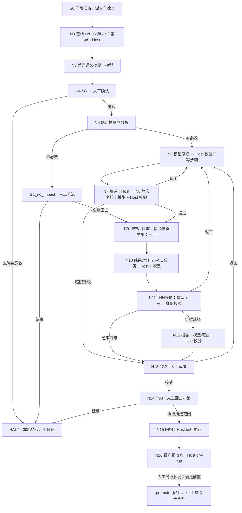

# 项目框架梳理与优化建议

起草日期：2026-11-02；核对完成日期：2026-11-03（北京时间）；讨论版本 D01。代码基线：`4c572e25fe2fc4ab39070a472183ed3ffecdaab8`，本地 main。

**本轮是否修复：否。** 本轮阅读代码、规格与已有验收记录，新增分析文档；未改产品实现、未执行真实模型或仿真、未重新运行测试，不构成独立复核。本轮没有重新拉取远端，结论绑定上述提交。

| 状态 | 项目 |
|---|---|
| 已完成静态梳理 | A：系统层次、节点交接、状态与写权 |
| 已提出，未实施 | B：按收益与风险排序的优化建议 |
| 沿用既有记录 | C：验收边界；以 [STATUS §159–§162](../STATUS.md) 为准 |

| 时间 | 版本 | 项目 | 变化及理由 | 实施状态 |
|---|---|---|---|---|
| 2026-11-02，UTC+08:00（日精度） | D01 | A/B/C | 主线重构后进行框架梳理，区分代码现状、明确缺口与待测假设 | 分析已记录，建议未实施 |
| 2026-11-03，UTC+08:00（日精度） | D01 收尾 | A/B/C | 续做未完成的代码定位与新增文档检查；未开展建议项的实现 | 分析交付，建议未实施 |

## 1 判断与业务目标

项目是面向 FPGA 验证的变更影响闭环：输入 RTL/文档变化，确定受影响用例，修订和复核，在人工决策后执行回归，最终由人触发基线晋升。

当前形态适合称为**模块化单体 + 持久化工作流 + 外部工具/模型适配**。已有明确职责分工、证据封存和恢复机制；节点模块化已进入主线。后续价值主要在于完善可复现验收、减少跨层依赖和建立升级兼容机制。已有代码不等于真实运行已全部验收。

应保留的完成不变量：模型不能签闸门、计算权威计数或直接晋升；人工拒绝必须发生在签署和恢复前；错误必须明确失败；同环境仿真保持单槽；冻结环境和历史归档不可被随意改写。

## 2 当前系统层次

| 层次 | 当前落点 | 主要职责与边界 |
|---|---|---|
| 操作台 | `loop/web/` | 原生 HTML/JS/CSS；环境准备、配置、监控、节点详情、人工闸门、Agent 窗口；消费服务端结论 |
| HTTP 与读视图 | `loop/services/` | FastAPI API、SSE、报告/节点/模型投影、DSH 同源代理、人工覆写和晋升入口 |
| 流程编排 | `loop/workflows/main_flow.py` | TriggerFlow 图、分支和返工边；当前还承载 RunManager 生命周期、恢复、作业回调与投影入口 |
| 节点实现 | `loop/workflows/nodes/` | 各节点的业务步骤；`chunks/` 保留图入口、兼容导出、共享事实与校验逻辑 |
| Host 机制 | `loop/host/` | 路径、单槽、作业、证据解析、请求封存、人工控制、候选导入、环境派生与切换 |
| 业务权威工具 | `kb/tools/`、`kb/schema/` | 快照、差异、影响、用例状态、闸门、冲突、晋升的确定性规则与写入 |
| 外部能力 | `host/agent_backends/`、`host/simulation_adapter.py` | Agently/DSH 模型执行；默认 FPGA 环境的源件、编译、仿真及日志适配 |
| 规格与证据 | `doc/` | 现行契约、计划、状态和冻结证据；实现与验收分别追踪 |

技术栈以当前仓库为准：Python、固定版本 Agently TriggerFlow、FastAPI/Uvicorn、原生网页、文件产物与 JSON/JSONL 台账、外部 Linux 仿真工具。版本声明见 [requirements.txt](../../loop/requirements.txt)。这不是对第三方框架最新版本的评价。

**两条独立适配轴：**

- 模型执行：`AgentBackend` → Agently 或 DSH。DSH 已有实现、准入、进程/SDK、会话与候选导入接线；整图仍由 TriggerFlow 编排。不能把本机未完成真实 DSH 验收说成 DSH 代码未合入。
- 仿真环境：`SimulationAdapter` → `GuardedSimulation`。目前主要完成默认环境能力提取；S0 的副本创建/切换已存在，但这不等于任意仿真器插件可选择、可版本固定、可跨重启恢复。

## 3 当前业务流程

下图是现有代码的说明图，执行权威仍是 `main_flow.py`；没有新增流程协议。

这里有主线人工闸门，以及零必改时的额外人工分流。N8 检查修订后用例的静态质量和变更覆盖，不能替代 N9/N15 实际仿真。N16 的流程节点默认 `--dry-run`，真实晋升入口位于 `services/promote.py`，不能用“走到 N16”表示基线已经更新。

### 模型节点与关键交接

| 节点 | 主要输入 → 输出 | 授权消费者与边界理由 |
|---|---|---|
| N3 | N2 差异、条目身份、覆盖信息 → 分组摘要及引用 | G1 展示材料；人必须在影响修订之前理解变化 |
| N6 | N5 目标、源件事实、N8/N11 返工交接 → edits 或 DSH 隔离候选及说明 | `n6_apply` 核验身份、源件与候选后写沙箱；模型不能直接改正式用例 |
| N8 | 已施加的修订、编译与覆盖材料 → pass/rework、问题列表 | Host 验结论与返工预算，再发 `N8_PASS/REWORK/ESCALATE`；必须观察实际施加后的材料 |
| N10 | N9 实际日志、计数、身份及变化信息 → FAIL 分类和待裁决项 | Host/`case_state.py` 写状态与机器原因；供人工覆写、N11、N12 消费；机器失败原因不能被覆写抹掉 |
| N11 | N9/N10 证据、Host 身份对账、返工材料 → 成链结论与返工请求 | Host 不能接受掩盖身份不一致的 intact；消费为 N12 或返工/人工升级事件 |
| N12 | Host 计数/判决、证据路径、用例状态、N11 结论 → 结构化报告 | Host 校验判决一致和引用可解析后发布，供 G2/人阅读；报告没有签闸门的权力 |

中间节点只需满足本阶段契约。N6 产出候选不是完成验证，N8 静态通过不是仿真通过，N12 报告不是晋升授权。以上是关键交接梳理，不声称逐字段、逐次真实请求已全面复核。

## 4 状态、存储与唯一写者

| 对象 | 权威或写者 | 消费者 |
|---|---|---|
| 节点执行、中断与恢复位置 | TriggerFlow；RunManager 管句柄、落快照与重注入资源 | 节点和服务读视图 |
| 闸门、用例状态、基线与冲突 | `kb/tools/*` 经既有工具入口 | 流程准入、模型材料、前端投影 |
| 单槽与作业生命周期 | `host/admission.py`、`host/job_runner.py` | N7/N9/N15、恢复与取消逻辑 |
| 模型请求/结果、控制与来源 | `agent_memory.py`、`agent_control.py` 等 Host 模块 | 节点校验、人工窗口与审计 |
| 当前 UI 状态 | 权威事实的派生投影；可重建 | 浏览器；不能成为新增业务权威 |
| 跨运行经验 | 人确认来源与适用性，Host 筛选 | 模型参考；不能绕过闸门 |

三根必须分清：`TOOL_ROOT` 是软件代码，`ENV_ROOT` 是被验证工程，`WORKSPACE_ROOT` 是业务数据。`loop/state` 还承载服务侧快照、事件、作业及 S0/切换记录；备份和恢复不能只带走一个执行快照或只带 Git 代码。

## 5 优化建议：按优先级推进

P0 表示优先解决交付可信度，不表示本轮发现了新的运行阻断漏洞。P1 是下一轮结构收敛，P2 是按需求或测量结果推进。

### O1 / P0：让测试输入可获取、可识别、可复现

**[已确证]** 默认演练仍绑定历史运行身份，`context.py` 中有 `DEFAULT_DRILL_FIXTURE`；现有验收缺少匹配源件和历史资产，完整软件门尚未通过。已有 fixture 参数化、开发数据根准备与环境自测入口，应在这些入口上补齐能力。

- 建议：为既有夹具建立来源/版本/哈希/必需源件清单，并在启动前一次性报告缺件。将适合合成数据验证的纯软件行为逐项迁到明确的合成场景，保留真实历史回放与环境门。
- 收益：区分代码回归、环境缺件和历史身份不匹配，减少反复安装和试跑。
- Owner：测试与数据维护者；涉及生产准入由 Host owner 承接。
- 验收：干净机器可准备独立数据根；合成场景具有明确断言，历史测试仍校验原身份；通过/失败/跳过/未运行分别报告。缺件不能转成绿色通过。

### O2 / P0：修正当前入口与历史描述的冲突

**[已确证]** 根 `README.md:57` 起仍示范直接运行 kb 自测，`README.md:61` 仍称 drill 端到端需要可写环境根；与现行 `AGENTS.md` 统一入口及可写数据根要求冲突。根 README 对“任意符合插件契约环境”的描述也需要区分设计目标与当前适配能力。`main_flow.py:8` 的旧 N15 for_each 描述与文件内实际串行图不一致。

- 建议：更新当前入口、过期注释及能力声明；历史证据只链接并标明时间，不回写。当前状态入口直接引用 STATUS 最新验收与阻塞清单。
- 收益：避免新人按过期命令写错根目录，或把已实现、计划中、未验收混为一谈。
- Owner：Lead/文档负责人。
- 验收：按入口能准备正确测试环境；文档链接、命令和权限口径一致，历史材料不被改写。

### O3 / P1：分离业务判据与界面投影，保留唯一实现

**[已确证]** `services/contracts.py` 同时包含 `KbSources`、`compute_blockers`、理由要求、覆写可用性与展示投影；`workflows/context.py:23` 起从 services 引入角色与数据源，`nodes/gate_enter.py:16` 直接消费 contracts 生成闸门材料，覆写服务复用 `case_override_view` 的前置逻辑。

这目前帮助避免判据复制，但业务执行依赖展示模块，未来 UI 修改容易波及流程行为。**没有据此断言前端拥有权威或已经出现错误放行。**

- 建议：把共享的数据读取和确定性规则放回已有 Host/业务契约模块；services 只组合展示。原入口保留兼容导出，迁移同一实现，不能复制出一套“后端规则”和一套“界面规则”。kb 闸门/用例工具继续拥有最终写权。
- 收益：UI 与流程可以独立演进，规则责任更容易审查。
- 验收：相同事实下动作许可、拒绝原因、闸门材料和 API 投影保持一致；无 UI 依赖也能验证业务规则；界面专项同步回归。

### O4 / P1：将生命周期从图定义中局部提取

**[已确证]** `main_flow.py:215` 起的 RunManager 集中了启动、签署、取消、作业投递、快照定时器、恢复、槽恢复与读视图；`_status_of` 还要综合 doc、执行状态、中断和终止事件。

- 建议：先固定故障与恢复特征测试，再按既有职责提取恢复持久化、作业交接和投影代码；保留 RunManager 对外接口，图仍由 main_flow 唯一定义。不新增平行状态机，也不拆成跨网络服务。
- 收益：降低一次恢复或 UI 变更影响整个运行生命周期的风险。
- 验收：闸门等待、作业运行、排队、已结束、执行失败、重复完成通知以及落盘失败等场景均保持显式状态；取消后槽能正确释放。

### O5 / P1：把快照兼容变成可验证的升级契约

**[已确证]** `chunks/host_steps.py:145` 等处明确保留入口源码行号以保持兼容；已有同路径/指定版本快照对照结果，但更早拓扑与真实历史作业恢复仍有未验收项。

- 建议：保留现有兼容壳；在现行编排/恢复规格内明确可接受的源版本、图指纹、工作目录和适配器身份。为支持范围建立升级恢复矩阵；不支持的版本明确拒绝并给出操作路径。
- 稳定显式节点身份能否替代源码位置，要先核对当前固定版本框架的实际能力；不能假定已有某个 API，更不能改旧快照指纹强行加载。
- 收益：使“重排文件后旧运行能否恢复”成为发布时可检验的条件。
- 验收：支持范围内加载/恢复/取消结果一致；范围外拒绝且无副作用；真实旧运行单列验证。先完成这一项，再考虑删除兼容壳。

### O6 / P1：让节点边界从文件拆分进一步变成明确契约

**[已确证]** `nodes/n6_author.py:5`、`nodes/n11.py:8` 等入口依赖许多注入的内部辅助函数；共享校验仍位于 `chunks/model_steps.py:254` 的 `_validate`。节点独立落文件已经实现，但共享实现的耦合仍存在。

- 建议：按真实消费关系收敛依赖，优先将纯校验与格式化辅助归入已有 Host/节点契约模块；对关键节点输入/结果添加明确类型与版本边界。不要为每个小函数再建一层 manager，也不要将类型对象变成第二份持久化台账。
- 模型请求封存、预算、控制和后端执行继续复用 `model_request.py` 的公共路径，避免各节点自行处理。
- 收益：某个字段变化时能清楚找到生产者、校验者和消费者，减少跨节点误伤。
- 验收：不仅检查 import/源码位置，还用正常、缺字段、身份错配、旧结果和失败产物测试外部可观察行为；保留现有图入口兼容。

### O7 / P2：先测量，再优化事件与投影读取

**[已确证机制，性能影响待测]** `services/run_stream.py` 周期获取完整视图后计算签名；`main_flow.py:1325` 的 `run_view` 读取事件，`host/progress.py:131` 即使传入 since_seq 也先读取整文件再过滤。多个页面订阅或较长事件历史可能放大读盘和组装开销，当前没有本轮性能数据证明已成为瓶颈。

- 建议：先测长运行和多订阅情况下的读盘、CPU、延迟；确有瓶颈后，复用事件 seq 做增量读取，给可重建投影做进程内缓存与失效处理。
- 缓存不能只看 seq：人工签署、用例覆写、控制记录以及时间相关展示都可能改变视图，必须覆盖其权威来源。不要改业务台账写权或加入第二个结果库。
- 验收：收益来自测量；追加、重启、文件变化、人工覆写和取消后不显示旧结论；缓存丢失可重建。

### O8 / P2：按真实需求补环境扩展与模型质量评估

**[已确证能力边界]** `RunCtx.environment` 有默认适配器，尚不能据此声称任意插件、版本固定和定制恢复已就绪。现有模型封存/校验可支持效果复盘，但 standin 的软件通过不代表真实模型修订质量。

- 环境方向：先选定实际需要接入的第二环境，再确定最小能力差异、日志身份及恢复契约；将适配器身份绑定到运行和恢复上下文。当前没有第二环境需求时可暂缓。
- 模型方向：复用现有请求与校验记录，建立有来源的 N3 覆盖、N6 修订、N8 漏检/误报、N10 分类、N11 语义增益和 N12 引用正确性样本。真实模型执行另按授权和部署条件进行。
- 特别审视 N11：身份同值/完整性已有 Host 规则，模型是否发现了额外语义问题需要实测；若增益不足，应先修订契约再收窄职责，不能直接删除 guardian 或让模型覆盖确定性失败。
- 验收：新环境覆盖编译、运行、取消、重启和日志身份；模型评估记录输入/提示词/后端版本、质量与耗时，未知值保持未知，不用通过替身测试证明模型效果。

## 6 建议实施顺序与保留项

建议顺序为 **O1/O2 → O3/O4 → O5/O6 → 按实测和需求选择 O7/O8**。O5 的兼容规则应在任何移动图入口的改动前完成；O3/O4 只提取非图入口时仍需跑恢复检查。每个行为变更先更新规格与计划，再建立失败用例；保持行为的重构先跑特征测试。

保留当前模块化单体、TriggerFlow 唯一拓扑、Host 权威、人工闸门、追加式证据、原生离线网页与同环境串行执行。单槽来自真实共享资源，不能为了提速直接提高并发；节点划分存在实际观察和授权边界，也不宜简单合成一次大模型请求。

当前最值得先完成的是**一个可复制的验收入口和一组闭合的测试资产**，随后才是进一步调整目录和依赖。这些均为本轮建议，尚未作为用户决定或已实施能力记录。

## 7 验收限制与后续交接

最新实测与数量只引用 [STATUS §159–§162](../STATUS.md)。浏览器门已有通过记录，完整软件门、真实 FPGA/DSH、真实历史恢复及独立复核仍有未关闭项，详见 [本地验收与阻塞清单](../plans/2026-11-02-local-acceptance-and-blockers.md)。本次静态分析没有改变这些结论。

优先核查的源码入口：[流程及生命周期](../../loop/workflows/main_flow.py)、[节点上下文](../../loop/workflows/context.py)、[节点实现目录](../../loop/workflows/nodes/)、[模型请求公共路径](../../loop/workflows/chunks/model_request.py)、[模型后端](../../loop/host/agent_backends/base.py)、[仿真适配器](../../loop/host/simulation_adapter.py)、[业务与展示契约](../../loop/services/contracts.py)、[晋升入口](../../loop/services/promote.py)。
