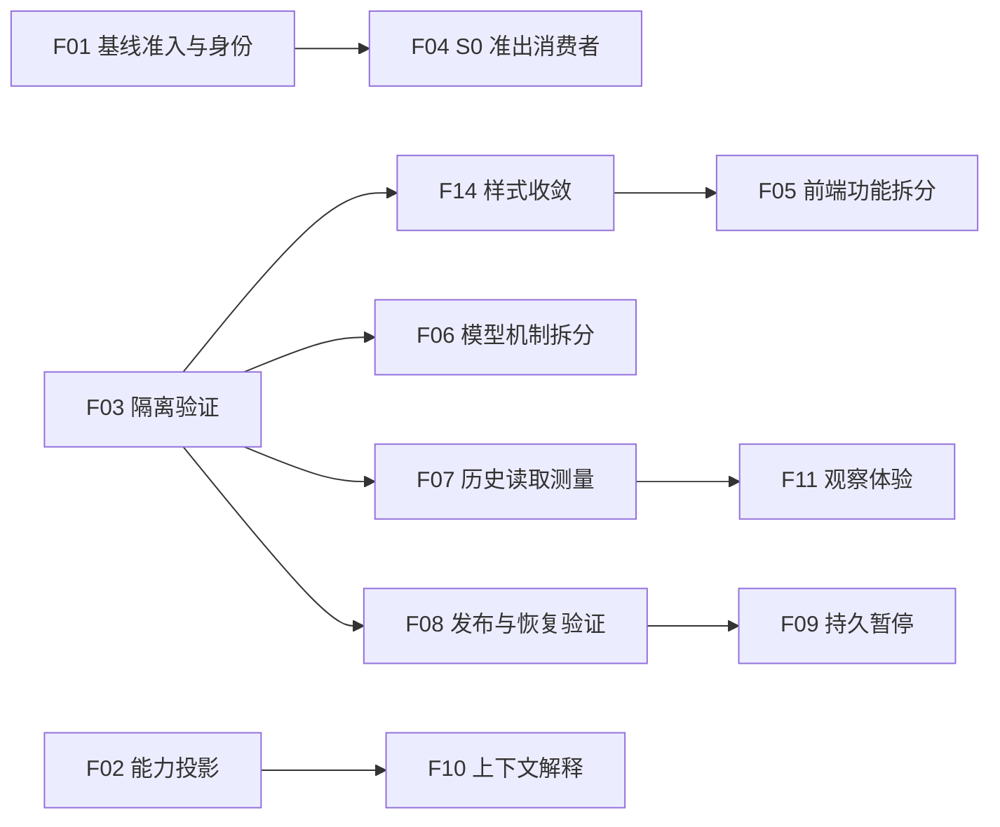

# 下一阶段优化与重构执行手册

编制基线：`d7cf7c6`，2026-10-21。**本轮交付是复核与执行方案，任务尚未实施。** 现状依据 [本次复核](../audit/AUDIT-20261021-post-ui-roadmap.md)，实测唯一入口为 [STATUS §13](../STATUS.md#13-下一阶段优化与重构成册2026-10-21)。

本手册是后续工作的统一执行入口，沿用 [原路线](2026-10-21-specdd-followups.md) 的 F01–F12 编号，新增 F13–F15；旧路线保留其历史背景。需求范围为现有浏览器网页及支撑它的 Host/编排能力，保留已交付的视觉设计。桌面客户端、手机专项设计、整仓框架迁移不在当前计划内。

## 1 如何使用本手册

1. 从 §2 选择当前阶段的首个未完成条目，先确认前置条件与唯一 owner；把 §7 的工作单复制到该切片的计划中。
2. 阅读任务卡指向的现行规格，写出可观察行为、输入/输出和不变量。若契约变化，先改规格并记录评审结论。
3. 在隔离的软件副本和测试数据根固定旧行为；缺陷修复增加先失败断言，纯提取固定行为即可。不要为了文档或机械搬移编造红灯。
4. 每次提交只承担一种目的：契约、保持行为提取、行为修复或验收归档。局部通过后执行适用质量门，分别记录失败、跳过和未运行。
5. 附上提交、命令、原始输出、MD5 与内网未决项，满足退出条件才把该项标为已完成。软件切片完成与完整真机验收分开记录。

执行规范见 [AGENTS.md](../../AGENTS.md)。同一执行者分阶段验证须如实说明，独立复核者只报告、不修改被测代码。实施与验证人员尚未指定，下面的 owner 是职责角色，不是已安排的人力。

## 2 总清单与优先级

P0 是真实运行正确性前置；P1 是近期应完成；P2 是依赖或测量完成后启动；P3 暂缓。以下均为待实施，不能用本表代替实时验收状态。

| ID | 优先级 / 类型 | 优化目标 | 唯一实施 owner | 前置 / 执行批次 |
|---|---|---|---|---|
| F01 | P0 / 缺陷 | 基线完整性和 N0→N2 身份一致 | Host 准入与编排 owner | 立即，批次 A |
| F02 | P1 / 缺陷 | 能力、模式、可用性和验证范围如实展示 | 服务投影 owner；UI 消费同一来源 | A |
| F13 | P1 / 缺陷 | 首次加载失败与陈旧数据反馈准确 | UI owner | A |
| F03 | P1 / 验证基础 | 测试根隔离、清理边界、文档解析 | 验证工具 owner | A；广泛重构前完成 |
| F15-a | P1 / 文档整理 | 当前规格与实现对齐 | Lead / 规格 owner | 随 A 更新能力及导航说明 |
| F14 | P1 / 保持行为重构 | 样式和断点收敛 | UI owner | F03，批次 B |
| F05 | P1 / 保持行为重构 | 前端按功能拆分、保留会话隔离 | UI owner | F03；建议 F14 后，B |
| F06 | P1 / 保持行为重构 | 模型请求机制与节点语义分离 | Host 请求 owner / 节点 owner 按模块分工 | F03，B |
| F04 | P1 / 能力建设 | S0-b 与执行准出闭环 | S0 Host owner；驱动由环境 owner 提供 | F01、驱动协议及内网验收，C |
| F07 | P2 / 先测量 | Agent 历史读取与控制响应 | Host 只读投影 owner | F03，C |
| F08 | P2 / 先注入故障 | 记录发布完整性与恢复语义 | 记录存储 owner；业务写权仍各自持有 | F03，C |
| F09 | P2 / 新行为 | 持久暂停和显式恢复 | 编排恢复 owner | F08，D |
| F10 | P2 / 产品增强 | 上下文预算和经验筛选可解释 | Host 上下文 owner；UI 展示 | F02，D |
| F11 | P2 / 产品增强 | 尝试对比、回执关联、历史查找 | UI owner；API 提供事实 | F07 的分页契约，D |
| F15-b | P2 / 工具化 | 可重复检查入口及可选 CI | 验证工具 owner | F03 隔离完成，B/D |
| F12 | P3 / 架构候选 | 有实际收益的只读并行委派 | 编排 owner | 先有具体用例与测量，暂缓 |

批次 A 退出：基线输入在写入前校验、选中身份贯穿链路；错误/能力提示准确；隔离验证入口可复现。批次 B 退出：拆分前后外部行为、业务产物和网页视觉一致。批次 C 退出：测量/故障结果可复现；S0 的软件协议与内网接入分别验收。批次 D 每项独立立项，不以“平台升级”打包放开。



## 3 批次 A：先修正确性和验证基础

### F01 基线准入与全链身份

**落点与契约**：[config_api](../../loop/services/config_api.py) 的 list_baselines、[RunManager.start](../../loop/workflows/main_flow.py)、[N0/N1/N2](../../loop/workflows/chunks/host_steps.py)；[环境规格](../spec/ENV_PLUGIN_SPEC.md)、[编排规格](../spec/LOOP_ORCHESTRATION_SPEC.md)、[Web API 契约](../spec/WEB_UI_SPEC.md)。

实施顺序：

1. 对照 kb 唯一解析器和实际基线产物，明确最小完整集合、manifest 类型/版本、身份、路径边界和指纹要求；把 UI 规格中的“七件套”展开成权威定义，不在 API/manager 各维护一份近似规则。
2. 用临时基线固定合法 v0、合法非默认版本和 drill 行为；增加缺目录、空对象、数组、坏 JSON、缺资产、路径逃逸及指纹不符用例。API 和直接调用 start 都应验证。
3. 将准入置于创建 run、写事件、隔离旧投影和申请槽之前；只读列表复用同一判据，返回明确缺件/错误，而不是 500 或“有效”。
4. 显式传递选中身份至 N0 manifest 引用、N1 parent、N2 from-baseline、运行投影和闸门材料；取消实际路径上的硬编码 v0。没有传入基线时的默认行为须由规格决定并有测试。
5. 定义校验后源变化的处置：固定内容快照或消费前重新核验，不能继续读另一版源却保留旧身份。

**验收**：非法输入在任何持久副作用之前拒绝；非默认基线在上述所有消费者一致；源漂移显式失败；既有合法 v0/drill 不回归。云端截获工具参数证明传递，内网一次真实非默认基线链路证明工具消费，二者结论分别登记。

**提交建议**：F01-a 规格与失败用例 → F01-b 统一准入 → F01-c 身份传递与漂移校验 → F01-d 内网结果归档。若必须改变冻结 kb 工具语义，单独切片交给 kb owner。**回退**：还原软件切片并继续阻断有问题的准入路径，不修改历史基线和账本。

### F02 能力说明与实际状态对齐

**落点**：[agent_view](../../loop/services/agent_view.py)、[app.js](../../loop/web/app.js) 的 deriveNote、[Web 规格](../spec/WEB_UI_SPEC.md) 中的 guardian/real 描述；N11 行为来源为 [n11_review](../../loop/workflows/chunks/model_steps.py)。

1. 定义“实现存在 / 当前环境依赖齐全 / 本次为真实或替身 / 验证范围”四个独立维度，明确未知值展示；由服务端提供事实，UI 不从颜色或 idle 推断能力。
2. 固定 N11 成功、失败、未开始、替身、依赖缺失的状态；把“未实现”旧预期替换为符合新契约的失败用例。
3. 更新服务投影、前端兜底和当前规格；历史审计/证据保留日期与原结论。新增字段采用兼容方式，旧客户端仍可读取基本状态。
4. 浏览器检查角色卡和工作窗口说明一致；只有真实证据存在时才描述真实验证完成。

**验收**：空事件表示未开始；N11 实现存在不再被标为未实现；provider 或 UVS 缺失有准确原因；standin 不变成真模型完成。**回退**：回退可选展示字段，未知保持未知，不默认 ready。

### F13 首次错误与刷新错误分开表达

**落点**：[app.js](../../loop/web/app.js) 的请求协调、renderRunHead/renderRunAlerts，以及 [浏览器会话测试](../../loop/tests/browser/test_run_sessions.py)。本次已受控复现，见复核报告。

1. 在 UI 规格定义初次加载中、首次失败、已加载、已有数据刷新失败、恢复五种可观察情况；它们是请求展示状态，不是新增工作流业务状态。
2. 增加真实浏览器用例：首次 503 时没有“最近一次成功的数据”，也不继续把失败响应描述为正在加载；有旧数据的刷新失败则明确“数据已过期”及上次成功时间。
3. 以当前请求代次和当前运行的最后成功数据驱动提示，提供可达的重新读取入口；拒绝旧选择的成功/失败回包更新当前状态。
4. 验证 A→B→A、恢复后消除错误、提交草稿与焦点仍保留；不重建表单或把失败当作空结果。

**验收**：用户能区分等待响应、读取失败和陈旧结果；没有成功数据时不声称展示成功数据。**回退**：仅回退展示切片；请求身份隔离不能移除。

### F03 隔离测试根、清理权限与文档解析

**落点**：[paths](../../loop/host/paths.py)、[conftest](../../loop/tests/conftest.py)、[accept_v1_run.sh](../../loop/spikes/accept_v1_run.sh)、[check_doc_links](../audit/check_doc_links.py)。现有验收驱动会清理共享 state，未经隔离不得对正在使用的软件副本运行。

1. 列出每类测试所需的环境根、数据根、软件 state、事件、恢复快照、日志、端口与进程；记录当前所有清理路径。
2. 设计并验证测试专属根注入。当前 `LOOP_WORKSPACE` 只切换业务数据根，不能自动隔离软件 `loop/state`；新增 state 根配置属于待实现契约，不能在命令示例中假定已存在。
3. 每次测试生成唯一资源标识和所有权清单；清理只处理本次资源。通过外部哨兵文件、另一轮记录和并发测试证明不会越界删除。
4. 分出纯软件、受控插件、真实内网三类入口；缺依赖给出未运行/阻塞原因。现有端到端的强断言保留，不能大面积 skip 来获得绿灯。
5. 为文档解析建立表驱动用例：本仓工具/Schema 走 TOOL_ROOT，环境资产走 ENV_ROOT，历史件、模板、行号后缀按既有契约处理；Markdown 目标和锚点另检。

**验收**：干净且未挂载内网资产的环境可运行软件层检查；并行测试相互隔离；外部哨兵不变；真正本仓断链使检查失败，内网缺件另列但不隐藏。**切片**：F03-a 根注入 → F03-b 夹具/清理改造 → F03-c 文档解析 → F03-d 验证入口。**回退**：保留独立副本运行方式；无法证明隔离时不启用共享环境清理。

## 4 批次 B：保持行为的结构重构

### F14 先收敛样式，再拆视图

**落点**：[tokens.css](../../loop/web/tokens.css)、[app.css](../../loop/web/app.css)、[legacy.css](../../loop/web/legacy.css)、[legacy.html](../../loop/web/legacy.html)。

1. 固定当前四页、目录、Agent 窗口、旧页及空/错/加载态的浏览器截图和关键组件计算样式。窗口尺寸沿用已有网页验收；不新增移动产品目标。
2. 按框架布局 → 通用控件 → S0 → 运行/闸门 → Agent 窗口逐段整理；每类组件只有一个基础声明和明确的状态/断点修饰，颜色与通用间距从令牌引用。
3. 一次合并一个组件的有效声明，核对 specificity 和源码先后顺序；只有动态状态、旧页面及键盘路径都覆盖后才删除疑似未使用规则。legacy 内联样式迁出另成提交。
4. 合并同范围的媒体查询，检查交界宽度和缩放后的可达性；不要通过增加 `!important` 掩盖层叠问题。

**验收**：默认、hover、focus、disabled、告警与模态态视觉一致；现有网页布局/交互全部通过；审阅截图差异，不能直接自动重录基准。文件行数下降仅作维护信号，不是验收目标。**回退**：按组件提交回退，保持共享令牌兼容。

### F05 前端按用户功能拆分

**落点**：[app.js](../../loop/web/app.js)；现有 [s0.js](../../loop/web/s0.js)、[agent-window.js](../../loop/web/agent-window.js) 已有局部边界。

1. 画出 state、请求代次、草稿、提交互斥和 DOM 的读写关系，保留一个会话协调 owner；不用多个模块各维护一套 runId 或提交锁。
2. 先提取闸门材料/表单渲染，再提取运行阶段/Agent/计数，最后提取配置和目录浏览；app 保留装配、导航与请求协调。模块名和文件组织在实际切片中确定。
3. 模块通过显式上下文、只读投影和回调协作；不得在 import/加载时偷偷启动轮询。旧 DOM ID、事件绑定次数、API 载荷和错误路径作为兼容边界。
4. 每次提取跑相同浏览器特征集，对照 GET/POST 目的地、次数、草稿身份和焦点；稳定后才提取真正重复的请求/会话辅助函数。

**验收**：旧回包不污染新 run/gate/session/attempt；提交中切走再返回不重复 POST；409 保留输入；两处闸门表单同步；关闭 Agent 窗口不停止任务；XSS 字符串仍按文本显示。**回退**：一次只回退一个功能模块，保留协议和数据形状。引入框架不是本项目标。

### F06 模型请求机制与语义节点拆分

**落点**：[model_steps.py](../../loop/workflows/chunks/model_steps.py)、[上下文规格](../spec/AGENT_CONTEXT_SPEC.md)、[Agent 控制规格](../spec/AGENT_WINDOW_SPEC.md)。

1. 固定 `_request_contract`、`_validate`、单次 attempt 和 `run_model_node` 的输入、顺序、错误与记录行为，再将请求/校验机制提取为窄接口。
2. 分别提取 N6 事实构造与修订、N10 分类/对账、N11 守护；旧节点入口保留兼容导出，TriggerFlow 拓扑和消费者保持一致。
3. 提取提交不同时改提示词、Schema、台账判据或 offered 集合；语义变化必须独立进入规格和失败用例。
4. 比较提示词/Schema 指纹、输入字段及顺序、产物内容和业务工具参数；实现文件指纹变化如实记录，不用它替代语义对照。

**验收**：每次新请求使用新 agent；预算完整覆盖、不静默截断；非法输出止于消费者之前；取消/重发不消费旧结果；N10/N11 台账与返工效果等价。受控 provider 证明机制，真实模型质量另验。**回退**：节点模块独立回退，不迁移或补写历史调用记录。

### F15 规格和交付入口整理

F15-a 随批次 A：建立当前能力对照表，修正现行 README/规格中的单文件前端、旧导航、角色数与 N11 描述；历史章节标明适用版本并指向现行章节。只有确证过时的说明才改，冻结证据不回填。

F15-b 在 F03 后：统一软件验证命令，锁定或记录依赖/浏览器版本，提供失败归因与证据模板；选择仓库 CI 或外部 CI 时复用同一入口。当前没有在本仓发现 `.github`，不代表外部 CI 不存在；实施时先检查已有平台。内网作业只能在具备资产和授权的执行端运行。

**验收**：新贡献者能从根入口定位当前契约、验证命令和已知限制；干净 checkout 可重复运行软件检查；CI 产物标明测试层级和依赖缺失；过期说明不再用作现状。**回退**：文档/验证入口独立提交，不改变业务判据。

## 5 批次 C/D：能力补齐、测量与工作窗口增强

### F04 S0-b 与准出闭环

依 [S0 契约](../spec/S0_ENVIRONMENT_SPEC.md) 拆成独立交付：

1. **协议包**：接口差异、逐 hunk 登记、准备身份、基线见证和三库驱动产物；明确 GATE-1 与现有 G1 的对应关系，不能默认为同一身份。
2. **副本应用器**：仅允许已授权的 top.sv 接口调整；声明、初始化、连接同步登记；越界在写前拒绝；否决按登记 hunk 回滚并重新核验。
3. **驱动适配器**：云端受控驱动测试协议与错误收敛；内网环境 owner 提供真实命令、退出码、每库日志和 warning 评估。以固定可校验参数调用，不能直接执行附件任意命令文本。
4. **准出消费者**：绑定同一准备记录、基线、副本、hunk 清单、三库证据和人工复核；执行前检查漂移。全部满足前继续 ready=false，入口最后开启。

**验收**：缺任一证据、空表冒充核对、非法 TB 变更、日志丢失、否决未回滚、执行前漂移均阻断；基线内容不变。**回退**：关闭新执行入口，保留副本及证据，不删除用户资产。未具备内网条件时仅协议/软件切片可完成，不能把它记作 S0 全部完成。

### F07 先测量，再决定增量读取

以 [read_view](../../loop/host/agent_control.py) 和 [Agent API](../../loop/services/api.py) 为对象，建立小/中/大历史样本，固定尝试数、单条输入字节、事件数与并发读取/控制负载；记录读取字节、响应体大小、耗时分布、事件循环等待、控制回执延迟和 CPU/内存。报告需附样本生成参数、硬件/依赖版本、重复次数、原始数据，目标阈值由基线和使用场景确定，不在计划里虚构已达到的指标。

只有测量表明需要时，依次引入尝试摘要列表、按需记录读取、事件游标/分页、可丢弃投影缓存；后台只读 I/O 与活跃命令执行分开处理，不能把 `_ACTIVE` 无锁移到线程。

**验收**：断线续读不漏不重；选定旧尝试稳定；新尝试可发现；损坏指纹仍显式失败；控制响应达到事先写入规格的目标。**回退**：兼容旧查询契约并保留明确重载路径，缓存不成为权威。

### F08 封存发布与崩溃边界

先对 [_sealed](../../loop/host/agent_memory.py) 的创建目录、写数据、写校验、控制 accepted/applied 边界注入进程终止，建立恢复观察矩阵。根据观察定义 incomplete/corrupt/committed 的区别、发布点、旧格式兼容及只读诊断，再提取公开封存接口以替代跨模块调用私有 `_sealed`。

**验收**：不消费半写记录，不覆盖已存在编号，不回填旧证据，不因恢复诊断自动重发模型；审计写失败不回成功。**回退**：兼容读取原格式，保留已发布记录；若引入新格式，先交付双读兼容再启用写入，代码回退不能留下不可读记录。

### F09 持久暂停与显式恢复

依赖 F08。先定义 TriggerFlow durable 调度与 Host 调用记录各自的唯一写权，说明 accepted 但未 applied 命令、旧远端计算、重启后用户恢复意图的关系；再实现新进程恢复握手和独立 attempt 身份。

**验收**：暂停后杀服务，新进程能说明可验证状态；未经有效续跑意图不调 provider；旧 session 控制拒绝；晚到响应不消费；不兼容快照显式失败且只读。**回退**：禁用续跑入口，历史仍可读，禁止自动重启任务。不能承诺远端恰好执行一次。

### F10 上下文与经验解释

先只读展示输入预算组成、经验采用/拒绝原因、事实与来源版本，再按 provider 能力增加 token 预检。未知 token 估算保持未知并继续执行现有字节预算；超限分块另立契约，必须定义覆盖、汇合和唯一消费者。

**验收**：用户能定位超限来源及经验失效原因；显示功能不改变筛选结果，不泄露认证信息；未经人工确认不写回长期经验。**回退**：移除可选解释字段，保留已有筛选和预算约束。

### F11 工作窗口观察效率

先做尝试摘要、输入/输出差异和“命令回执→应用事件→新尝试”关联；F07 分页稳定后再接筛选和完整历史导航。对不同来源事件显示来源/序号，时间相同不伪装成确定因果。固定侧栏或多窗口留作后续独立评估，不重复重做全站配色。

**验收**：筛选范围清晰且可返回完整历史；差异可追溯原文；失联时动作禁用；不同窗口不能串 run/node/session 或重复提交。**回退**：保留原始 JSON 只读入口和当前模态窗口。

### F12 并行委派暂缓

立项必须先给出可独立执行的只读任务、预计收益及测量，写清父子取消、部分失败、结果汇合和唯一消费者。共享文件修改、仿真单槽、人类闸门和经验晋升权限不因并行而放宽。未满足条件时不引入第二个调度框架。

## 6 验证方法与可用命令

**以下是后续执行方法，本轮未执行整套业务验收。** 执行前使用独立软件 checkout/工作树，安装其依赖，设置专属环境副本和数据根。当前软件 state 与 checkout 绑定，单独设数据根不够。不要把真实验收命令指向正式运行目录。

在隔离副本的 `loop` 目录运行；浏览器可执行文件使用实际安装位置：

```bash
# 网页改动：浏览器真实交互 + HTTP 静态资源
LOOP_BROWSER_EXECUTABLE=/usr/bin/chromium .venv/bin/python -m pytest tests/browser tests/test_web_smoke.py -q

# 模型边界提取：受控 provider / 临时记录
LOOP_LLM_MODE=standin .venv/bin/python -m pytest tests/test_agent_context_memory.py tests/test_agent_control.py -q

# S0 软件契约：受控目录与 API，不代表真实三库
LOOP_LLM_MODE=standin .venv/bin/python -m pytest tests/test_s0.py -q

# 配置/能力投影：执行前确认各测试所需的隔离夹具
LOOP_LLM_MODE=standin .venv/bin/python -m pytest tests/test_config_api.py tests/test_agent_view.py tests/test_fix_lifecycle.py -q
```

F01 还需新增基线准入/身份专属断言；上面既有测试不能自动覆盖新契约。F03 结束后形成经验证的分层命令，再用于 CI，不能把本手册示例当成已经完成的隔离工具。

仓库四道门仍以 [AGENTS.md §4](../../AGENTS.md#4-dod四道门缺一不算完成) 为准。内网终验前置清单：专属软件副本、可写环境副本、有效非默认基线、完整历史夹具、UVS/许可证/provider 就绪、独占环境槽及空闲服务端口；条件不全则登记阻塞。现有验收脚本会清理 state 和 drill 目录，必须先核对其解析出的路径与本次资源清单，再在该副本运行。

| 层级 | 证明什么 | 不能代替什么 |
|---|---|---|
| 静态语法 / 链接 / diff | 文件可加载、引用可达、补丁格式 | 业务正确性 |
| 受控单元与契约 | 参数、身份、失败边界、写权、恢复状态 | 真实 provider 语义和仿真结果 |
| Chromium 交互与截图 | 请求隔离、草稿、动作、焦点、布局与提示 | 后端授权和环境就绪 |
| kb 自测与受控端到端 | 工具/账本/编排在指定夹具下协同 | 真实三库和用例全跑 |
| 内网真实链路 | 所选版本/环境/工具链下的实际效果 | 未测试版本、环境或并发规模 |

性能优化比较相同数据集与负载的前后结果；可靠性改动使用真实子进程终止/重启，不能只改内存变量模拟崩溃。视觉提取同时看实际样式、交互和截图，快照变动需人工解释。

## 7 单个切片工作单与提交模板

```text
任务：Fxx-子切片 / 标题
类型：缺陷修复 / 保持行为重构 / 新能力 / 验证工具
状态：待规格 / 待特征基线 / 实现中 / 待验证 / 受外部条件阻塞 / 已完成
基线提交：
唯一 owner：            独立复核者（若无，明确同一执行者分阶段）：
问题与触发示例：
目标可观察行为：
规格位置与评审记录：
允许修改文件：         不变量与权威消费者：
依赖任务 / 环境条件：
已有特征及结果：       新行为失败断言（纯提取注明不适用）：
实现步骤与提交划分：
测试命令、版本与夹具来源：
实际输出：通过 / 失败 / 跳过 / 未运行分别记录
四道门结果与内网剩余项：
回退步骤及历史格式兼容：
提交哈希 / 新证据路径 / MD5 / STATUS 位置：
退出判据逐条结论：
```

提交标题建议采用 `fix(baseline): ...`、`refactor(web): ...`、`feat(s0): ...` 等具体范围；描述写明触发问题、最终行为、验证和限制。修复、纯提取、新协议分别提交，禁止把状态 schema、提示词、UI 和调度机制同时大改后只跑一组测试。

## 8 建议立即领取的工作包

首包 F01-a/b：确定基线完整性契约，补非法 manifest/缺资产的失败用例，建立 API 与 manager 统一准入。交付内容为规格差异、受控测试、最小修复、无副作用证明及状态记录；先不混入 UI 模块搬移。

随后 F01-c 完成非默认身份传递，F02/F13 修正能力与异常反馈；F03 为后续重构提供隔离入口。F14/F05/F06 以绿色特征基线逐组件、逐功能、逐节点推进。内网 S0 驱动条件另行收集，不等待内网资产才能开始软件正确性与结构整理。

下一轮实施从对应任务卡开始；本手册没有把任何待办标成已修复，也不替代每次实际规格评审和验收。
