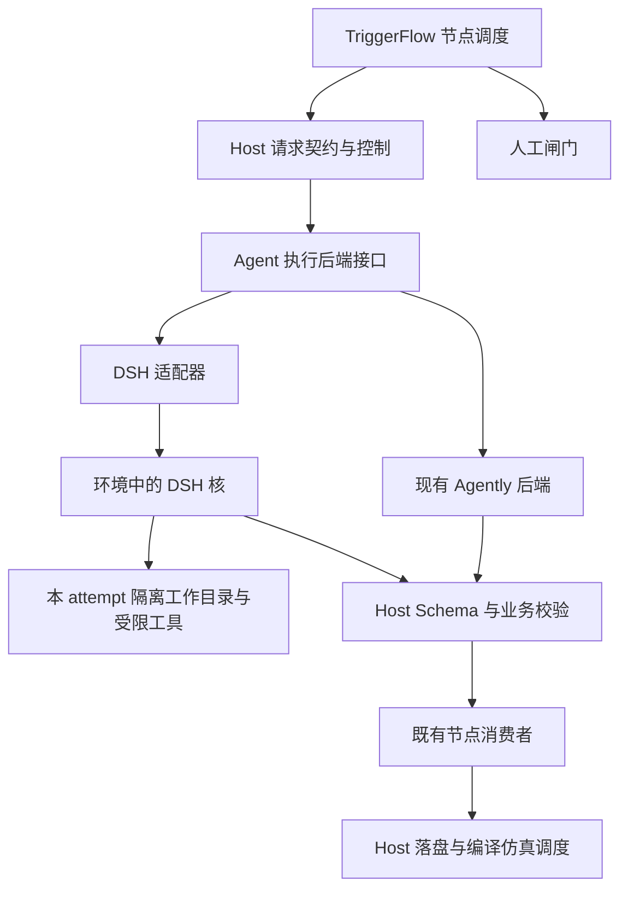

# SPEC-08 · 环境 DSH 核作为 Agent 执行后端（分期实施 v0.3）

> 日期：2026-10-23；D1 首片契约补充于 2026-10-24。状态：**后端边界分期实施；真实 DSH 未接通、未启用、未验证**。
> 用户要求补充一版设计；本文提出本仓契约，不宣称 DSH 已提供同名接口。
> 修订记录：[SPEC-REV-02](SPEC-REV-02-20261023.md)。实施切片：[接入计划](../plans/2026-10-23-dsh-agent-runtime.md)。
> v0.2 采纳评估：[SPEC-REV-05](SPEC-REV-05-20261024.md)。保持 Agently 默认，N3 仅作接入探针，N6 对照验证收益，其他节点按结果决定是否扩展。

## 1 目标、现状与首版选择

目标是在内网执行环境中复用已有 DSH Agent 核，使 N3/N6/N8/N10/N11/N12
能够在明确任务范围内调用工具、读取材料、形成结构化结果，并在工作窗口中观察和干预。
DSH 的 Agent 循环、工具调用和会话由其运行时执行，本仓不另造一套通用 Agent 核。

现状依据：

- [model_provider.py](../../loop/host/model_provider.py) 已能读取宿主声明的模型配置与凭据，交给 Agently；
  这只是模型配置复用，尚无 DSH 核执行适配器。
- [model_request.py](../../loop/workflows/chunks/model_request.py) 当前直接创建 Agently agent，
  并负责请求契约、预算、调用留痕和 Host 校验。
- [SPEC-07](AGENT_WINDOW_SPEC.md) 当前只提供请求边界干预，未承诺 DSH 终端、持久聊天或并行委派。
- 当前云实例未在 PATH 找到 `dsh`，也未找到可核验的 DSH SDK/协议文档；
  此事实不代表内网未安装 DSH。旧任务 `080c60f` 缺失，本文不声称恢复了此前讨论原稿。

**采纳结论**：当前证据支持局部试验，不支持整体替换。保留 Agently 默认和 TriggerFlow 拓扑；
DSH 作为显式选择的实验后端，每个 attempt 新建隔离会话。N3 只读任务先验证能否接通和限制工具，
这不是迁移 N3 的收益证明；N6 候选编辑是首个价值对照对象。只有 §12 的效果和成本门满足后，
才考虑按节点扩展。持久暂停、跨进程续跑、并行子 Agent 及 DSH 直接编译/仿真不在首版范围。

### 1.1 相比当前方案，实际改变什么

| 维度 | 当前 Agently + Host | DSH 拟议后端 | 采纳判断 |
|---|---|---|---|
| 材料获取 | Host 收集差异、源码片段、规则后交给模型 | AI 在授权材料集内继续检索、追踪定义和补读 | 跨文件探索可能受益；必需事实和覆盖责任仍在 Host |
| 工作过程 | 一次 attempt 以结构化请求/结果为主，不足时重发 | 一次任务可含多轮读取、工具调用、候选编辑与检查 | 仅在需要主动探索时有明显收益假设 |
| 代码修订 | AI 返回 edits，由 Host 校验并应用 | DSH 可编辑独立候选副本，Host 验证后导入 | 减少人工来回补材料的可能性值得试验；不能绕过原校验 |
| 上下文与记录 | 本仓管理预算、事实、控制和封存 | 可复用运行时部分机制，但需映射和核验 | 不能假定原生记忆/压缩满足覆盖与审计要求 |
| 取消与恢复 | 本地请求取消、重发及旧结果拒绝 | 需管理执行任务、工具子进程和未知执行状态 | 接入复杂度增加，必须实际故障验证 |
| 耗时与费用 | 路径较固定，易限定和对照 | 多轮模型/工具执行可能提高成功率，也可能更慢、更贵 | 不预设性能收益，成本纳入对照 |
| 业务放行 | Host 判据和人工闸门 | 仍由原 owner 完成 | 更换内核不增强或替代确定性业务权威 |

DSH 列表示拟议能力，尚未完成内网版本验证；不能把框架可能提供的能力计作已实现收益。

### 1.2 节点优先级与界面关系

- **N6 优先验证价值**：跨文件理解接口、查定义、形成候选修改可能减少人工补材料及返工。
- **N8 有条件扩展**：只有补充查证确有收益、覆盖可证明且 N6 试验通过后再立项。
- **N3/N12 默认保持现有路径**：材料明确的归纳和报告任务与当前方案匹配；不能因 N3 探针成功就默认迁移。
- **N10/N11 不以换核提升确定性判据**：分类和解释可在有实际需求时评估，计数、身份匹配和指纹核验仍属 Host。
- **界面难读独立优化**：摘要、候选对照、状态与操作反馈可复用当前接口，不必等待 DSH。
  若进入 DSH 试验，先约定统一执行投影，再改依赖会话/工具的界面；见 [SPEC-09](AI_WORK_PANEL_SPEC.md)。

## 2 架构与唯一 owner



| 对象 | 唯一 owner | 边界 |
|---|---|---|
| 拓扑、返工边、节点恢复 | TriggerFlow / RunManager | DSH 不推进下一节点、不决定业务恢复 |
| 输入事实、版本、覆盖、预算 | Host 上下文构造器 / agent_memory | DSH 可以提出补读请求，不能自报覆盖已完整 |
| 请求控制、尝试代次、结果接受资格 | agent_control | DSH 回执只提供执行事实，不直接改业务状态 |
| DSH 会话内推理与获准工具执行 | DSH 核 | 只在绑定的能力范围内工作；不调用业务闸门 |
| 协议转换、会话标识映射、能力探测 | DSH 适配器 | 不复制业务判据、不签署、不持有第二套运行账本 |
| request/result 及执行审计的发布 | agent_memory | DSH 不直接写这些权威记录 |
| 业务输出合法性 | 现有 Host `_validate` 及节点消费者 | DSH 的“完成”只表示产生候选结果 |
| N6 应用、N7/N9/N15 调度、单槽与台账 | 现有 Host / kb 工具 | DSH 不能写共享沙箱、case_states 或直接跑仿真 |
| G1/G2/G3 与晋升触发 | 人 | DSH 请求操作不构成人工签署 |

## 3 执行后端选择与配置

分开记录三个维度：工作流模式 `drill/real`、模型方式 `standin/live`、执行后端 `agently/dsh`。
DSH 后端的完成不等于真实仿真通过，drill 也不能显示成 real。

以下为 **N3 只读接入探针的目标配置示例**，不是生产默认迁移；D1 首片只解析后端选择并拒绝尚未接通的 DSH，不能直接作为可运行的 DSH 部署配置：

```yaml
loop:
  agent_runtime:
    default_backend: agently
    node_backends:
      N3: dsh
    dsh:
      connection_alias: environment-agent-runtime
      adapter_profile: verified-local-runtime
      tool_profile: analyze_readonly_v1
      limits:
        wall_time_s: 180
        max_tool_calls: 20
        tool_output_bytes: 65536
```

示例限制是待测起点，实际值由环境能力与节点预算确定，并写入 request；不能作为历史性能数据。
`connection_alias` 只引用运维已配置的运行时身份，不携带密钥。
后端、工具权限与版本由服务端配置；浏览器请求和模型输出不能覆盖它们。

- 缺省保持 Agently；显式选择 DSH 后，DSH 不可用必须在节点开始前给出失败原因，不能悄悄回退为
  Agently 或 standin。standin 只能由独立的模式配置选择并显示来源。
- 选择 DSH 时不再要求 `MP.resolve()` 先提供 Agently 凭据；由适配器探测 DSH 自己的模型与身份就绪情况。
  每次有效探测记录运行时版本、协议版本、工具配置指纹、观测时间；版本或配置变化后旧探测失效。
- 连接断开、身份拒绝、模型不可用、协议不兼容、权限无法强制执行分别报告；不因占位值判断凭据过期。
- 既有代理和 CA 配置按环境要求继承；模型凭据留在原有受管配置中，不写入工作目录、请求记录或日志。

## 4 接入协议：本仓抽象，DSH 映射待核实

### 4.0 D1 首片执行契约（先于实现）

本片按 [SPEC-REV-06](SPEC-REV-06-20261024.md) 和
[D1 实施计划](../plans/2026-10-24-dsh-backend-boundary.md) 开发。
只抽取单次结构化调用，后文完整 DSH 生命周期协议继续待 D0 核验。

- `host/agent_backends` 提供受类型约束的请求/后端接口与 Agently 实现。后端只接收完整 input、
  info/instruct 和输出 Schema，返回原候选 payload；不接收 RunCtx、校验器或业务写盘句柄。
  每次调用新建 agent；取消作为异步取消向上传播，不能返回伪成功。
- `model_request` 继续独占请求组织、预算、Host 校验调用与事件发布；agent_memory 独占封存，
  agent_control 独占控制与结果接受。后端不得自行调用业务校验或落业务产物。
- 缺少 `loop.agent_runtime` 时选择 Agently；`default_backend` 与 `node_backends` 为服务端选择，
  节点覆盖优先。节点名使用现有模型节点白名单；无效 YAML、错误结构、未知键、未知后端/节点显式失败，
  错误只报固定诊断，不回显配置原文。可保留 `dsh` 配置对象但不解析/宣称其能力。
- 显式选中 DSH 时在 provider 解析、调用记录分配及模型执行前报 `BackendUnavailable`；
  即使配置 standin 也不悄悄换后端。输入或模型返回中的 backend 字段不能覆盖服务端选择。
- Agently provider 只在适配器中解析；一次 attempt 使用同一配置快照进行审计与 SDK 配置，
  不在执行前重新解析而令实际模型与审计漂移。沿用原不可用 provider 的显式 standin 行为。
- request/result 与返回引用兼容增添 `backend={name, implementation_sha256}`，指纹针对适配器模块；
  原 request 的 `implementation_sha256` 仍指请求机制模块。字段由 Host 从已选后端取得，
  不使用模型返回值；不得序列化凭据或内部配置对象。配置/调用异常继续脱敏。
- 既有 Agent API 通过封存 request/result 暴露这些字段；旧记录缺 backend 就保持缺失。
  不新增臆测的工具活动、用量、运行时版本、原生会话或子进程停止状态。

本片不完成完整统一执行投影，也不提供可用 DSH 插件。D1 后续投影与 D2/D3 的工具执行、
隔离及终止确认仍受 D0 实际接口证据约束；Agently 协程取消不等于证明远端模型/工具进程已经停止。

优先采用 DSH 官方支持、可版本化的结构化 SDK/IPC；若只有受支持的 CLI，要求独立进程与机器可读协议。
不抓取 Web GUI，不通过解析交互终端文本推断成功，不臆造 `dsh run` 等命令。
最终传输方式在能力探测切片锁定，并记录真实文档/源码版本及示例输出。

| 本仓拟定义操作 | 输入/输出要点 | 必须证明的性质 |
|---|---|---|
| `probe` | 运行时/协议版本、模型标识、工具限制、取消/查询/隔离能力 | 观测结果与配置声明分开；缺失为 unknown |
| `start` | RequestEnvelope → ExecutionHandle | 返回稳定 request_id/session_id；无交互登录或权限弹窗 |
| `observe` | handle + cursor → 执行事件 | 可识别重复、乱序、缺口与断流；不能把断流当完成 |
| `result` | handle → ResultEnvelope 或未终态 | 只接受明确终态、身份一致、符合契约的完整结果 |
| `cancel` | handle + command_id → 取消事实 | 区分请求已接收与执行已终止，覆盖工具子进程 |
| `close` | handle → 资源释放事实 | 不删除审计；不能用 close 成功代替 cancel 完成 |

这些名称只属于本仓适配层，不是 DSH API 名称。若 DSH 缺少稳定查询或去重能力，
适配层必须关闭相应能力，超时不自动重发，执行状态未知时阻止同会话新尝试。

RequestEnvelope 至少包括：

- `protocol_version`、`request_id`、`run_id/node/cycle/control_session_id/attempt_id/generation`；
- 任务目标、原 input/info/instruct、输出 Schema 与各自指纹、已确认经验及人工补充指令；
- 环境/基线标识、输入文件清单及哈希、权限清单、工具白名单、预算、截止时间；
- Host 生成的工作目录句柄、允许产物目录及相对路径规则，不能采用模型给出的宿主绝对路径；
- 后端/适配器/角色定义/环境规则/运行时版本指纹，及不含秘密的模型身份。

ExecutionHandle 绑定全部请求身份与 DSH session_id；session_id 不是授权凭据。
ResultEnvelope 包含相同身份、终态、Schema 结构化 payload、候选产物清单及哈希、执行诊断与实际可得用量。
stdout 中一句“成功”、进程 rc=0 或产生某个文件均不能单独构成有效结果。
结果必须重新经过现有 Host 校验；N6 候选文件也不能绕过 edits/目标范围/源指纹校验。

## 5 环境材料、角色与工具权限

Host 通过现有唯一根解析器取得 TOOL_ROOT、ENV_ROOT、WORKSPACE_ROOT 和 STATE_ROOT。
DSH 运行在能访问实际环境的执行机上；云端只验证适配器机制，不要求导出内网环境与历史数据。

环境中的角色、技能和工程规则按白名单导入：Host 先读取环境 `doc/AGENTS.md` 与获准的角色/技能说明，
记录来源和指纹，绑定节点角色；未确认的规则冲突阻止启动。工作目录中的普通源码、日志、注释和文档
均作为任务材料，不能借其中的指令增加权限。环境技能是否可被 DSH 原生加载、是否执行启动脚本、
如何禁用默认插件/自动委派，须在探测中验证；不能因“支持技能”而自动加载全部能力。

| 节点 | 首版允许的 DSH 工作 | 输出消费者 |
|---|---|---|
| N3 analyst | 对给定 diff、基线与文档快照做只读检索和差异分析 | 现有摘要消费者；进入 G1 |
| N6 author | 在本 attempt 候选副本内编辑分配用例，生成结构化 edits 和说明 | Host 校验后由 N6_apply 应用 |
| N8 checker | 只读检查 Host 应用后的本轮沙箱快照和全部变更区域 | 原静态复核消费者 |
| N10 checker | 只读分析已归档的执行证据，提出分类 | Host 保持计数与身份匹配权威 |
| N11 guardian | 只读解释 Host 守护事实与异常 | 哈希核验与完整性结论仍由 Host 决定 |
| N12 reporter | 基于已确认事实组织报告候选 | Host 校验和报告落盘 |

每次尝试使用独立的派生工作目录：输入快照只读、scratch 可写、candidate 仅限获准目标。
优先提供受限 read/search/edit 工具；若需要 shell，只开放可审查的工具包装器与参数，
并用实际文件系统/进程/网络隔离限制效果。工具名白名单和提示词本身不构成隔离证明。
必须证明 DSH 不能通过原生 shell、插件、符号链接或子进程绕过限制；无法强制时该工具配置不可启用。

DSH 无权写原 ENV_ROOT、共享 TESTLIB_sandbox、基线/索引/冲突台账、gates/anchor、调用审计或正式产物。
原有 Host 的仿真工作目录/uvs.setup 例外不转授给 DSH。它也不取得浏览器人工签署身份、Git push、
任意联网或环境发布权限。DSH 用户级凭据和其他会话不得出现在可读取的任务挂载中；模型连接由受管通道提供。

候选导入在 DSH 和子进程停止后进行；Host 用不可变快照核对文件清单、大小、哈希、路径、源版本和目标覆盖，
拒绝绝对路径、路径穿越、链接逃逸、特殊文件、额外未授权文件及校验后换件。
接受候选只授予既有消费者处理资格，编译/仿真仍走原 Host 与单槽调度。

## 6 会话、人工干预与恢复

一个 attempt 对应一个 DSH session；不能复用用户正在操作的 DSH 会话，也不跨 run/node 继承隐式记忆。
工作窗口可按本仓 control_session 分组展示多次尝试，但每次重发绑定新的后端 session 和代次。

| 操作/情况 | 首版语义 |
|---|---|
| 正常完成 | 身份与代次仍有效 → 结果完整 → Host 校验 → 记录封存 → 交给唯一消费者 |
| pause | 先撤销当前结果接受资格，再请求取消；确认执行及获准工具已停止后才显示 paused |
| steer | 将指令写控制审计；取消旧尝试并等待终止，再创建新尝试；暂停时按 SPEC-07 发送并恢复 |
| resume | 用原事实快照与已记录指令启动新 DSH 会话，不续接旧的隐藏上下文 |
| terminate | 撤销接受资格、取消执行、记录 interrupted；由原编排失败路径收敛 |
| 取消超时/执行失联 | 显示 execution_unknown，节点失败且禁止自动重发；保留 handle 供查询或运维确认终止 |
| 服务重启 | 历史只读；未完成尝试标记中断/待核查，不自动重发、不自动消费迟到结果 |

命令继续使用现有 request_id、expected_revision、目标会话和人工元数据检查。
接受控制和接受结果必须在同一 Host 控制 owner 下串行判定；旧 generation 的回包只留审计，永不进入消费者。
同一 request_id 重复传输必须由 DSH 去重或由适配器查明原执行；未知执行绝不直接再发一次。

取消“已接收”不等于“已停止”。若 DSH 只能取消模型请求而无法处理工具子进程，带工具的 pause/steer
不可启用。即使后端已终止，模型服务是否停止计费也只能依据真实回执说明。
后续持久恢复必须另行定义重连身份、租约/隔离、结果接受账本及下游副作用去重；首版不声称 exactly-once。

## 7 上下文、预算与可追溯性

原 SPEC-06 的完整输入与变更覆盖规则继续适用；工具检索不能用来省略原本必须提供的事实。
工具补读通过输入清单中的文件句柄进行，Host 记录文件哈希、行区间、解码方式及实际返回范围。
材料变更需重新构造请求；不能在同一 attempt 偷换基线。

DSH 多轮调用的预算由 Host 定义上限、适配器协同强制：原始输入字节、累计工具输出、调用次数、
墙钟和实际可得 token 用量分别计量，不混成一个数字。任何必需内容超限必须显式失败；
搜索分页须返回游标和范围说明，不能截断后声称全量覆盖。token 不可得时保持 unknown。

DSH 的隐式历史、默认系统提示或上下文压缩可能改变实际发送内容：探测必须明确哪些部分可核验。
首版关闭自动跨会话记忆和静默压缩；若不能关闭或无法证明关键材料未丢失，该节点不满足准入。
公开记录“Host 提交内容”和“DSH 可观测的实际调用”各自范围，不把前者冒充完整模型上下文。

建议在原 request/result 中增添 backend/version/handle/工具配置指纹等兼容字段；
工具事件、补读材料和产物清单由 agent_memory 在 attempt 下新增封存记录，DSH 只提交事件数据。
逐事件记录先持久化再确认接收，终态清单覆盖全部事件与校验摘要；缺段、损坏或审计失败则不消费结果。
原 request/result 状态枚举继续使用，backend 诊断另列，不把 `execution_unknown` 塞成业务成功。

不保存认证头、原始 env、凭据文件或模型隐藏推理。工具输出限制在获准工程材料，诊断使用字段白名单和脱敏；
不将 stderr 原文直接对外展示。已确认经验仍由 SPEC-06 筛选，DSH 不自动写回经验库。

## 8 事件投影与 Agent 工作窗口

DSH 原生事件先转为独立的执行审计，再通过现有 [progress.py](../../loop/host/progress.py) 白名单
投影为 warning/节点进度；不得在前端或适配器私自增加业务事件 kind。若需新 kind，另修订 SPEC-02 并统一消费。

工作窗口拟新增：执行后端与版本、实际模型、DSH 会话、最近观测时间、只读/候选编辑能力、当前工具及阶段、
结果校验状态、资源用量、取消回执。只显示确实收到的工具事件，不伪造 token 流或百分比。
实际支持的 available_actions 由服务端给出，依赖探测未通过时显示原因；无活跃会话的历史窗口保持只读。

保持 run/node/session/attempt 身份校验与旧回包防护；从节点详情进入时绑定同一身份。
已有 `/agents/{node}` API 可增兼容字段，旧历史 backend 缺失时显示“未记录”；不能回填成 DSH。
首版不嵌通用终端或自动打开 DSH Web GUI。需要 DSH 原生 UI 的后续集成须验证身份与能力边界。

## 9 失败模型与回退

| 失败类别 | 行为 |
|---|---|
| 后端未装/版本不兼容/权限能力不满足 | 准入失败，列缺项，不创建运行时尝试 |
| 网络、认证、模型服务错误 | 分别记录失败类别，不推断凭据过期，不自动切后端 |
| 协议乱码、身份错误、结果缺失/损坏 | 封存诊断，关闭消费者；stdout 正常退出也不能掩盖 |
| 工具拒绝/候选越界/预算超限 | 显式失败并保存可脱敏原因，禁止扩大权限重试 |
| 记录发布失败 | 不发请求或不消费已返回结果，沿用 SPEC-06 封存纪律 |
| 取消无法确认、重启遗留执行 | 标为待核查，禁用新尝试，确认终止后才允许人工触发新的尝试 |

回退按**下一次新运行/新尝试**选择已验证的 Agently 后端；先确认 DSH 执行已终止，
保留旧尝试与失败记录。不能把同一次失败伪装为另一后端的成功，不能丢弃未解决的候选写入。

## 10 接入验收矩阵

| 编号 | 可观察的验收条件 | 所需环境 |
|---|---|---|
| D01 | 后端选择、live/standin、drill/real 互不混淆；显式 DSH 不自动回退 | 受控适配器 |
| D02 | 未安装、坏版本、身份拒绝、断连、模型失败各有明确诊断；探测过期不可沿用 | 受控 + 内网真 DSH |
| D03 | N3 使用实际 DSH 工具读取授权材料，结果经原 Schema/Host 校验；越界读被实际阻止 | 内网真 DSH |
| D04 | N6 只改独立 candidate；额外文件/链接/源版本漂移拒绝；共享沙箱只能由 Host 应用 | 受控 + 内网真 DSH |
| D05 | 结果到达与 pause/steer 竞争、迟到结果、重复回包均不进入错误代次消费者 | 受控竞态 |
| D06 | cancel 覆盖工具子进程；超时显示未知并禁止重发；重启不重放 | 故障注入 + 内网真 DSH |
| D07 | 非法结构化输出、缺材料、超预算、静默压缩均不能被当作完整有效结果 | 受控 + 内网真 DSH |
| D08 | 调用与工具审计可校验、无秘密、半件/损坏显式失败；历史 API 可读 | 软件层 |
| D09 | 窗口能力、来源、状态与实际执行一致，取消回执不冒充停止，切换窗口不串身份 | 浏览器 + 受控 API |
| D10 | 无 DSH 配置时既有 Agently 特征用例不变；全套门禁与环境限制如实记录 | 软件层 + 内网 |
| D11 | DSH 无法写冻结资产/闸门/审计，不能绕过单槽启动仿真；前后指纹一致 | 内网隔离验证 |

受控替身验证协议处理，真 DSH 验证能力事实，两者分别留证。节点输出质量由固定业务样例和 Host 验收判定，
不要求不同模型生成逐字相同文本，也不以接口测试通过替代完整工作流。

## 11 待核实项与实施准入

| 未决项 | 需要的材料/验证 | 阻塞范围 |
|---|---|---|
| 内网 DSH 发行版、版本及受支持接口 | 非机密版本信息、接口文档/源码版本、最小结构化调用样例 | 所有真实接入 |
| 角色/技能加载与默认插件行为 | 加载顺序、版本指纹、禁用自动工具/委派方法 | 任务隔离与可复现 |
| 工具/文件/网络/子进程隔离 | 实际强制机制及越界拒绝试验，不能只给提示词 | 带工具执行 |
| session/request 身份、查询、去重及事件序列 | 丢包/重复发送/断流探针 | 超时处理与结果接受 |
| 取消及子进程清理 | 已停止回执、取消失败语义、运行时退出后的进程检查 | pause/steer/terminate |
| 结构化结果、上下文压缩、用量与补读记录 | 完整输出与缺失/超限/压缩样例 | 各节点准入 |
| 持久恢复、并行子 Agent | 单独的恢复与汇合/冲突契约、测量依据 | 后续版本，首版关闭 |

这些材料在内网就地核验，提交脱敏版本事实和验收摘要即可；不要求导出密钥或受限业务资产。
本草案可用于评审和拆分实现，未决能力未满足时只完成软件适配层，不宣称 DSH 已接通。

## 12 N6 对照试验与采纳门

本节区分“能接通”和“值得采用”。先通过协议、隔离、取消和 Host 校验门，再比较任务收益。
目前未执行试验，没有修订通过率、时间节省或成本改善的实测结论。

### 12.1 对照条件

1. 预先选定有代表性的 N6 任务，包含局部简单修改、跨文件接口理解、上下文缺件和返工任务；
   固定基线、任务目标、必需输入、可访问材料集和 Host 验收规则，不挑成功案例作为全部样本。
2. 两组使用相同模型版本与可配置的生成参数、相同权限上限、人工补充规则和任务总预算上限。
   两组均有权获取同一材料集：Agently 组按现有 Host/人工补料方式获取，DSH 组可通过受限工具主动获取；
   获取机制是比较对象，不能额外给 DSH 更广材料或更高写权。显式记录 DSH 原生提示/历史管理等不可控差异。
3. 不能锁定相同模型或成本口径时，结果只算探索，不能把差异归因于内核。模型和工具调用次数无需相同，
   但全部计入耗时与成本；不能只比较最后一次成功调用。
4. 每组使用独立 state 和候选副本，前一组的答案不作为后一组额外提示；任务配对、执行顺序和重复规则
   在试验前固定，以观察随机性。失败、超时、取消、校验拒绝全部入账。
5. 复用现有 Host 校验及相同 N7/N8 受控验收；如要证明业务正确性，内网还需执行相同业务用例。
   Host 结构校验通过不等于修订业务正确，无法运行的验收单独标为未验证。

### 12.2 指标与判读

| 指标 | 记录口径 |
|---|---|
| 人工补材料负担 | 每任务人工补充次数与操作耗时，区分补资料和做业务决策 |
| 修订通过率 | 分别记录首次 Host 校验、后续编译/复核和业务验收；各自分母包含所有适用任务，未验证不计通过 |
| 返工 | 达到同一验收条件前的尝试/退回次数，以及最终失败原因 |
| 端到端耗时 | 从任务开始到可验收候选/明确失败，包含工具、多轮调用及人工等待；机器和人工时间另列 |
| 模型与工具成本 | 全部尝试的实际 token/费用、调用次数、工具时间与资源量；不可得项标 unknown，不用字节伪装 token |
| 可控性 | 越权尝试、实际越权、取消无法确认、遗留子进程、审计缺失、候选导入拒绝分别记录 |
| 维护成本 | 适配器开发/维护、版本兼容和排障投入，与可重复的任务收益一起评估 |

试验前，由任务负责人登记样本清单、重复规则、当前基线、最低有意义改善、可接受质量回退及成本/时延上限。
阈值须在看结果前确定；未确定阈值或有效样本不足时，结论只能是“探索/证据不足”，不能宣布采纳。
适配成本单列，不通过减少安全约束或跳过业务验收来制造收益。

| 结果 | 决策 |
|---|---|
| 质量符合预定要求，人工负担或返工有可重复改善，成本在预定上限内，隔离/审计/取消门通过 | 仅对验证过的 N6 场景显式启用；再单独评估 N8 |
| 基本等效，收益不稳定，或维护成本抵消任务收益 | 保持 Agently 默认，暂停扩展 |
| 能力不足、质量回退超出约定、实际越权/审计失效/执行失控 | 停止试点，确认执行清理；修复并重新验证前不启用 |
| 模型不可比、样本不足、关键用量或业务验收未知 | 不作全面替换结论，补齐证据后再评估 |

无论结果如何，都不自动迁移全部节点；N3 探针通过、界面变友好和 DSH 能启动均不能替代本节采纳门。

## 云端实施补充（2026-10-26，尚未实现）

[REV13](SPEC-REV-13-20261026.md) 与 [详细设计](../plans/2026-10-26-cloud-dsh-memory-design.md)
将本计划落实为云端可执行的软件切片、当前能力探测、真实 DSH/公开工程验证与内网验收分级。
当前环境指目标云端，不使用本机 Windows 的限制判定云端不可开发。D1 与历史 D0 握手不等于 D2/D3 已实现；
本补充不启用 DSH，也不自动扩大工具权限。M1/M2/M3 可沿现有 Agently 路径先实施，不因等待原生接入停工。
