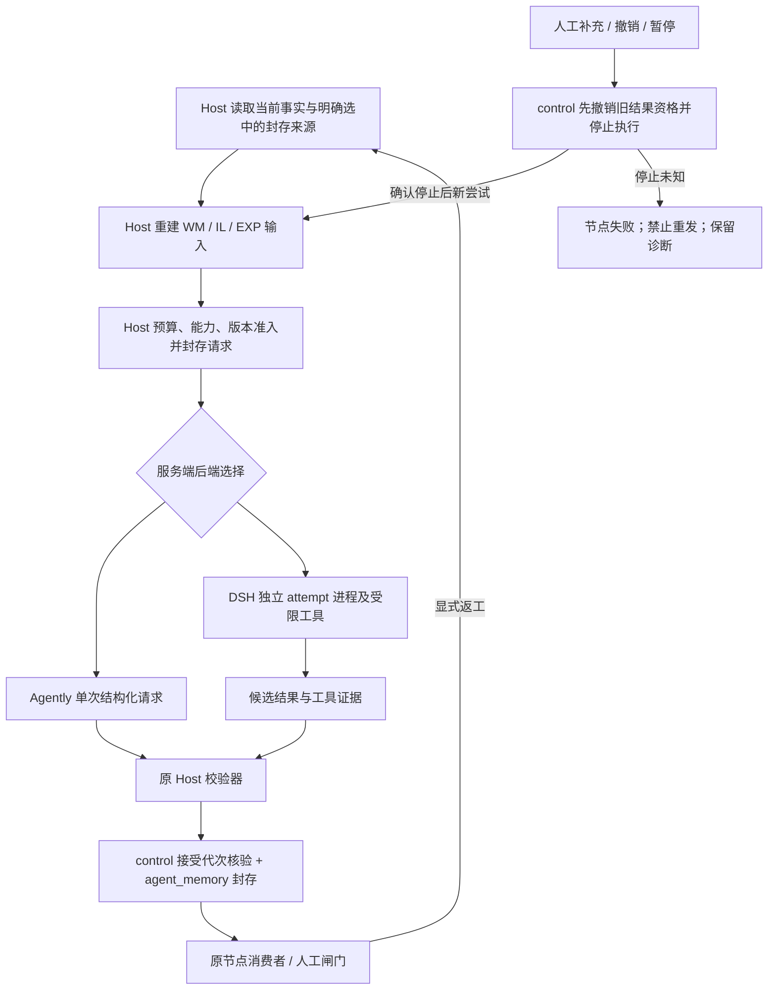

# SPEC-REV-13 · 云端 DSH 内核接入与 Agent 记忆优化

日期：2026-10-26。状态：**实施规格，尚未实现或验收**。基线：dd587e602dc5576aef0ddfe6e7838dd8d742ed6f。

本修订补充 [SPEC-08](DSH_AGENT_RUNTIME_SPEC.md)、[SPEC-06](AGENT_CONTEXT_SPEC.md) 与 [SPEC-07](AGENT_WINDOW_SPEC.md)，不替代业务判据。详细模块、接口、迁移及云端执行清单见 [实施设计](../plans/2026-10-26-cloud-dsh-memory-design.md)。本轮只形成规格和设计，不将文档交付标成内核或记忆优化已实现。

## 1 当前状态、环境判断及更正

**“当前环境”指云端开发环境。** 本机 Windows 的运行时、版本或 WSL 访问限制不能用于判定云端不可开发。本聊天没有可用的云端执行入口；尝试读取原云端任务得到 403，故当前云端实例的安装、模型认证、网络和隔离就绪状态均为**未重新核实**。这不是云端不具备这些能力的证明。

云端可承接适配器开发、受控协议/故障/恢复测试、M1/M2/M3 软件实现；具备当前模型认证和强制隔离后，还可用公开/合成工程运行**真实 DSH 内核**测试。真实内网 FPGA 工程的业务验收需能访问获准工程资产与工具的执行端，和云端软件验证分开。

原云端公开运行时安装及 initialize/wait/shutdown 探针见 STATUS §57；那是历史观察，不能证明当前实例仍已安装、凭据可用、工具隔离可强制或真实业务已接通。当前代码显式选 dsh 仍抛 BackendUnavailable。

| 状态 | 既有项或待做项 | 判定依据 |
|---|---|---|
| 已有实现 | C1 输入覆盖/预算、逐次调用封存与核验 | agent_memory、model_request、现行 SPEC-06 |
| 已有实现 | H1 来源交接、H2a 逐项回应、H2b 逐项复核与失效重开 | agent_handoff、agent_review；STATUS §64 |
| 已有基础，优化未完成 | 会话内 steer/pause/resume/terminate；人工确认经验的精确匹配 | agent_control.Session.instructions；scope_for/experiences |
| 已有首片 | D1 后端选择、AgentlyBackend 与 Host 边界 | agent_backends、model_request |
| 仅有历史初探 | D0 安装与无模型 SDK 握手 | 原探针归档；当前实例未复测 |
| 未实现 | D2 原生适配、N3 只读工具探针；D3 带工具控制/审计 | 没有 DSH 适配器，选择器明确拒绝 |
| 未实现 | D4 N6 独立候选编辑及价值对照 | 原 D4 计划未交付 |
| 未实现 | 计划 M1：通用可重建工作记忆 | 没有 working_memory 构造与统一消费；H2b 只覆盖问题交接 |
| 未实现增强语义 | 计划 M2：尝试/节点返工/run 作用域、撤销、替代和恢复 | 现有指令只保留在活跃 Session 的列表中 |
| 未实现分层复用 | 计划 M3：审计指纹与经验适用性分离、精确事实/通用建议分层 | 当前经验要求 item.scope 与整个 scope 精确相等 |

**命名澄清**：旧 SPEC-06 中“M1 逐次调用记录”“M2 人工确认经验”是已实现条款；协作计划的 M1/M2/M3 是后续优化切片，两者同名异义。本补充用 WM、IL、EXP 作为验收前缀，分别映射计划 M1、M2、M3，不创建另一套业务状态或更改旧归档含义。

| 日期 / 修订 | 决策或变化 | 仍待完成 |
|---|---|---|
| 2026-10-24 / D1、D0 初探 | 保持 Agently 默认；取得公开 SDK 的初步接口证据 | DSH 原生业务接入与能力门 |
| 2026-10-26 / H2b | 问题闭环已合并；继续保守重开 | 通用记忆、指令生命周期、经验分层 |
| 2026-10-26 / REV13 v1 | 明确云端为开发目标；补齐可执行设计与分级验收 | 本规格全部新增能力尚待实现 |

## 2 目标、边界与唯一 owner

目标是让模型节点在受控 DSH 核内使用获准工具，同时保留原 Host 权威；让跨尝试信息准确、可解释、可撤销地进入后续请求。安装成功、SDK idle、agent_memory 文件存在和有历史聊天，都不能单独证明目标完成。

| 决策/状态/效果 | 唯一 owner | 不变量 |
|---|---|---|
| 节点拓扑、返工边、恢复与终态 | 现有 TriggerFlow / RunManager | 不另建调度器，不从 DSH 事件直接推进下一节点 |
| 事实快照、覆盖、预算、WM 只读投影 | Host 上下文构造器 | 有来源且版本有效；不从模型文字猜业务事实 |
| 指令作用域/撤销、代次、结果接受资格 | agent_control | 指令事件与结果接受单一判据，旧代次不能进入消费者 |
| 模型推理及获准工具调用 | DSH 核或现有 Agently 后端 | 模型提出候选/语义判断，不签闸门、不改业务台账 |
| 进程/容器句柄、协议与运行时能力观察 | DSH 适配器 | 接入边界，无 RunCtx/校验器/业务写权 |
| request/result、来源及新增执行审计发布 | agent_memory | 只增不改，读写失败显式阻断 |
| 经验审批/撤销与适用规则确认 | 人；Host 只读筛选 | 模型不能将自己的输出自动晋升为长期经验 |
| 输出合法性、候选导入及业务效果 | 原 _validate / N6_apply / kb 工具 | 只有一套业务判据；仿真继续走单槽 |

不实施全节点迁移、并行子 Agent、共享聊天历史、自动学习、向量数据库或 DSH 直接仿真。新能力不继承当前聊天的推送/合并权限。权限策略、调用预算与已授权模型路由由执行环境提供，不从历史令牌推断。

## 3 目标流程与精确交接



图为目标设计，现状 DSH 分支不可用。模型节点仍是 N3/N6/N8/N10/N11/N12；WM 与经验筛选首版是确定性投影，不增加“记忆摘要模型”或第二轮评审调用。

| 生产者 | 交接值/信号 | 消费者及验证 | 缺失/过期行为 |
|---|---|---|---|
| 当前事实与已接受结构化输出 | 有类型事实、模型建议、问题及来源 | WM → 对应节点输入；核验来源和资源版本 | 关键源损坏失败；旧格式按明确可用性处理 |
| control 事件 | 有效指令集合 + revision | model_request 及最终接受门 | 旧 revision 不接受；撤销后不再注入 |
| 人工经验目录 | 适用建议 + 采用/拒绝诊断 | EXP → 请求输入 | 无匹配为空；非法/过期不降为可信建议 |
| Host 请求 | 完整 input/info/instruct/schema + 身份/授权清单 | 后端；预算与能力准入在调用前 | 超预算、能力未知不发模型请求 |
| DSH 工具 | 当前 attempt 的读取/编辑证据、产物候选 | Host 执行审计及候选导入 | 口头声称“已读/已写”不作为效果证明 |
| DSH 终态候选 | 绑定 handle/generation 的结构化结果 | 原 _validate、control 接受门 | idle、rc=0、缺 turn 终态均不足以放行 |
| 人工指令/控制命令 | 接收、应用、停止事实 | UI；只显示 Host 结论 | accepted 不显示成 applied/stopped |

必需材料必须真实送达消费者：Agently 没有补读工具时，Host 必须预载决策所需正文；不能只给不可访问引用再要求模型完成判断。DSH 可补读时，引用须绑定获准读取工具和本次版本。

## 4 云端开发与验收分层

| 层级 | 可在云端完成的内容 | 完成证明 | 不代表什么 |
|---|---|---|---|
| C0 当前就绪 | 运行时/锁文件、网络/身份、文件/进程隔离、审计目录探测 | 当前实例的脱敏 capability manifest | 历史安装记录不算当前就绪 |
| C1 软件机制 | 协议、坏帧、预算、取消竞态、WM/IL/EXP、旧格式兼容 | 受控协议端及临时数据测试 | 不算真实 DSH 或模型质量 |
| C2 云端原生 | 真实 DSH + 已授权模型 + 公开/合成工程 + 强制权限边界 | 真实工具证据、结构化输出、停止与越界试验 | 不算真实内网 FPGA 验收 |
| E 内网业务 | 原工程/基线/工具链、N3/N6 与原业务判据、对照收益 | 环境侧验收与冻结件前后指纹 | 不能由合成数据或演练通过替代 |

能力取值 ready / unavailable / unknown；配置“启用”与观察“可用”分开。当前工具未能读取云端不意味着 unavailable，应保留 unknown。每次部署/运行时/配置变更后重新观察，不复用已删除实例的 ID 或旧探针结论。

云端执行开始时先调用该环境提供的 environment_status（若可用），检查当前网络策略、代理/CA 和身份绑定。缺工具则记录无法观察，不能编造 ready。凭据只用正常 SDK/CLI；不打印环境变量全集、密钥或私有配置。

没有内网工程时，C1/C2 不得因此自动停工：使用明确标记的合成任务继续开发、协议和真实内核验证。C2 缺模型授权或强制隔离时，先完成 C1 并交付其余缺口，保持 dsh 不可用。

## 5 DSH 适配与生命周期

### 5.1 版本与传输

采用经过目标云端核验的 dsh SDK profile/JSON-RPC stdio；原 0.2.1-rc.2 仅为历史探针版本，不宣称最新版或兼容所有发行版。实施先锁定实际 package/依赖树/协议类型/受限 profile 指纹。0.1.x 与 0.2.x 不默认兼容，不用本机安装版本代替云端版本。

本仓逻辑操作为 probe/start/observe/result/cancel/close，不是凭空构造的 DSH API。initialize、session/prompt、session/wait 只按已验证版本的协议定义编码；session/prompt 的 messageId 是入队身份，不是完成结果。session/事件和 turn 的字段映射由锁定的类型文件及录制帧测试决定，缺接口映射就不启用该能力。

stdout 只接收 JSON-RPC 帧；限定帧大小、缓冲大小、deadline 和事件数。拒绝坏 JSON、未知方法/字段版本、错 request/session/turn 身份、重复冲突终态与流缺口。stderr 仅作脱敏诊断，不从自由文本抽取“成功”；输出截断/预算耗尽不是正常完成。

### 5.2 Host 请求与句柄

本补充扩展现有 BackendRequest，旧 Agently 实现通过兼容适配保持原输入。新增字段由 Host 填写、后端只读：

```json
{
  "contract_version": 1,
  "identity": {"run_id": "...", "node": "N3", "control_session_id": "...", "attempt_key": "...", "generation": 1},
  "input_data": {}, "info": "...", "instruct": "...", "schema": {},
  "context_manifest_ref": "...", "instruction_revision": "...",
  "execution_grant_ref": "...", "runtime_fingerprint": "..."
}
```

所有省略号为说明占位，不是可执行配置。execution_grant_ref 在 Host 授权表中解析为本次只读挂载/候选目录/允许工具/联网边界；模型不得提供任意宿主路径或提升权限。DSH 后端不接收业务 RunCtx、校验器、闸门签署或共享写盘句柄。

adapter handle 绑定上述身份、实际 DSH session/turn/message、受管进程/容器 ID、配置指纹与控制代次。句柄只存在于接入层；可恢复描述由 agent_memory 封存，不能序列化活进程、客户端或秘密。

### 5.3 状态和取消

状态转换：prepared → starting → running → completed / failed / cancelled / execution_unknown → closed。completed 仅表示后端候选完备；最终业务接受另经原 Host 校验和当前代次检查。

- 每 attempt 独立进程、独立 session、私有 DSH_HOME/DSH_AGENTS_HOME；不连接用户正在使用的会话，不加载跨 run 隐式历史，不使用 session/resume 续接不明上下文。
- pause/steer/terminate 先撤销旧结果资格，再关闭其执行；必须确认受管范围全部停止才进入 paused 或启动替代尝试。
- 若目标版本没有逐 session 取消/关闭，采用进程或容器级终止。shutdown 回执只证明请求被接受，必须再等待进程和后代静止。
- 停止超时或身份/执行状态未知：execution_unknown、节点失败、禁止自动重发。诊断保留，不用切换 Agently 掩盖失败。
- 服务重启只恢复历史与活跃句柄描述的核验；默认不续会话、不重发、不重新应用候选。确认残留执行停止后，才允许显式新尝试。
- 完成回包与控制命令并发时，由 control 的单一接受门核验 generation/指令版本；迟到结果只留审计，不进入业务消费者。

### 5.4 工具、隔离和上下文

云端首选每 attempt 独立、可回收的受管容器/等价强制沙箱：输入快照只读，scratch/candidate 分区可写，无其他 run、宿主 home、凭据文件、共享台账或仿真入口挂载。限制资源、工具和网络目的地；不以 cwd、提示词或工具名称白名单代替效果隔离。

没有容器也不直接退化为任意宿主 shell：只完成无工具协议验证；带工具准入必须有等价且实测的隔离。N3 首版只读获准材料；N6 仅写本 attempt 候选副本。拒绝链接逃逸、额外文件、绝对路径、特殊文件、源版本漂移及校验后换件。候选导入必须发生在执行停止后，由 Host 固定快照转换/校验并交给原 N6_apply。

仅开放完成节点任务必要的工具；默认关闭自动委派、持久 shell、任意插件、Git 写入、直接仿真和未授权联网。模型认证由受管配置/转发通道提供，原始凭据不得成为模型可读文件/工具输出。若无法阻止工具读取原始秘密或宿主其他数据，则带工具准入失败。

受限 profile 关闭自动压缩、静默工具裁剪和 token 达限当成功；具体配置名须以锁定发行版证明。Host 应用预算继续检查完整 input/info/instruct/schema；DSH 额外系统提示/工具描述/补读也要记录和限制，不能把应用字节预算冒充完整原生上下文或 token 测量。

用录制型受控模型端点核验实际请求所含强制材料/指令与补读结果，并注入预算/压缩边界；实际无法观察或禁止的变换标 unknown，不宣称“完整覆盖”。这类记录不保存认证头或隐藏推理。N3 原生探针通过后仍需 N6 公平对照，默认后端继续 Agently。

## 6 WM：计划 M1 的可重建工作记忆

### 6.1 内容和来源

WM 由 Host 在每次尝试前从**当前业务状态明确引用的有效记录**重建，输出 input.working_memory；随原 request 封存，不建立第二套运行账本，不扫描“目录里最新一次”来覆盖节点选择。

| 条目种类 | 生产者 / 来源 | 消费限制 |
|---|---|---|
| observed_fact | 当前版本事实/证据工具、Host 核验结果 | 必须绑定资源版本；不能来自模型口头断言 |
| human_decision | 已核验 gates/人工控制事实 | 投影只读；不能代签或重新执行决定 |
| model_proposal | 已接受的节点结构化判断/候选说明 | 保留“建议”类别，不提升为业务事实 |
| open_issue | H1/H2a/H2b 的当前投影 | 保持 issue_id、原来源、follow_up 和重开规则 |
| constraint | 当前项目/节点契约与仍有效的人工约束 | 优先级、来源及作用域明确；不能由任务材料提升权限 |

首版只投影现有字段，不用正则、关键词或字符串相似度替模型判语义，也不增加独立“总结模型”。如后续需要语义压缩，须单独定义请求、消费者、证据保真与失效契约，不在本片暗中接入。

### 6.2 载体

```json
{
  "version": 1, "availability": "verified", "snapshot_sha256": "...",
  "entries": [{"entry_id": "...", "kind": "open_issue", "value": {}, "source_keys": ["s1"], "applicability": {"node": "N6"}, "resource_versions": {}}],
  "unavailable": []
}
```

已在本次 input.targets/identity/rework_handoff 等字段提供的正文只保留一份。WM 条目必须二选一提供 value 或 input_ref；input_ref 是直接指向同一请求既有字段的 JSON Pointer，Host 必须核验存在/版本一致，禁止指向 working_memory 自身、循环引用或外部未读取材料。索引不等于冷材料已送达。

详细记录路径/哈希保留在 request 的 Host source map；模型看到实际必要事实、稳定 issue_id 与可使用的短引用。复用 H2b 问题身份，不让模型重复一组无消费者的 opaque ID。每个输出条目必须能定位生产者、节点消费者与源字段；没有消费需求的历史不注入。

source map 绑定 run/node/明确 attempt、request/result 指纹、当前资源版本及条目类型。值或依赖改变产生新投影指纹；缓存可丢弃，不能成为权威。来源损坏/半件被选中/跨 run 或越界引用显式失败；旧格式缺来源不得标 verified，可在现行兼容契约允许时标 unavailable 并保留当前权威事实。

WM 不是全聊天记录：N6 需要当前目标、有关建议/约束和全部未解决问题；N8 需要本次候选、作者回应、实际沙箱与复核分配；N11 需要身份/证据事实、有关问题及回应。其他节点按原消费者字段白名单投影。必需输入、未解决问题与已生效约束不得为节省预算而删除。

恢复只重建数据，不触发模型、仿真、闸门或候选应用。每次新 N6 保守重新打开旧关闭项，WM 不另写关闭规则。失效的 proposal 不能因摘要里残留一句“已修复”而继续消费。

### 6.3 预算和冷热分离

强制事实/问题/约束直接进入热输入；大型支持材料冷存于当前快照，保留授权引用和读取能力。无读取能力的后端必须在派发前取得所需正文；未读取的冷引用不计为材料已经送达。

只允许确定性无损投影、去掉已过期条目和不属于当前消费者的历史；源记录不删除。全部强制材料超限则在调用前失败并报告缺口，不截断、不抽样、不假设“摘要足够”。可选经验按 EXP 自己的整体拒用规则处理，不能挤掉事实或未解决问题。

## 7 IL：计划 M2 的指令生命周期

### 7.1 作用域

| scope | 明确语义 | 到期/变化 |
|---|---|---|
| attempt | 为一次显式重发保留，绑定 Host 预留的 next-attempt identity | 该尝试终态即到期；拒绝迟到结果，不续到后续返工 |
| node_rework | 同 run、同节点后续显式尝试及返工 | run 终态、约束依赖变化或显式撤销时到期；单次节点返回不提前结束返工作用域 |
| run | 同 run 内指定模型节点白名单 | run 终态、依赖变化或撤销；绝不跨 run 继承 |

“本次尝试”在 steer 场景指**确认旧执行停止后的替代尝试**，不是马上被取消的旧请求。Host 先预留 intent/generation，之后绑定真正的 attempt；客户端不能猜目录序号或选择别的 run。初始化失败仍封存失败/到期事实，不把一次性指令挪到下一次未授权尝试。

现有不带 scope 的 /control 请求保留原会话内语义，不自动升级为 node/run。旧会话指令不能通过简单重放日志变成长期约束。

### 7.2 API、事件和投影

现有 /agents/{node}/control 的 steer/pause/resume/terminate、幂等键和旧客户端保持兼容。拟新增同 run 的指令端点：

- GET /api/runs/{run_id}/instructions：当前有效条目、版本、来源和失效原因；历史只读。
- POST /api/runs/{run_id}/instructions：create / revoke / supersede。必带 actor、request_id、expected_instruction_revision；create 带 message/scope/target_nodes/显式依赖，revoke 带目标 ID，supersede 带目标 ID 和替代内容。

指令身份、实际作用域和生效尝试由 agent_control 决定；run_id 由路由和当前运行绑定。新字段全部参与命令指纹，同 ID 不同 payload 必须冲突。同一有效指令集合的变更串行提交，CAS 失败返回冲突，不覆盖别人的撤销。

事件仍由 agent_control 写入 agent_controls 下。现有节点 session 事件不回填；run 级事件可使用该目录下独立的 run 作用域子目录，读取器显式支持该格式。它是指令事件流，不是第二份业务账本。单个 supersede 事件原子包含“旧 ID 失效 + 新条目”，防止双生效；源文件由 agent_memory 公共封存接口发布。

运行服务保持每 run 单写者，沿用现有 RunManager 写权，不增加隐含多 worker 并发写入。多进程部署若没有经验证的单写者协调，则拒绝指令写入。

每个 request 记录 instruction_revision、实际采用 ID/版本和明确未采用原因。模型只收到有效指令文字/必要作用域，不获得撤销权限。人工补充不能覆盖事实、授权、Schema、预算、业务判据或闸门。

### 7.3 控制竞态和恢复

涉及当前活跃尝试的 create/revoke/supersede，先持久化接收事实并撤销旧结果接受资格，再停止执行；确认后才标 applied 或发新请求。accepted、applied、effective 是不同事实，UI 只消费服务端投影。

目录 revision 只用于变更 CAS；节点有效指令指纹仅覆盖实际适用条目。修改 N12 指令不无理由取消 N6。返回结果必须同时符合当前 generation、事实快照和本节点有效指令版本；语义校验通过但控制版本过期的结果标为丢弃并留审计，不进入下游。后端不能自行绕过这道接受门。

撤销不修改旧请求，不回滚已发生业务效果；已经进入消费者的节点按既有业务流程处理。恢复按封存事件重建有效指令，默认不复活旧控制 session、不重发请求、不重放命令效果。run/node 指令只用于以后获准的新尝试。

文字间是否业务矛盾不靠关键词或“最后一句获胜”决定。显式 supersede 才取代旧条目；无法同时满足时由原节点的合法 notes/失败路径报告冲突，交人工裁决，不偷偷丢指令。

## 8 EXP：计划 M3 的经验分层

### 8.1 现有基础与问题

已有人工 approved、来源文件 SHA、scope 精确匹配及拒用诊断；不是“完全没有经验机制”。但 scope_for 混入大部分输入，包含交接来源、人工干预等变化，item.scope 必须全值相等；这种审计级匹配不等于稳定的经验适用性。

必须区分：

- 请求审计指纹：完整实际输入、契约、工具配置、WM、指令、后端等，任何变化都如实记录。
- 经验适用条件：由人工确认的条目种类及明确依赖决定，不用审计指纹直接判所有经验是否可复用。

### 8.2 条目与兼容

仍使用 adjudication/agent_experiences.json。版本 1 沿用现有精确匹配行为；版本 2 引入显式 kind 和 applicability。提供离线迁移/校验工具，但不自动改变已批准条目的用途或宽化范围。

```json
{
  "version": 2,
  "items": [{
    "id": "...", "revision": 1, "status": "approved", "approved_by": "human:...",
    "kind": "general_advice", "advice": "...",
    "source": {"path": "runs/.../result.json", "sha256": "..."},
    "applicability": {"nodes": ["N6"], "environment_policy": "...", "contract_versions": ["..."], "dependencies": []}
  }]
}
```

未确认、重复/冲突身份、非法格式、坏来源/路径/哈希、未知依赖或范围，一律拒用并记录原因。human 字段仍是单机元数据，不声称新增了真实用户鉴权。审批、撤销与条目语义修改由人完成；修改内容/范围必须新 revision 并重新确认。

### 8.3 两类适用性

| kind | 绑定规则 | 禁止行为 |
|---|---|---|
| exact_fact | 绑定明确资源/事实的当前内容、环境及必要基线；每个依赖由既有 Host 事实解析器核验 | 资源改变不能靠“看起来差不多”继续使用；不能把历史事实当本轮事实 |
| general_advice | 绑定已批准的节点/任务类别、环境策略及契约兼容范围；来源哈希仍须有效，显式依赖逐项核验 | 不要求整个请求字节相同；不能无条件跨环境套用或用“通用”标签绕过依赖 |

适用性规则由 typed 依赖和人工确认的兼容列表决定，不用模型/关键词推测相似性。契约版本不同且没有已批准兼容声明时拒用；不是任意提示词格式变化都能由程序宣称语义兼容。

源记录完整性与当前事实适用性分开检查：历史源有效只说明来源未变，不说明当前资源仍匹配。所有选中条目的版本、来源、适用条件、检查结果与目录指纹写入 request 的 Host 选择记录；模型仅见必要建议及来源引用。

跨 run 只能复用已人工确认且适用的经验。WM、旧关闭结论、取消请求、模型自述或普通笔记不能自动晋升。经验永远不能签闸门、修改计数、弱化 blockers 或替代当前证据。

### 8.4 选择与预算

先按明确的节点/环境/依赖筛选，再按确定性 ID 顺序组织。首版不引入学习排序、向量检索或猜测的重要性分数。规范化后的可选经验批次若超出其公开预算或使必需上下文超限，整体不采用该批次并记录候选 ID/拒用原因；不截断单条建议或静默只取前若干条，普通执行可在必需材料完整时继续。

旧版目录的数量/大小规则保持；新版限制必须是显式配置并在首次生成前交代给消费者，不暗中加重试门。全部实际注入内容仍计入原 Host 预算。

## 9 产物必要性与提示词契约

| 产物 | 必要性 / 授权消费者 | 可见性与保留 |
|---|---|---|
| working_memory | 后续节点恢复上下文，保留当前事实/决定/未解决项 | 模型见必要值；完整 source map 随 request 冷存 |
| 有效指令集合与 revision | 每个受影响的新尝试；control 接受门 | UI 可解释；文字按作用域进入模型，事件只增 |
| selected experiences / diagnostics | 当前节点参考建议及运维排障 | 建议进入模型；审批/匹配细节 Host 留证 |
| runtime capability/handle | 适配准入、停止确认和状态投影 | 运维可见，模型不能覆盖，不含秘密 |
| 工具读写证据/候选清单 | 覆盖核验、候选导入与审计 | Host 发布；模型自述不构成效果证明 |

所有可满足的模型规则必须在首个请求的 info/instruct/schema 中可见：角色、已知事实与建议区别、工具权限、允许引用、必需覆盖、输出结构、版本失效及冲突处理。Host 的权限和完整性检查继续确定执行；不把不断碰撞校验器当作教模型规则的主要方法。

N3/N6/N8/N11 沿用现有字段与授权消费者。新增建议/记忆不能使 N6 漏掉观测点印记、使 N8 超出实际提供范围复核，或让 N11 用作者意见代替 Host 身份证据。H2b 每个 assigned 问题的回应/复核覆盖保持不变。

## 10 必测不变量与验收

| 编号 | 先失败用例 / 可观察断言 | 验证层 |
|---|---|---|
| CL-01 | 当前实例/版本/策略改变，旧 readiness 不再准入；unknown 不显示 ready | C0/C1 |
| DS-01 | 显式 dsh 不可用时失败，不悄悄变 Agently/standin；输入 backend 不能覆盖配置 | C1 |
| DS-02 | 坏帧、错误身份、重复冲突终态、断流、仅 idle/messageId/rc=0 都不放行 | C1/真实 SDK |
| DS-03 | 超时取消、先回包后撤销、重复指令、迟到结果，仅当前代次可进入消费者 | C1/C2 |
| DS-04 | 真实工具读取获准文件；越界、链接、读其他 run/凭据被实际阻止 | C2/E |
| DS-05 | 停进程后故意留工具后代：不能报 paused、不能重发 | 故障注入+C2 |
| DS-06 | 额外候选文件/源漂移/校验后换件拒绝，Host 独占应用 | C1/C2/E |
| DS-07 | 禁用压缩/截断的实际效果可观察，必需材料完整；未知不可冒充 | C1/C2 |
| WM-01 | 同一明确来源重建确定；换资源版本后旧事实失效，不消费孤儿最新尝试 | C1 |
| WM-02 | proposal 不晋升 fact；H2b ID、follow_up、standin/unreviewed 和 reopened 保持 | C1 |
| WM-03 | 源半件/篡改/越界显式失败；所有强制问题超预算不截断且不调用模型 | C1 |
| WM-04 | Agently 无补读工具时材料预载；冷引用没有被读不能声称完整 | C1/C2 |
| WM-05 | 已在本次输入提供的大型事实不在 WM 复制，直接输入引用可解析且无循环；预算仍按真实序列化测量 | C1 |
| IL-01 | attempt 只作用于绑定的一次替代尝试；node/run 不越 scope | C1 |
| IL-02 | revoke/supersede 原子生效，旧结果被拒；相同幂等键冲突 payload 拒绝 | C1 |
| IL-03 | 重启重建有效指令但不重放命令/业务；旧 Session 不可控制 | C1 |
| IL-04 | 旧 /control 的默认语义保持；新字段参与签名；accepted 与 applied 分开 | C1/API |
| EXP-01 | v1 行为保持；v2 精确事实遇依赖变更拒用，通用建议在已批准范围复用 | C1 |
| EXP-02 | 源坏/撤销/未知兼容版本/缺审批不注入；审计指纹变化不直接决定通用建议失效 | C1 |
| EXP-03 | 经验超预算整批拒用有诊断；强制事实/问题保持；不自动晋升 | C1 |
| OBS-01 | UI 按 Host 四维能力与实际记录展示；历史记录不回填成新能力 | API/浏览器 |
| REG-01 | 无新配置时旧后端、请求封存、预算、H2b、单槽和闸门行为不回归 | 软件/既有四门 |

协议替身、真实 SDK、真实模型、内网业务四类证据分别标明。真实模型语义正确性不以 Schema 合法代替；质量/人工负担/返工/时延/成本采用既有 SPEC-08 的配对方案，预先固定样本、阈值和失败口径，所有失败/取消计入，不预先宣布节省成本。

完成分级：C1 通过只能声明机制已实现；C2 通过才能对验证过的云端 profile/node 声明原生接入可用；E 与价值试验通过后才声明该内网场景可采纳。不得把新规格、握手、演练或缺件 skip 标为已完成。

## 11 兼容、部署与回退

旧 request/result、control 事件、经验目录和源文件只读，不回填。新字段版本化且可缺省；缺字段时展示 legacy/unknown，不能推定已具备新能力。新范围只对新尝试生效。

部署仍默认 Agently；原生 DSH、WM、IL、EXP 分切片提交和开关，关闭优化时保留原 H2b 和基本留痕。关闭某项不得丢失已经生效的 run/node 指令：必须给出迁移/失效确认或拒绝带有效新指令的运行降级。

回退前停止并确认 DSH 受管执行已结束；仅后续显式新尝试使用旧后端，不重放候选或覆盖审计。无法确认停止时保持 execution_unknown。已有 v2 目录不由旧读者猜测读取；回退需人工提供旧格式目录或明确拒用并留诊断。

## 12 交付及未决项

实施依据为本规格及配套设计，不新增框架迁移。本轮未改模型/控制/记忆代码；未更改云端环境配置、安装依赖、启动模型、执行真实工具或推送/合并新规格。

当前仍需在目标云端重新观察：运行时及协议版本、当前 provider 授权、模型路由/预算、可用容器/沙箱、子进程强制控制、上下文变换开关与审计写入。内网工程/仿真资产是否可达另记，不作为拒做 C1 或 M1/M2/M3 的理由。

现有公开原生探针引用：见 [原生接口计划](../plans/2026-10-24-dsh-native-interface.md) 与 STATUS §57；本修订不改冻结件。未取得的实际调用证据保持未验证，具体云端开发、单测与验收交接见配套设计。
